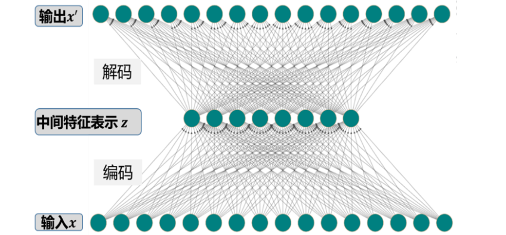
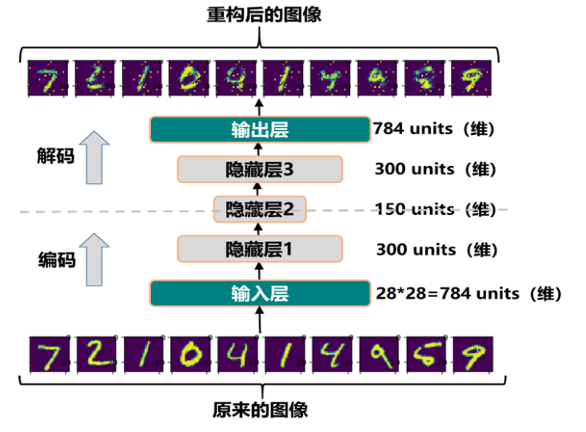
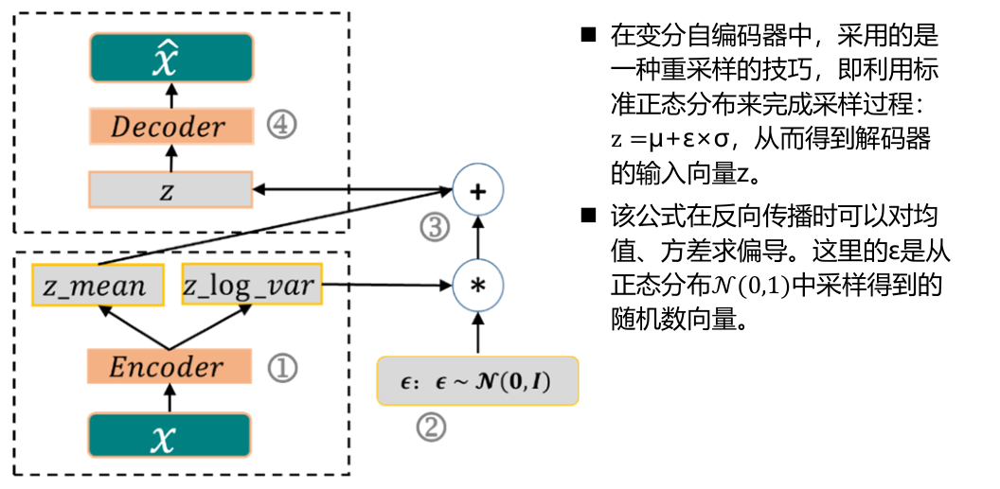
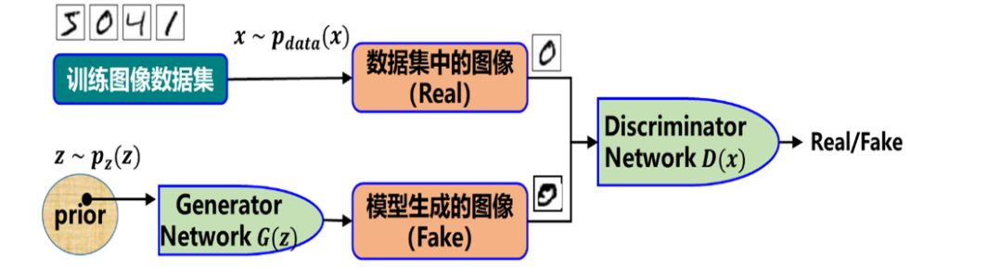

## 1. 生成式神经网络概述

生成式神经网络（Generative Neural Networks, GNNs）是一类能够生成新数据样本的深度学习模型。与判别式模型不同，生成式模型不是学习输入样本与标签之间的映射关系，而是学习特征分布. 可以说是一种无监督学习模型。

它可以分为两个主要步骤:
1. 训练：假设$x$表示样本, 模型从训练集中学习得到的样本数据分布为 $p_{model}(x)$, 以尽可能接近训练数据中的真实分布$p_{data}(x)$。
2. 生成：在训练完成后，模型可以从学习到的分布中采样，生成新的数据样本。

常见的生成式神经网络模型包括两大类，即变分自编码器（VAE）和生成式对抗网络（GAN）。VAE通过引入潜在变量来建模数据分布，而GAN则通过对抗训练的方式生成逼真的样本。

## 2. 自编码器(Auto encoder)

自编码器是一种无监督学习模型，旨在学习数据的低维表示。它由两个主要部分组成：编码器（Encoder）和解码器（Decoder）。编码器将输入数据映射到潜在空间，而解码器则从潜在空间重建输入数据。

关于它的用途:
1. 自编码器有助于去除数据噪声, 因为它可以学习到数据的主要特征，从而在重建过程中忽略噪声。
2. 其次，自编码器提取的特征可以在其它有监督学习中进一步使用。可以在未标注样本数据上利用自编码器学习到新特征，并送入到其它有监督学习模型中做进一步学习调整。
3. 另外，自编码器可以达到对数据的降维效果。中间隐藏向量表示z的维度通常小于输入数据的维度，这样可以在保持数据主要特征的同时减少数据的复杂性。

数学的来看, (以只有一个隐藏层的自编码器为例):
1. 编码过程:编码器接受输入x, 将其映射到潜在空间z, 如果用单层感知机,则公式为:
$$
z = \sigma(Wx + b)
$$
2. 解码过程:解码器接受潜在表示z, 将其映射回原始数据空间, 公式为:
$$
x' = \sigma(W'z + b')
$$

它的训练目标主要为减少重构误差, 参数取值的优化目标是使
在训练样本集合𝑋中所有样本的误差平方和最小：
$$
\Phi, \Psi = = argmin_{\Phi, \Psi} \sum_{x \in X} ||x - x'||^2
$$
对上面的例子来说, 其损失函数可以表示为:
$$
\mathcal{L}(X, X') = ||X - X'||^2 = ||X - \sigma'(W'(\sigma(WX + b)) + b')||^2
$$

当我们为自编码器增加了更多中间特征层, 即会得到堆栈自编码器(Stacked Auto encoder, SAE), 其结构如下图所示:

在其中, 自编码器提取的特征可以在有监督学习中进一步使用, 如用于下游任务的分类、回归,加上有标签的数据, 通过有监督学习的方式对自编码器提取的特征进行进一步学习调整.

## 3. 变分自编码器(Variational Auto encoder, VAE)

注意自编码器中，解码器利用潜在变量z（其实质是一个低维度的向量）就可以得到一幅图像。

如果这个z不是通过原始图像编码得到，而是设法学习到输入图像集中的分布规律并从中随机采样获得，是否仍然可以生成某个比较合理的图像呢？

这就是变分自编码器（VAE）的核心思想。VAE通过引入潜在变量的概率分布(VAE 假设潜在变量$z$服从某种先验分布（如高斯分布）)来建模数据的生成过程，从而能够生成新的样本。

流程简单来说:
1. 将数据x输入到encoder中，得到潜在变量z的分布参数（均值和方差）
2. z_log_var表示z的对数方差，z_mean表示z的均值。对它们重采样, 得到潜在变量z
3. 将潜在变量z输入到decoder中，生成新的数据样本x'

在生成时可以通过指定其标签来生成指定类别的样本，例如指定生成数字9（Label c=“9”）的手写体图像,加上这个即为条件变分自编码器(Conditional Variational Auto encoder, CVAE).

关于使用变分自编码器/条件变分自编码器生成新样本
1. 训练完毕变分自编码器得到神经网络中参数的优化取值, 生成数据只需要解码器就可以了, 生成阶段解码器的输入z可以从设定好的先验标准正态分布 $\mathcal{N}(0, I)$ 中采样得到.
2. 训练完毕条件变分自编码器之后，在生成数据阶段，与变分自编码器类似，也是先从正态分布采样，此时需要再拼接上希望得到的数字图像类别标签的嵌入，然后送入解码器 ，以生成该标签所对应的图像。

## 4. 生成式对抗网络(Generative Adversarial Networks, GAN)

GAN有两个主要的构成部件: 即生成器（Generator）和判别器（Discriminator）。

生成器可以采用多层感知机、卷积网络、变分自编码器等来生成样本。其通常从均匀分布或高斯分布中获取随机噪声，进而生成样本，例如图像或者文本等。

判别网络（判别器）的训练集中包括来自原始数据集中的图像（真实图像，标签设为0）以及来自生成器生成的图像（作为虚假图像，标签设为1），从而构成一个训练集，用于其学习甄别。判别网络也可以采用任何具有分类或者回归能力的神经网络，如多层感知机、卷积神经网络等。

接下来我们更数学的来看GAN

GAN的训练目标是通过对抗训练的方式，使生成器生成的样本尽可能接近真实数据分布，从而欺骗判别器。具体来说，GAN的优化目标可以表示为一个最小化-最大化问题, 表达式如下:
$$
\min_G \max_D V(G, D) = \mathbb{E}_{x \sim p_{data}(x)}[\log D(x)] + \mathbb{E}_{z \sim p_z(z)}[\log(1 - D(G(z)))]
$$

1. 判别器D的优化: 当对判别器D进行优化时，为了得到一个很好的判别模型，需要使得$V(G, D)$最大化,即:
$$
\max_D V(G, D) = \mathbb{E}_{x \sim p_{data}(x)}[\log D(x)] + \mathbb{E}_{z \sim p_z(z)}[\log(1 - D(G(z)))]
$$
等号右边第一项的下标$x \sim p_{data}(x)$表示从真实数据分布中采样得到的样本，第二项的下标$z \sim p_z(z)$表示从潜在空间的先验分布中采样得到的噪声向量。

2. 生成器G的优化: 当对生成器G进行优化时，只需要评价生成的样本，不需要真实样本，所以只需要优化公式损失函数的第二部分，即生成器G的优化目标
$$
\min_G V(G, D) = \mathbb{E}_{z \sim p_z(z)}[\log(1 - D(G(z)))]
$$

生成器和判别器在交替学习的过程中分别提升性能.

在生成模型G和判别模型D中都加入条件约束c, 即可得到条件生成式对抗网络(Conditional Generative Adversarial Networks, CGAN)。在CGAN中，生成器G和判别器D都接收一个额外的条件变量c作为输入，从而使得生成的样本可以根据指定的条件进行控制。
