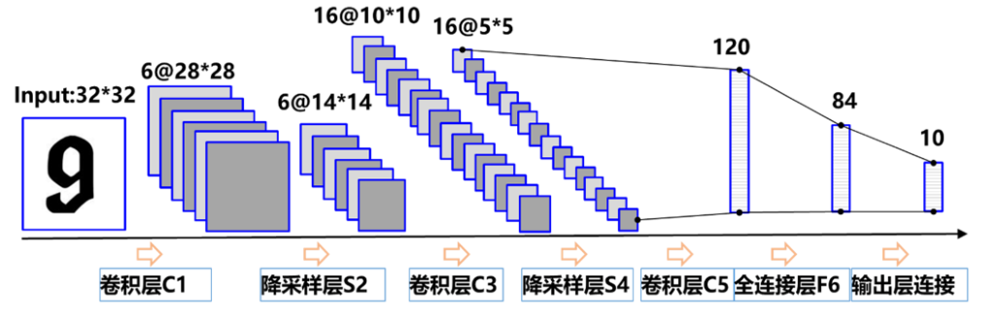

## 1. LeNet-5 架构概览

LeNet-5 是典型的多层卷积神经网络（CNN）架构，由 Yann LeCun 等人在 1998 年提出，主要用于手写数字识别。其结构如下：

图中是以数字手写体图像的识别问题为例：输入的图像尺寸为32x32像
素，经过中间3个卷积层及2个降采样层和后续等处理，可以输出该图像是10个类别（即该图像是数字0-9之间的数字字符）的概率有多大。

下面让我们逐层分析:

## 2. LeNet-5的卷积层C1

卷积层C1有6个卷积核，且每个核的大小为5x5，因而其会输出6个大小为28x28的特征图，对应6种局部特征。
每个卷积核有5x5=25个单元参数和一个偏置（bias）参数，因此每个卷积核的参数数目为(5x5+1)=26。由于总共有6个卷积核，所以该层的参数的总数为26x6=156。

感性的理解: 这一层的卷积核可以看作是6个不同的特征探测器，每个探测器都在输入图像上滑动，提取不同的局部特征。通过这些特征图，网络可以捕捉到输入图像中的各种模式和结构。

## 3. LeNet-5的池化层S2

降采样层S2的输出仍然是6个特征图，然而其尺寸却有了降低。S2层有6个14x14像素的特征图，其每个像素单元与上一层的 2x2 像素的领域连接（即滑动窗口为2x2）。所以S2层的尺寸是C1层的1/4.

降采样层通常有两种模式：最大池（Max-Pooling）或者平均池（Mean-Pooling）。最大池是指特征图中每个元素来自上一层对应局部区域的最大值，而平均池则是指特征图中每个元素是上一层对应局部区域的平均值。通过使用降采样层，有助于降低网络训练参数及克服模型过拟合。

## 4. LeNet-5的卷积层C3

C3层有16个卷积核，每个卷积核的大小为5x5。C3层的输出是16个10x10的特征图。
但是它的参数量为1516, 为什么不是 $16\times6\times25+16=2416$？

因为C3 用的是**稀疏连接表**：16 个输出通道各连 6 个输入通道中的一部分，共 60 条连接（$6$ 个连 3 个、$9$ 个连 4 个、$1$ 个连全部 6 个：$6\times3+9\times4+1\times6=60$）。每条连接一个 $5\times5$ 核, 所以参数量为 $60\times25+16=1516$。

这种稀疏连接的设计是为了减少参数量，同时保留足够的特征表达能力。通过这种方式，C3层能够捕捉到更多样化的特征，同时避免过拟合。

## 5. LeNet-5的池化层S4

S4层得到16个5x5的特征图，其每个单元与上一层的 2x2 个领域连接（滑动窗口为2x2）。所以S4层的尺寸是上一层C3层的输出结果的1/4

## 6. LeNet-5的卷积层C5

卷积层C5有120个卷积核，卷积核大小恰好为5×5，和输入的特征图的整体尺寸相同。因此生成120个特征图，每个特征图的大小为1×1。每个特征图都与上一层S4的所有特征图连接。C5层有120x(5x5x16+1) = 48120个连接，这里的16为上一层的特征图个数。

## 7. LeNet-5的全连接层F6和输出层

LeNet-5的下一个层是全连接层，如图所示。其类似于多层感知机神经网络中的一个层，共有84个神经元，或者也可以被理解为像素。这84个神经元与上一层C5层的120个神经元进行全连接，所以需要训练的
参数的数量是(120+1)x84=10164。

LeNet-5的输出层由欧式径向基函数单元构成。每个输出RBF单元计算输入向量和参数向量之间的欧式距离

$$
y_i = \sum_{j=1}^{n} (x_j - w_{ij})^2
$$

其中, $y_i$ 是第 $i$ 个输出单元的输出，$x_j$ 是输入向量的第 $j$ 个分量，$w_{ij}$ 是第 $i$ 个输出单元的参数向量的第 $j$ 个分量，$n$ 是输入向量的维度。
输入图像经过之前的全连接层F6处理，得到的共有84个像素。因此𝑥有84个元素，用下标𝑗来遍历。

## 总结

| 层 | 类型 | 输入 | 核/步长 | 输出 | 参数量 |
|---|---|---|---|---|---|
| C1 | 卷积 | $1\times32\times32$ | $5\times5$，$S=1$ | $6\times28\times28$ | $(25+1)\times6=156$ |
| S2 | 池化 | $6\times28\times28$ | $2\times2$，$S=2$ | $6\times14\times14$ | $6\times2=12$ |
| C3 | 卷积 | $6\times14\times14$ | $5\times5$，$S=1$ | $16\times10\times10$ | $1516$ |
| S4 | 池化 | $16\times10\times10$ | $2\times2$，$S=2$ | $16\times5\times5$ | $16\times2=32$ |
| C5 | 卷积 | $16\times5\times5$ | $5\times5$，$S=1$ | $120\times1\times1$ | $(400+1)\times120=48120$ |
| F6 | 全连接 | $120$ | — | $84$ | $(120+1)\times84=10164$ |
| 输出 | RBF | $84$ | — | $10$ | $84\times10=840$ |

参数合计

$$
156+12+1516+32+48120+10164+840=60{,}840 .
$$

