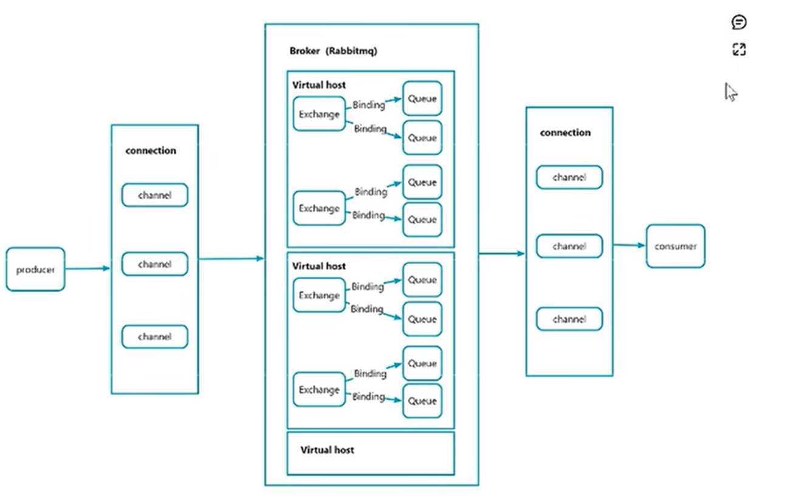
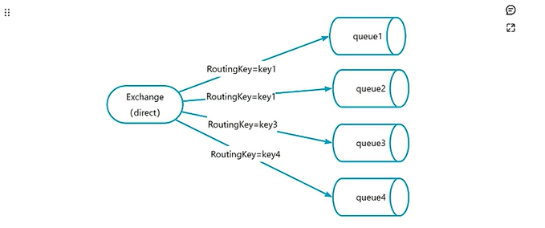
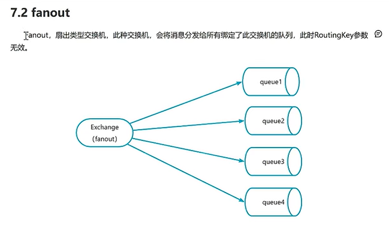
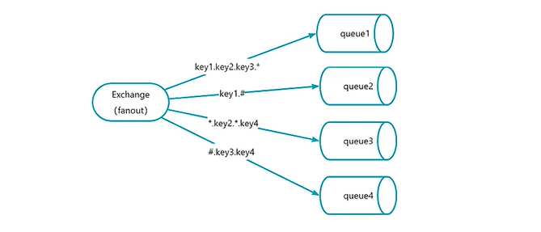

## 1. 什么是消息队列
Message Queue （消息队列）是一种异步通信的方式，它允许不同的系统或组件通过发送和接收消息来进行通信，而不需要直接调用对方的接口。消息队列通常用于解耦系统组件，提高系统的可扩展性和可靠性。

Message 是指在应用之间传递的数据;

Queue just a data structure.

## 2. 作用与应用场景
```Plaintext
                 |-> 库存系统
订单系统 -> MA --|
                 |-> 物流系统
```

应用解耦, MQ 异步提速, 消息缓冲, 流量削峰
但是降低了系统的可用性, 提高了系统的复杂度, 需要额外的运维成本, 一致性问题.

## 核心
1. 生产者（Producer）：负责发送消息到消息队列的应用程序或组件。
2. 消费者（Consumer）：负责从消息队列中接收和处理消息的应用程序或组件。
3. 消息队列（Message Queue）：用于存储和传递消息的中间件，它可以是内存队列、数据库队列或专门的消息队列系统（如 RabbitMQ、Kafka 等）。
4. 交换机（Exchange）：在消息队列中，交换机负责接收生产者发送的消息，并根据一定的规则将消息路由到一个或多个队列中。交换机可以有不同的类型，如直连交换机、主题交换机、扇出交换机等。

AMQP 协议是一种二进制协议，定义了消息的格式、交换机的类型、队列的行为等。RabbitMQ 是一个实现了 AMQP 协议的开源消息队列系统，它提供了可靠的消息传递机制和丰富的功能。




Broker: 接受和分发消息的应用，RabbitMQ 就是 Message Broker

Virtual Host：是一个虚拟主机的概念， 一个 Broker 可以有多个 Virtual Host， 每个 Virtual Host 是一个独立的环境，拥有自己的交换机、队列和绑定关系（不能重名）。

Connection: publisher/consumer 和 broker 之间的 TCP 链接。

Channel: 是在connection内部建立的逻辑连接，如果应用支持多线程，通常每个thread创建一个单独的channel，AMOP method 包含了 channel id 帮助客户端和 message broker 识别channel， channel 之间是相互独立的，轻量级的channel 极大地减少了OS 建立TCP连接的开销。

Exchange: message 到达 broker 的第一站， 根据分发规则， 匹配查询表中的 routing key， 将 message 分发到queue， 包括 direct （point to point）， topic （publish/subscribe）， fanout（broadcast）等类型。
Queue: message 到达 broker 的第二站， queue 是一个先进先出的数据结构， 负责存储 message， 直到 consumer 消费。
Binding：exchange 和 queue 之间的绑定关系， binding 中可以包含 routing key， Binding 信息被保存到exchange 的 routing table 中。

## 如何实现生产者和消费者

生产者代码
```java
package com.xc.rabbit;

import com.rabbitmq.client.ConnectionFactory;

public class Producer {
    public static void main(String[] args) throws Exception {
        ConnectionFactory factory = new ConnectionFactory();
        factory.setHost("192.168.16.137");
        factory.setUsername("admin");
        factory.setPassword("admin");
        factory.setPort(5672);

        // 创建连接和通道
        Connection connection = factory.newConnection();
        Channel channel = connection.createChannel();

        // 创立exchange
        // 1. exchangName
        // 2. exchangeType direct, topic, fanout
        // 3. 指定交换机是否持久化
        // 4. 指定交换机是否自动删除
        // 5. Map<String, Object> 用来指定交换机的其他属性
        channel.exchangeDeclare("test_exchange", "direct", true, false, null);

        // 创立queue
        /* 1. queueName
         * 2. 指定队列是否持久化
         * 3. 指定队列是否独占此连接
         * 4. 指定队列是否在不使用时自动删除
         * 5. Map<String, Object> 用来指定队列的其他属性
         */
        channel.queueDeclare("test_queue", true, false, false, null);

        // 绑定交换机和队列
        /* 1. queueName
         * 2. exchangeName
         * 3. routingKey in Direct exchange, routingKey is also named as queueName, in Fanout exchange, routingKey is ignored, in Topic exchange, routingKey can be a pattern
         */
        channel.queueBind("test_queue", "test_exchange", "test_routing_key");

        String message = "Hello, RabbitMQ!";

        // 发送消息
        channel.basicPublish("test_exchange", "test_routing_key", null, message.getBytes());

        System.out.println(" [x] Sent '" + message + "'");
        channel.close();
        connection.close();
    }
}
```

消费者代码
```java

package com.xc.rabbit;

import com.rabbitmq.client.ConnectionFactory;

public class Producer {
    public static void main(String[] args) throws Exception {
        ConnectionFactory factory = new ConnectionFactory();
        factory.setHost("192.168.16.137");
        factory.setUsername("admin");
        factory.setPassword("admin");
        factory.setPort(5672);

        // 创建连接和通道
        Connection connection = factory.newConnection();
        Channel channel = connection.createChannel();

    DeliverCallback deliverCallback = (consumerTag, delivery) -> {
        String message = new String(delivery.getBody(), "UTF-8");
            System.out.println(" [x] Received '" + message + "'");
        };
        channel.basicConsume("test_queue", true, deliverCallback, consumerTag -> { });
    }
    CancelCallback cancelCallback = consumerTag -> {
        System.out.println(" [x] Cancelled '" + consumerTag + "'");
    }
}
```

## 交换机类型


路由键与队列名完全匹配，消息才会被投递到队列中。


此时，路由键被忽略，消息会被投递到所有与交换机绑定的队列中。


可以使用通配符来匹配路由键，消息会被投递到所有匹配的队列中。
1. Topic 中， 将routingkey 通过"."分隔成多个单词， 例如： "user.add" , "user.delete" , "order.add" , "order.delete"
2. 绑定队列时， 可以使用通配符：
   - `*` 匹配一个单词
   - `#` 匹配零个或多个单词

## headers

headers 匹配AMQP消息头中的键值对，而不是路由键。消费者可以根据消息头中的特定键值对来选择性地接收消息。
