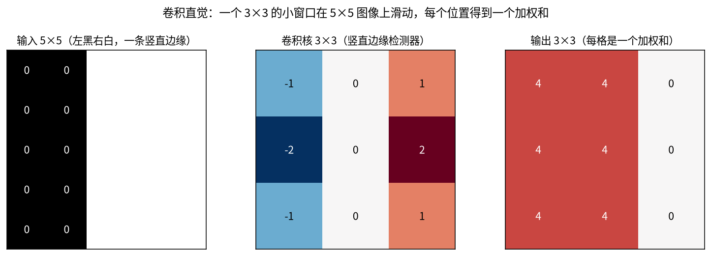
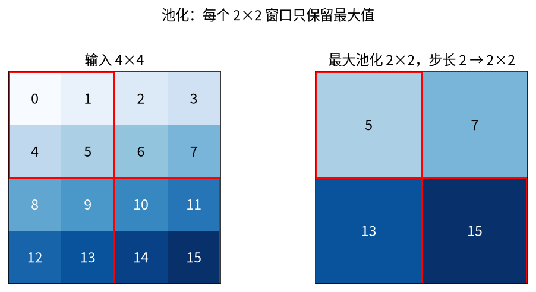

第 0 步你已经会用 PyTorch 的张量和 autograd。从这一讲开始进入 CNN 的特有概念。

本讲结束时你要能回答三个问题，并且能写出一个**不调用 `F.conv2d` 的手写卷积**：

1. 卷积在图像上到底算了什么？
2. 给定输入尺寸、卷积核大小、步长、填充，输出尺寸是多少？
3. 一个卷积层有多少个参数？为什么它比全连接层少那么多？

---

## 1. 直觉：一个会滑动的小窗口

先看一张图（`learn/figures/01_conv_intuition.png`）：



左边是一个 5×5 的图像，左半部分全黑（像素 0），右半部分全白（像素 1），中间有一条**竖直边缘**。
中间是一个 3×3 的"卷积核"（也叫滤波器、filter），它的数字是：

```
-1   0   1
-2   0   2
-1   0   1
```

右边是输出，3×3，数字是 4、4、0…… 怎么来的？

**把 3×3 的核盖在图像左上角的 3×3 区域上，对应位置相乘再全部相加**，得到一个数；
然后把核向右平移一格，再算一个数……直到扫完整张图。这个"滑动窗口 + 加权求和"就是卷积。

在这个例子里：

- 当窗口落在"左边全黑、右边全白"的边缘上时，核的右列（正数）乘到白色 1、左列（负数）乘到黑色 0，加起来是 **4**——**响应很大**，说明"这里有竖直边缘"；
- 当窗口完全落在白色区域里时，正负两边乘的都是 1，加起来正好 **0**——说明"这里没有边缘"。

所以这个核是一个**竖直边缘检测器**。CNN 要学的就是：不要人工设计这些核，让网络自己从数据里学出来。

一句话本质：**卷积 = 用同一组小权重，在原图的每个局部位置做一次加权求和。**
"同一组小权重"就是**权值共享**，它让参数数量和图像大小无关，这是 CNN 比全连接层省参数的根本原因。

---

## 2. 数学定义

### 2.1 单通道、单卷积核

设输入 $X$ 是 $H\times W$ 的矩阵，卷积核 $K$ 是 $k\times k$ 的矩阵，步长（stride）为 $S$，填充（padding）为 $P$。
先给输入四周补 $P$ 圈 0（如果 $P>0$），再让核以 $S$ 为间隔滑动，输出

$$
Y_{i,j}=\sum_{u=0}^{k-1}\sum_{v=0}^{k-1}X_{iS+u-P,\;jS+v-P}\cdot K_{u,v}+b,
$$

其中 $b$ 是偏置（一个标量）。**注意 PyTorch 的 `Conv2d` 计算的其实是"互相关"（cross-correlation）：核不翻转。**
数学教材里的"卷积"会先把核翻转 180°，深度学习框架不翻——这不影响表达能力（学出来的核会自己适应），
但你自己手写验证时必须和框架一致，**不要翻转**。

### 2.2 输出尺寸公式

$$
H_{out}=\left\lfloor\frac{H+2P-k}{S}\right\rfloor+1,\qquad
W_{out}=\left\lfloor\frac{W+2P-k}{S}\right\rfloor+1 .
$$

记住这个公式，后面搭 LeNet-5 时每一层都要用它。直觉：核在长度为 $H+2P$ 的（填充后）区域上，
第一个位置在 0，最后一个位置在 $H+2P-k$，每隔 $S$ 取一个位置，所以位置数是
$\lfloor (H+2P-k)/S\rfloor+1$。

### 2.3 多通道、多卷积核

真实图像的通道数 $C_{in}$ 可能大于 1（RGB 是 3，LeNet-5 第二层输入是 6）。
此时**一个卷积核也有 $C_{in}$ 个通道**，输出是该核在所有输入通道上的加权和：

$$
Y_{o,i,j}=\sum_{c=1}^{C_{in}}\sum_{u=0}^{k-1}\sum_{v=0}^{k-1}
X_{c,\,iS+u-P,\;jS+v-P}\cdot W_{o,c,u,v}+b_o .
$$

- 输入：$(C_{in}, H, W)$（PyTorch 里再加一个 batch 维，成 $(N,C_{in},H,W)$）；
- 权重：$(C_{out}, C_{in}, k, k)$——注意 PyTorch 的维度顺序是 **输出通道在前**；
- 偏置：$(C_{out},)$；
- 输出：$(C_{out}, H_{out}, W_{out})$。

**每个输出通道对应一个卷积核**，所以 $C_{out}$ 个卷积核 → $C_{out}$ 个输出通道。

### 2.4 一层卷积的参数量

$$
C_{out}\times\left(k^2\cdot C_{in}+1\right).
$$

如果 `bias=False`，就去掉那个 $+1$。举例：LeNet-5 的 conv1 是 $1\to6$、$k=5$，
参数是 $6\times(5^2\times1+1)=6\times26=156$ 个；而一个把 784 维接 256 维的全连接层有
$(784+1)\times256=200{,}960$ 个。**同样"处理 28×28 的图"，卷积层比全连接层小三个数量级。**

### 2.5 池化

池化没有可学习参数，只是对每个通道独立地做下采样。最常用的是 $2\times2$、步长 2 的最大池化：

$$
\text{MaxPool}(X)_{i,j}=\max_{u,v\in\{0,1\}}X_{2i+u,2j+v}.
$$

输出尺寸公式与卷积相同（池化的 padding 一般为 0，核大小=步长=2 时尺寸正好减半）。
它的作用是：降低分辨率、减少后续计算量、扩大感受野、对小范围平移不敏感。



---

## 3. 手算例题

这一节所有数字都是实际计算出来的，你可以用纸笔跟着算一遍。

### 例 1：单通道卷积，把 9 个输出全算出来

**题目。** 输入 $X$ 是 5×5（就是第 1 节那张图），核 $K$ 是 3×3，$S=1,P=0$，无偏置：

$$
X=\begin{bmatrix}
0&0&1&1&1\\
0&0&1&1&1\\
0&0&1&1&1\\
0&0&1&1&1\\
0&0&1&1&1
\end{bmatrix},\qquad
K=\begin{bmatrix}
-1&0&1\\
-2&0&2\\
-1&0&1
\end{bmatrix}.
$$

**第 1 步：用输出尺寸公式确定输出大小。**
$H_{out}=W_{out}=\lfloor(5+0-3)/1\rfloor+1=2+1=3$，所以输出是 3×3。

**第 2 步：算 $Y_{0,0}$。** 取输入第 0~2 行、第 0~2 列：

$$
\begin{bmatrix}0&0&1\\0&0&1\\0&0&1\end{bmatrix}
$$

逐元素相乘：
- 第 0 行：$0\times(-1)+0\times0+1\times1=0+0+1=1$
- 第 1 行：$0\times(-2)+0\times0+1\times2=0+0+2=2$
- 第 2 行：$0\times(-1)+0\times0+1\times1=0+0+1=1$

三行相加：$1+2+1=4$，所以 $Y_{0,0}=4$。

**第 3 步：算 $Y_{0,1}$。** 窗口右移一格，取第 0~2 列：

$$
\begin{bmatrix}0&1&1\\0&1&1\\0&1&1\end{bmatrix}
$$

- 第 0 行：$0\times(-1)+1\times0+1\times1=1$
- 第 1 行：$0\times(-2)+1\times0+1\times2=2$
- 第 2 行：$0\times(-1)+1\times0+1\times1=1$

相加 $=4$，所以 $Y_{0,1}=4$。

**第 4 步：算 $Y_{0,2}$。** 窗口取第 2~4 列，全是 1：
- 第 0 行：$-1+0+1=0$
- 第 1 行：$-2+0+2=0$
- 第 2 行：$-1+0+1=0$

相加 $=0$，所以 $Y_{0,2}=0$。

**第 5 步：算剩下的 6 个。** 因为这张图上下每一行都相同，所以第 1、2 行的窗口和第 0 行一模一样，
结果也相同。于是：

$$
Y=\begin{bmatrix}
4&4&0\\
4&4&0\\
4&4&0
\end{bmatrix}.
$$

**验算。** 用 PyTorch：

```python
import torch, torch.nn.functional as F
x = torch.tensor([[0,0,1,1,1]]*5, dtype=torch.float32)
k = torch.tensor([[-1,0,1],[-2,0,2],[-1,0,1]], dtype=torch.float32)
print(F.conv2d(x[None,None], k[None,None])[0,0])
# tensor([[4., 4., 0.],
#         [4., 4., 0.],
#         [4., 4., 0.]])
```

和手算一致。**这个例子说明：手算卷积不难，就是"取窗口 → 对应位置相乘 → 全部相加"，难的是下标不要错。**

### 例 2：填充与步长怎么改变输出尺寸

**题目。** 输入 28×28，核 5×5。分别计算下面几种配置的输出尺寸：

**第 1 步：$P=0,S=1$。**
$H_{out}=\lfloor(28+2\times0-5)/1\rfloor+1=\lfloor23/1\rfloor+1=23+1=24$。

**第 2 步：$P=0,S=2$。**
$H_{out}=\lfloor(28+0-5)/2\rfloor+1=\lfloor23/2\rfloor+1=11+1=12$。
（$23/2=11.5$，向下取整得 11，再加 1。）

**第 3 步：$P=2,S=1$。**
$H_{out}=\lfloor(28+4-5)/1\rfloor+1=27+1=28$。填充 2 圈正好让输出和输入一样大（5×5 核的 same padding）。

**第 4 步：$P=1,S=2$。**
$H_{out}=\lfloor(28+2-5)/2\rfloor+1=\lfloor25/2\rfloor+1=12+1=13$。

汇总：

| 输入 $H$ | 核 $k$ | 填充 $P$ | 步长 $S$ | 计算过程 | 输出 $H_{out}$ |
|---|---|---|---|---|---|
| 28 | 5 | 0 | 1 | $\lfloor(28-5)/1\rfloor+1=23+1$ | 24 |
| 28 | 5 | 0 | 2 | $\lfloor(28-5)/2\rfloor+1=11+1$ | 12 |
| 28 | 5 | 2 | 1 | $\lfloor(28+4-5)/1\rfloor+1=27+1$ | 28 |
| 28 | 5 | 1 | 2 | $\lfloor(28+2-5)/2\rfloor+1=12+1$ | 13 |

**第 5 步：验证一个带填充的实际输出。** 还是例 1 的 5×5 输入和 3×3 核，但这次 $P=1,S=2$。
先补一圈 0，变成 7×7：

```
0 0 0 0 0 0 0
0 0 0 1 1 1 0
0 0 0 1 1 1 0
0 0 0 1 1 1 0
0 0 0 1 1 1 0
0 0 0 1 1 1 0
0 0 0 0 0 0 0
```

输出尺寸 $\lfloor(5+2-3)/2\rfloor+1=3$，所以是 3×3。算 $Y_{0,1}$（窗口的左上角在填充后坐标 $(0,2)$）：

$$
\begin{aligned}
&\begin{bmatrix}0&0&0\\0&1&1\\0&1&1\end{bmatrix}\cdot K\\
&\quad= (0)+(-2\times0+0\times1+2\times1)\\
&\quad\quad+(-1\times0+0\times1+1\times1)=0+2+1=3.
\end{aligned}
$$

PyTorch 复算：`F.conv2d(x[None,None], k[None,None], stride=2, padding=1)` 的完整输出是

$$
\begin{bmatrix}
0&3&-3\\
0&4&-4\\
0&3&-3
\end{bmatrix},
$$

$Y_{0,1}=3$ 与手算一致。**注意 padding 处是 0，0 不贡献任何乘积，但会改变窗口的位置。**

### 例 3：多通道卷积（2 个输入通道 → 1 个输出通道）

**题目。** 输入两个通道

$$
X_0=\begin{bmatrix}1&2&3\\4&5&6\\7&8&9\end{bmatrix},\quad
X_1=\begin{bmatrix}1&1&1\\1&1&1\\1&1&1\end{bmatrix},
$$

卷积核两个通道为

$$
K_0=\begin{bmatrix}1&0&0\\0&1&0\\0&0&1\end{bmatrix},\quad
K_1=\begin{bmatrix}2&2&2\\2&2&2\\2&2&2\end{bmatrix},
$$

偏置 $b=1$，$k=3,S=1,P=0$。输出只有一个位置（因为 $3+0-3+1=1$）。

**第 1 步：算通道 0 的贡献。** $X_0$ 与 $K_0$ 逐元素相乘再相加。$K_0$ 只有对角线上是 1：
$1\times1+5\times1+9\times1=1+5+9=15$。

**第 2 步：算通道 1 的贡献。** $K_1$ 全是 2，$X_1$ 全是 1，共 9 个位置：
$9\times(1\times2)=18$。

**第 3 步：合并。** 多通道卷积要把各通道的贡献**相加**，再加偏置：
$15+18+1=34$。

所以输出是 $34$。用 PyTorch 验算：

```python
x = torch.stack([X0, X1])[None]                        # (1, 2, 3, 3)
w = torch.stack([torch.stack([K0, K1])])               # (1, 2, 3, 3)
print(F.conv2d(x, w, bias=torch.tensor([1.0])))        # tensor([[[[34.]]]])
```

### 例 4：最大池化手算

**题目。** 对下面的 4×4 输入做 $2\times2$、步长 2 的最大池化：

$$
\begin{bmatrix}
0&1&2&3\\
4&5&6&7\\
8&9&10&11\\
12&13&14&15
\end{bmatrix}
$$

**第 1 步：** 左上窗口 $\begin{bmatrix}0&1\\4&5\end{bmatrix}$ 的最大值是 **5**。
**第 2 步：** 右上窗口 $\begin{bmatrix}2&3\\6&7\end{bmatrix}$ 的最大值是 **7**。
**第 3 步：** 左下窗口 $\begin{bmatrix}8&9\\12&13\end{bmatrix}$ 的最大值是 **13**。
**第 4 步：** 右下窗口 $\begin{bmatrix}10&11\\14&15\end{bmatrix}$ 的最大值是 **15**。

输出为 $\begin{bmatrix}5&7\\13&15\end{bmatrix}$，与第 1 节的池化示意图一致。

### 例 5：LeNet-5 的参数量

**第 1 步：conv1（$1\to6$，$k=5$）。** 每个输出通道的核有 $5\times5\times1=25$ 个权重，加 1 个偏置 = 26 个参数；
6 个输出通道：$26\times6=156$。

**第 2 步：conv2（$6\to16$，$k=5$）。** 每个核有 $5\times5\times6=150$ 个权重，加 1 个偏置 = 151；
16 个输出通道：$151\times16=2{,}416$。

**第 3 步：两个卷积层合计。** $156+2{,}416=2{,}572$ 个参数。

**第 4 步：对比全连接层。** 如果把 28×28 拉平成 784 维、接到 256 维隐层：
$(784+1)\times256=785\times256=200{,}960$ 个参数。

**第 5 步：结论。** 一个全连接层 $200{,}960$ 个参数，是 LeNet-5 两个卷积层（2,572）的
$200{,}960\div2{,}572\approx78$ 倍。这就是第 2 节说的"权值共享让参数数量与图像大小无关"。

---

## 4. 在 PyTorch 里怎么写

### 4.1 函数式接口

```python
import torch.nn.functional as F

# x: (N, C_in, H, W)   w: (C_out, C_in, k, k)   b: (C_out,)
y = F.conv2d(x, w, b, stride=1, padding=0)

# 池化：核对 kernel_size 与 stride
p = F.max_pool2d(x, kernel_size=2, stride=2)      # 最大池化
a = F.avg_pool2d(x, kernel_size=2, stride=2)      # 平均池化
```

第 2 步搭网络时你会用模块版（`nn.Conv2d`、`nn.MaxPool2d`），但**它们内部算的是同一件事**。
先用函数式接口把形状和数值搞对，再学模块版会轻松很多。

### 4.2 手写卷积的思路

作业要求你先自己写一个 `naive_conv2d`，不许调用 `F.conv2d`。最直接的写法是**多重循环**：

```
输出初始化为偏置
for 每个输出通道 o:
    for 每个输出位置 (i, j):
        acc = b[o]
        for 每个输入通道 c:
            for 核内每个位置 (u, v):
                输入坐标 = (i*S + u - P, j*S + v - P)
                如果坐标越界（落在 padding 区域）：跳过（等价于乘 0）
                否则 acc += x[c, 输入行, 输入列] * w[o, c, u, v]
        输出[o, i, j] = acc
```

两个容易错的地方：**下标顺序**（`x` 是 $(C,H,W)$，`w` 是 $(C_{out},C_{in},k,k)$）；
**padding 的边界判断**（越界部分乘 0，不要真的去访问负下标）。
写完后用随机小数据调用 `F.conv2d` 对比，误差小于 $10^{-5}$ 就算对。

### 4.3 和 `nn.Conv2d` 的对应关系

| 函数式 | 模块式 | 说明 |
|---|---|---|
| `F.conv2d(x, w, b, stride, padding)` | `nn.Conv2d(in_ch, out_ch, k, stride, padding)` | 模块内部自己维护 `weight` 和 `bias` 参数 |
| `F.max_pool2d(x, k, s)` | `nn.MaxPool2d(k, s)` | 池化没有参数 |
| 手动传入权重 | 参数由 PyTorch 初始化并自动求导 | 第 2 步会看到权重的形状 |

---

## 5. 常见坑

1. **权重维度顺序**：PyTorch 是 $(C_{out},C_{in},k,k)$，不是 $(k,k,C_{in},C_{out})$。
2. **卷积不翻转核**：框架算的是互相关；你手写时也不要翻转，否则和 `F.conv2d` 对不上。
3. **padding 是两侧各补 P 圈**，不是总共补 P 个。
4. **输出尺寸要向下取整**：$\lfloor(H+2P-k)/S\rfloor+1$，不是四舍五入。
5. **偏置的形状是 $(C_{out},)$**，不是标量；多个输出通道各有一个偏置。
6. **dtype / device 要一致**：`F.conv2d` 要求输入和权重同 dtype、同 device，否则报错。
7. **手写循环时越界**：直接按 `i*S+u-P` 索引会访问负下标/越界；要么先 `F.pad` 再滑窗，要么用 if 判断跳过。
8. **池化窗口与步长**：最常用 $2\times2$、步长 2；如果步长小于核大小，窗口会重叠。

---

## 6. 本步任务

打开 `practice/step01_conv.py`，填 6 个 `TODO`：

| TODO | 任务 | 验收 |
|---|---|---|
| 1 | `out_size(h, w, k, stride, padding)` 按公式返回输出高宽 | 5 组尺寸全对 |
| 2 | `conv_params(c_in, c_out, k, bias=True)` 返回一层卷积的参数个数 | 与手算 156 / 2,416 / 9,248 一致 |
| 3 | `naive_conv2d(x, w, b, stride, padding)` 用循环手写卷积（不许调 `F.conv2d`） | 与 `F.conv2d` 误差 < 1e-5 |
| 4 | `naive_maxpool2d(x, k, stride)` 手写最大池化 | 与 `F.max_pool2d` 一致 |
| 5 | `vertical_edge_kernel()` 设计一个能检测竖直边缘的 3×3 核 | 在合成图上响应符合预期 |
| 6 | `lenet_shapes()` 用 `out_size` 推出 LeNet-5 各层特征图形状 | 28→24→12→8→4 全对 |

运行：

```bash
cd experiment5/learn/practice
python step01_conv.py
```

全部通过会看到 `6/6 PASS`。第 3 题是本步核心：**先手写，再和 PyTorch 对比。**

### 思考题（发我时写一句答案）

1. 为什么输出尺寸公式是"向下取整 +1"，而不是 $\lceil(H+2P-k)/S\rceil$？用 $H=28,k=5,S=2$ 说明。
2. 两个 3×3 卷积堆叠，输出端一个位置"看到"原图的多大区域（感受野）？先算一个 3×3 的感受野，再算第二个。
3. 如果输入是 3 通道 RGB、输出 16 通道、$k=3$、带偏置，这一层有多少参数？和"把 3×28×28 拉平接 16 维全连接"比，差多少倍？

### 提交什么给我

1. `6/6 PASS` 的完整输出；
2. 你写的 `naive_conv2d` 代码；
3. 一句"哪里最别扭/最不确定"；
4. 三个思考题的一句话答案。
