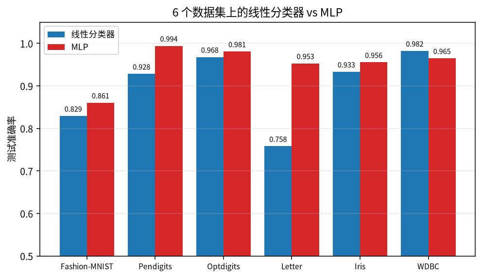
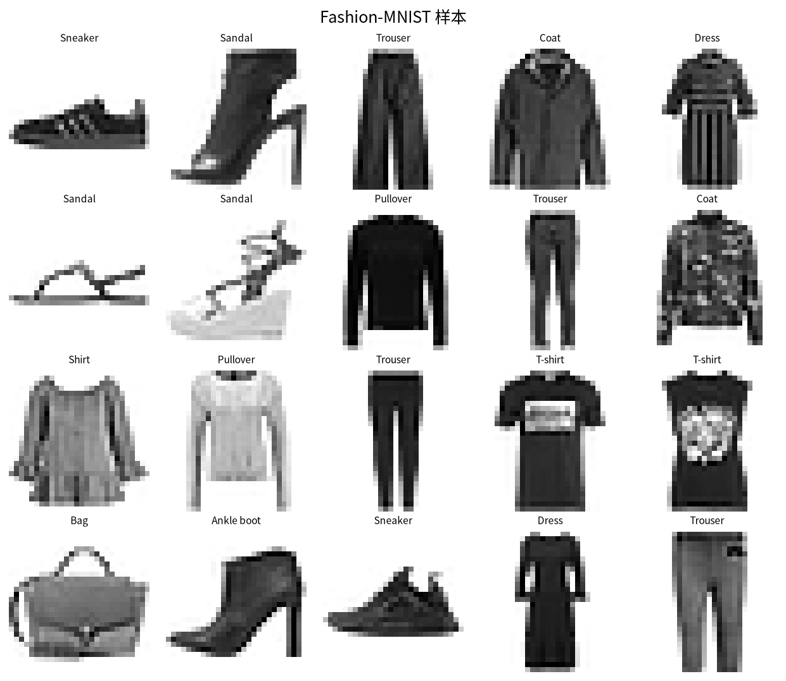
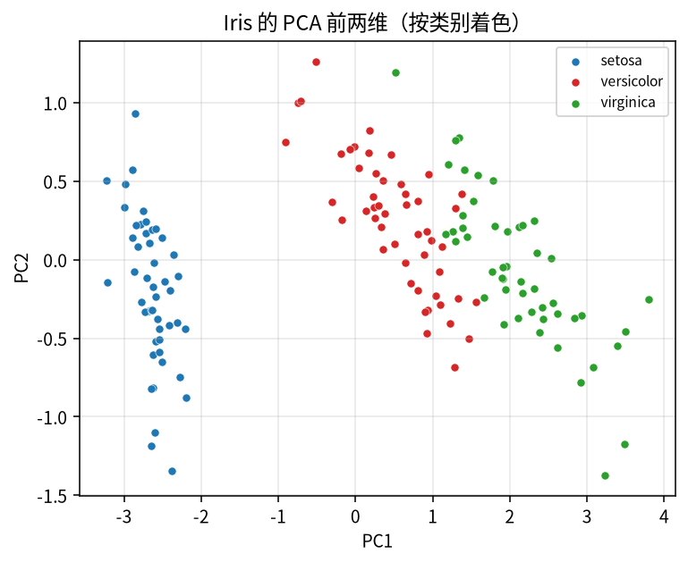

> 对应脚本：`learn/practice/extra_datasets.py`
>
> 运行：`cd learn/practice && python extra_datasets.py`（约 45 秒）
>
> 数据：Fashion-MNIST 在 `data/fashion/`；其余四个来自 `../experiment3/data/`。

## 1. 六个数据集的结果

同一套 MLP（ReLU、He、Adam）、同一个线性分类器，只换数据：

| 数据集 | 训练 | 测试 | 特征 | 类别 | 线性 | MLP | gap |
|---|---|---|---|---|---|---|---|
| Fashion-MNIST | 20,000 | 5,000 | 784 | 10 | 0.8294 | 0.8606 | +0.031 |
| Pendigits | 7,696 | 3,296 | 16 | 10 | 0.9284 | 0.9942 | +0.066 |
| Optdigits | 3,935 | 1,685 | 64 | 10 | 0.9680 | 0.9810 | +0.013 |
| Letter | 14,000 | 6,000 | 16 | 26 | 0.7583 | 0.9530 | +0.195 |
| Iris | 105 | 45 | 4 | 3 | 0.9333 | 0.9556 | +0.022 |
| Breast Cancer WDBC | 398 | 171 | 30 | 2 | 0.9825 | 0.9649 | −0.018 |



## 2. 每个数据集是什么

### Fashion-MNIST

Zalando 发布的服装图，28×28 灰度，10 类：T 恤、裤子、套头衫、连衣裙、外套、凉鞋、衬衫、运动鞋、包、短靴。格式与 MNIST 完全一样（IDX），所以可以直接复用 MNIST 的加载和训练代码。

它比 MNIST 难：同类服装的版型差异大，不同类之间（衬衫/套头衫/外套）又很像。用 2 万张、12 轮，MLP 约 86%；用全量 6 万张、20 轮，通常能到 89%～90%。



### Pendigits

UCI 的手写数字笔迹数据：每个数字用 16 个笔迹特征（坐标序列重采样后的值）表示，10 类，10992 个样本。特征已经是低维的，MLP 很容易到 99% 以上，线性只有 92.8%。

### Optdigits

UCI 的手写数字图像，8×8 像素拉平成 64 维，10 类，5620 个样本。线性已经 96.8%，MLP 98.1%——因为 8×8 的像素空间里，数字的类别边界本来就接近线性。

### Letter

UCI 的字母识别：20,000 个字母图像，用 16 个几何/统计特征表示（边缘数、笔画数等），26 类。类别多、边界高度非线性，线性只有 75.8%，MLP 到 95.3%——这是六个数据集里差距最大的。

### Iris

4 个特征（花萼/花瓣的长宽）、3 类、150 个样本。测试集只有 45 个，差 2 个样本就是 4.4 个百分点，所以 93.3% 与 95.6% 的差别不显著。小数据上线性模型通常已经够用。



### Breast Cancer WDBC

30 个细胞核形态特征、2 类（恶性/良性）、569 个样本。特征之间高度相关，线性分类器 98.25%，MLP 96.5%——小样本、强线性信号时，MLP 反而容易过拟合。

## 3. 怎么解释这些差距

- **差距最大的是 Letter（+19.5）**：26 类、每类边界都弯，线性分类器的凸区域完全不够用；
- **Pendigits（+6.6）**：10 类、16 维特征，非线性边界明显，但数据量足够，MLP 能学出来；
- **Optdigits（+1.3）**：64 维像素已经接近线性可分，MLP 的额外容量收益有限；
- **Fashion（+3.1）**：图像任务，但这里的 MLP 只训练了 12 轮、2 万张，容量和数据都没拉满；
- **Iris（+2.2）**：45 个测试样本，差距在噪声范围内；
- **WDBC（−1.8）**：小样本 + 强线性信号，MLP 没有优势，甚至更差。

这和实验四主报告里的结论一致：**MLP 的优势取决于任务边界的弯曲程度与数据量，而不是参数量本身。**

## 4. 还能用什么数据

本地 `../experiment3/data/` 里还有：

| 数据 | 特征 | 类别 | 样本 | 文件 |
|---|---|---|---|---|
| Segmentation | 19 | 7 | 2310 | `segmentation.data` + `.test` |
| Wine | 13 | 3 | 178 | `downloads/wine.arff` |
| Seeds | 7 | 3 | 210 | `seeds.data` |
| Diabetes | 8 | 2 | 768 | `downloads/diabetes.arff` |
| Vehicle | 18 | 4 | 846 | `downloads/vehicle.arff` |
| Satimage | 36 | 6 | 6435 | `downloads/satimage.arff` |
| Electricity | 8 | 2 | 45312 | `downloads/electricity.arff` |

可以下载的：

- **CIFAR-10**：32×32 彩色图，10 类，MLP 大约 50%～55%，适合展示全连接网络在复杂图像上的局限；
- **EMNIST**：手写字母/数字，类别更多；
- **Adult / Covertype**：表格数据，Adult 需要处理类别特征，Covertype 有 58 万样本、54 维；
- **Fashion-MNIST 全量**：把 `load_fashion_mnist(20000, 5000)` 改成 `(60000, 10000)`、`epochs=20`，就能复现约 89%～90%。

## 5. 怎么加一个新数据集

1. 写一个 loader，返回 `(X, y)`，`X` 是 `(N, D)` 的浮点数组，`y` 是 `0..C-1` 的整数；
2. 在 `main()` 里加一节：

```python
X, y = load_xxx()
Xtr, ytr, Xte, yte = train_test_split(X, y, test_frac=0.3, seed=0)
r = run_one("XXX", Xtr, ytr, Xte, yte,
            hidden=[64, 32], epochs=60, batch_size=64, lr=1e-3,
            standard=True)
results.append(r)
```

3. `run_one` 会自动训练线性分类器和 MLP，并返回准确率。

如果特征是不同量纲的（例如 WDBC、Pendigits），一定要 `standard=True`；像素数据已经在 `[0,1]`，可以 `standard=False`。

## 6. 读这些结果时要注意

- 每个数据集只跑了一个划分、一个种子，**差距小于 1～2 个百分点不能当真**；
- MLP 的结构和轮数是统一给的，没有针对每个数据集调参；调过之后 WDBC、Fashion 的结果会更好；
- 线性分类器的结果依赖特征缩放，`standard=True` 时才是公平对比；
- 不同数据集的准确率不能横向比较（类别数、难度不同），只能比较**同一数据集内**线性和 MLP 的差距。

---

**一句话总结**：Letter 和 Pendigits 展示了 MLP 的非线性优势，Optdigits 和 Iris 说明线性模型常常够用，WDBC 提醒小样本下 MLP 可能过拟合。选模型之前，先看数据的边界形状和样本量，而不是先看参数量。
