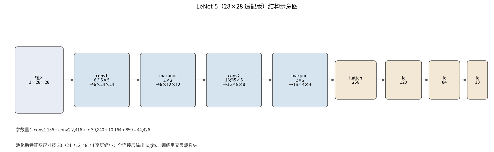

第 1 步你已经能手算卷积、池化、输出尺寸和参数量了。这一讲把这些零件**组装成一个真正的模型**：
一个 `LeNet5` 类，输入 `(N, 1, 28, 28)`，输出 `(N, 10)` 的 logits，默认参数量 **44,426**。

学完这一讲，你要能回答：

1. `nn.Module` 到底帮你做了什么？
2. 为什么层必须写在 `__init__` 里、并赋给 `self.xxx`？如果写在 `forward` 里会怎样？
3. LeNet-5 每一层的形状和参数量怎么手算？怎么用代码核对？

---

## 1. 一句话本质：`nn.Module` 是"参数 + forward"的容器

在实验四手写 MLP 时，你的"模型"是几个 NumPy 数组（`Ws`、`bs`）加一个 `forward` 函数。
PyTorch 把这两样东西绑进一个类里，就是 `nn.Module`：

- **参数**：在 `__init__` 里把 `nn.Linear`、`nn.Conv2d` 这类层赋给 `self.xxx`，PyTorch 会自动把它们登记成"模型的参数"；
- **计算**：在 `forward(self, x)` 里写 `x` 怎么一层层变成输出；
- **调用方式**：不要写 `model.forward(x)`，写 `model(x)`——`__call__` 会在 `forward` 外面加一些框架逻辑（hook、训练/评估模式等）。

最小例子：

```python
import torch.nn as nn

class LinearModel(nn.Module):
    def __init__(self, in_dim, out_dim):
        super().__init__()                 # 必须先调用
        self.fc = nn.Linear(in_dim, out_dim)   # 层赋给 self.fc，参数被自动注册

    def forward(self, x):
        return self.fc(x)

model = LinearModel(784, 10)
print(sum(p.numel() for p in model.parameters()))   # 785*10 = 7,850
```

三条硬规则：

1. `__init__` 第一行必须 `super().__init__()`，否则 PyTorch 内部状态没初始化，加层会报错；
2. 层要赋给 `self.xxx`。如果只写 `fc = nn.Linear(...)`（局部变量），参数不会注册进模型，`model.parameters()` 里看不到，优化器也更新不到它；
3. 不要在 `forward` 里新建层。那样每次前向都会创建**新的随机参数**，训练永远学不到东西。

**和实验四对照**：实验四里你手写了 `get_params()` 把 `Ws`/`bs` 收集起来交给优化器；
`nn.Module` 的 `parameters()` 就是自动版的 `get_params()`。

---

## 2. 本讲会用到的层

| 层 | 用法 | 参数形状 | 作用 |
|---|---|---|---|
| `nn.Conv2d(in_ch, out_ch, k, stride=1, padding=0)` | 卷积 | weight `(out_ch, in_ch, k, k)`，bias `(out_ch,)` | 提取局部特征 |
| `nn.MaxPool2d(2)` / `nn.AvgPool2d(2)` | 池化 | 无参数 | 下采样、扩大感受野 |
| `nn.Linear(in_features, out_features)` | 全连接 | weight `(out_features, in_features)`，bias `(out_features,)` | 分类头 |
| `nn.Flatten()` | 拉平 | 无参数 | `(N, C, H, W) → (N, C*H*W)` |
| `nn.ReLU()` / `nn.Sigmoid()` / `nn.Tanh()` / `nn.LeakyReLU(0.1)` | 激活 | 无参数 | 引入非线性 |
| `nn.Dropout(p)` | 正则化 | 无参数 | 训练时随机丢弃（第 4 步再细讲） |

**和上一讲函数式接口的对应**：`nn.Conv2d` 内部维护 weight/bias 并调用 `F.conv2d`；
`nn.MaxPool2d` 就是 `F.max_pool2d` 的模块封装。第 1 步你手写的 `naive_conv2d` 帮你理解了它们内部的循环；
实际建模时用这些模块，因为参数管理、初始化、GPU 搬运和自动求导都由框架处理好了。

一个形状小坑：`nn.Linear` 的 weight 是 `(out_features, in_features)`，计算的是 `x @ W.T + b`；
而 `nn.Conv2d` 的 weight 是 `(out_ch, in_ch, k, k)`，这就是 PyTorch 的约定，记住即可。

---

## 3. LeNet-5 的结构



| 层 | 操作 | 输入形状 | 输出形状 | 参数量 |
|---|---|---|---|---|
| conv1 | 5×5 卷积，6 通道 | 1×28×28 | 6×24×24 | 156 |
| pool1 | 2×2 池化 | 6×24×24 | 6×12×12 | 0 |
| conv2 | 5×5 卷积，16 通道 | 6×12×12 | 16×8×8 | 2,416 |
| pool2 | 2×2 池化 | 16×8×8 | 16×4×4 | 0 |
| flatten | 拉平（从通道维开始） | 16×4×4 | 256 | 0 |
| fc1 | 256 → 120 | 256 | 120 | 30,840 |
| act | 激活 | 120 | 120 | 0 |
| fc2 | 120 → 84 | 120 | 84 | 10,164 |
| act | 激活 | 84 | 84 | 0 |
| fc3 | 84 → 10 | 84 | 10 | 850 |
| **合计** | | | | **44,426** |

代码结构上分两块：

- `self.features`：两个 `ConvBlock`（每个是 conv → activation → pool），负责"图像 → 特征图"；
- `self.classifier`：`Flatten → Linear → 激活 → Linear → 激活 → Linear`，负责"特征图 → 10 类分数"。

为什么这么分？`features` 是特征提取器（换任务时通常保留或微调），`classifier` 是任务相关的分类头。
这种"特征提取 + 分类头"的划分是后面所有 CNN（VGG、ResNet）的通用结构。

---

## 4. 手算例题

### 例 1：batch=4 时每一层的完整形状链

**题目。** 输入一个 batch：`x` 形状 `(4, 1, 28, 28)`，经过默认 LeNet-5，逐层写出形状。

**第 1 步：conv1（k=5，stride=1，padding=0）。**
用第 1 步的公式：

$$
H_{out}=\left\lfloor\frac{H-K+2P}{S}\right\rfloor+1
=\left\lfloor\frac{28-5+0}{1}\right\rfloor+1=23+1=24 .
$$

宽同理，所以空间尺寸 24×24；batch 维不变，通道数 1→6，输出 **(4, 6, 24, 24)**。

**第 2 步：pool1（2×2，stride=2）。**

$$
\left\lfloor\frac{24-2}{2}\right\rfloor+1=11+1=12,
$$

输出 **(4, 6, 12, 12)**。

**第 3 步：conv2（k=5，stride=1，padding=0）。**
$\lfloor(12-5)/1\rfloor+1=7+1=8$，通道 6→16，输出 **(4, 16, 8, 8)**。

**第 4 步：pool2（2×2，stride=2）。**
$\lfloor(8-2)/2\rfloor+1=3+1=4$，输出 **(4, 16, 4, 4)**。

**第 5 步：Flatten。**
从 dim=1 开始拉平：$16\times4\times4=256$，输出 **(4, 256)**。

**第 6 步：三个全连接层。**

- fc1：**(4, 120)**
- fc2：**(4, 84)**
- fc3（输出层）：**(4, 10)**

整个过程 batch 维 4 一直不变，只有 `(C, H, W)` 在变。**这就是"特征图逐层变小、通道逐层变多"的含义。**

### 例 2：默认 LeNet-5 的参数量，逐层算

**第 1 步：conv1（1→6，k=5）。** 每个核 $5\times5\times1=25$ 个权重，加 1 个偏置是 26：
$26\times6=156$。

**第 2 步：conv2（6→16，k=5）。** 每个核 $5\times5\times6=150$ 个权重，加 1 个偏置 151：
$151\times16=2{,}416$。

**第 3 步：fc1（256→120）。** 权重 $256\times120=30{,}720$，偏置 120：
$30{,}720+120=30{,}840$。

**第 4 步：fc2（120→84）。** 权重 $120\times84=10{,}080$，偏置 84：
$10{,}080+84=10{,}164$。

**第 5 步：fc3（84→10）。** 权重 $84\times10=840$，偏置 10：
$840+10=850$。

**第 6 步：求和。**
$156+2{,}416=2{,}572$（两个卷积层），
$30{,}840+10{,}164+850=41{,}854$（三个全连接层），
合计 $2{,}572+41{,}854=44{,}426$。

**例 2 结论：默认 LeNet-5 有 44,426 个可训练参数。** 你的模型跑出来后必须等于这个数。

### 例 3：改 `fc_sizes=(512, 128)` 后参数变成多少

**第 1 步：卷积部分不变。** 仍然是 $156+2{,}416=2{,}572$。

**第 2 步：fc1（256→512）。** $(256+1)\times512=257\times512=131{,}584$。

**第 3 步：fc2（512→128）。** $(512+1)\times128=513\times128=65{,}664$。

**第 4 步：fc3（128→10）。** $(128+1)\times10=129\times10=1{,}290$。

**第 5 步：求和。**
$2{,}572+131{,}584=134{,}156$；
$134{,}156+65{,}664=199{,}820$；
$199{,}820+1{,}290=201{,}110$。

所以 `fc_sizes=(512,128)` 的模型有 **201,110** 个参数——这正是实验五第 8 节 Dropout 实验里用的"放大版"结构。

### 例 4：`Flatten` 之后为什么是 256

**第 1 步：pool2 的输出是 16 个通道，每个通道 4×4。**
**第 2 步：拉平就是把每个通道的 4×4 摊开、再接下一个通道：** $16\times16=256$。
**第 3 步：验算。** $16\times4\times4=16\times16=256$。所以 `nn.Linear` 的输入维度写 **256**，不是 16、也不是 4×4=16。
**踩坑提醒：** 如果忘了改 Flatten 后的维度（比如写成 `nn.Linear(16*5*5, 120)`，那是原始 32×32 输入时的 400），
运行时会报 `mat1 and mat2 shapes cannot be multiplied`。报这个错时，第一反应就是打印 flatten 前的形状。

### 例 5：用代码核对参数量（验算）

手算之后，再用两行代码验算：

```python
model = LeNet5()
print(sum(p.numel() for p in model.parameters()))   # 应为 44426
```

如果结果不是 44,426，常见原因有：

- Flatten 后的维度写错（比如 400 或 128）；
- 某个 `nn.Linear` 的 in/out 接错（例如 fc2 写成 120→10，少了一层）；
- 激活/池化被误写成了带参数的层；
- 重复注册了某个层（同一层被赋给两个属性会被重复统计参数）。

---

## 5. 模型的输出：logits 与 softmax

模型的最后一层输出 10 个**未归一化的分数**，叫 **logits**。它还不是概率：

$$
\text{logits} = z \in \mathbb{R}^{10},\qquad \sum_{c} z_c \neq 1 .
$$

概率要经过 softmax：

$$
p_c = \frac{e^{z_c}}{\sum_{j=1}^{10} e^{z_j}},\qquad \sum_c p_c = 1 .
$$

**训练时不要在模型最后加 softmax**，因为 `nn.CrossEntropyLoss` 内部已经把 `log_softmax` 和 `NLLLoss` 合并了，
它期望的输入就是 **logits**。如果你先 softmax 再传进去，等于对概率又做了一次 log_softmax，梯度会不对，训练效果显著变差。

所以本讲约定的接口是：

- `model(x)` → logits，形状 `(N, 10)`；
- 需要概率时，单独写 `predict_proba(model, x) = softmax(model(x), dim=1)`，并且推理时用 `torch.no_grad()`。

---

## 6. 参数量统计与 forward hook

### 6.1 统计参数量

```python
def count_parameters(model):
    return sum(p.numel() for p in model.parameters() if p.requires_grad)
```

`model.parameters()` 递归遍历所有已注册的参数；`.numel()` 返回元素个数；`requires_grad` 过滤掉冻结的参数。
对默认 LeNet-5 应该是 44,426。

### 6.2 用 hook 看每一层的真实形状

有时候手算形状和实际不一致（比如忘记池化、Flatten 写错），最可靠的调试方式是**在真实前向上打印每层形状**。
`register_forward_hook` 可以在某个层计算完之后自动调用一个回调：

```python
model = LeNet5().eval()
shapes = []
hooks = []
for m in model.modules():
    if isinstance(m, (nn.Conv2d, nn.MaxPool2d, nn.AvgPool2d)):
        hooks.append(m.register_forward_hook(
            lambda mod, inp, out: shapes.append(tuple(out.shape[1:]))))
with torch.no_grad():
    model(torch.zeros(1, 1, 28, 28))
for h in hooks:
    h.remove()
print(shapes)   # [(6,24,24), (6,12,12), (16,8,8), (16,4,4)]
```

这个技巧在实验五后面还会用到：我们要记录"第一层卷积权重的梯度范数"，也是用 `register_hook` 实现的。

---

## 7. 常见坑

1. **忘记 `super().__init__()`**：报 `AttributeError` 或 layer 注册异常。
2. **层写在 `forward` 里**：每次前向都重新随机初始化，loss 不下降。
3. **层只赋给局部变量**（`conv = nn.Conv2d(...)` 而非 `self.conv = ...`）：参数不在 `model.parameters()` 里。
4. **`nn.Flatten()` 放在错误的维度**：默认从 dim=1 开始（保留 batch 维），不要用 `x.view(-1, 256)` 把 batch 也压掉。
5. **全连接输入维度写错**：28×28 输入时是 256，不是 400；报 `mat1 and mat2 shapes cannot be multiplied`。
6. **模型最后加了 softmax 又用 `CrossEntropyLoss`**：重复归一化，训练变差。
7. **把 `nn.Module` 实例当成函数**：要 `model(x)`，不要 `model.forward(x)`（能跑，但 hook 不生效）。
8. **激活函数模块重复用同一个实例**：`nn.ReLU()` 本身无状态，问题不大；但如果换成 Dropout/BN 这类有训练/评估状态或随机性的模块，重复使用同一实例会出问题——每个位置建一个新实例最安全。
9. **`.to(device)` 只搬模型没搬数据**：第 4 步训练循环会强调"模型和数据必须同 device"。
10. **统计参数时用了 `named_parameters()` 又重复遍历**：一个参数只会在 `parameters()` 里出现一次，不要自己手动乘倍数。

---

## 8. 本步任务

打开 `practice/step02_lenet.py`，填 6 个 `TODO`：

| TODO | 任务 | 验收 |
|---|---|---|
| 1 | `make_activation(name)` 激活函数工厂 | 4 种激活行为正确、未知名字抛 ValueError |
| 2 | `ConvBlock`：conv → 激活 → 池化 | (1,28,28)→(6,12,12)，参数 156 / 2416 |
| 3 | **`LeNet5`**：features + classifier + forward | 输出 (N,10)，默认参数 44,426 |
| 4 | `count_parameters(model)` | 44,426 / 220 |
| 5 | `feature_shapes()` 用 forward hook 记录形状 | [(6,24,24),(6,12,12),(16,8,8),(16,4,4)] |
| 6 | `predict_proba(model, x)` | 行和为 1、不带梯度、argmax 一致 |

运行：

```bash
cd experiment5/learn/practice
python step02_lenet.py
```

全部通过会看到 `6/6 PASS`。

### 思考题（发我时写一句答案）

1. 如果 `LeNet5.__init__` 里写成 `self.classifier` 但把 `nn.Linear` 赋给了局部变量 `layer`（没赋给 `self`），
   `model.parameters()` 会少哪些参数？训练时会怎样？
2. 输入 batch=4 时，为什么 conv1 输出是 4 个通道的 24×24（即 (4,6,24,24)）而不是 (6,24,24)？
3. 模型的输出为什么不能直接当概率用？`CrossEntropyLoss` 期望的输入是什么？
4. 手算 `LeNet5(fc_sizes=(256,128))` 的参数量（提示：fc1 是 256→256，fc2 是 256→128）。

### 提交什么给我

1. `6/6 PASS` 的完整输出；
2. 你写的 `LeNet5` 类代码（`__init__` + `forward`）；
3. 一句"哪里最别扭/最不确定"；
4. 四个思考题的一句话答案。
