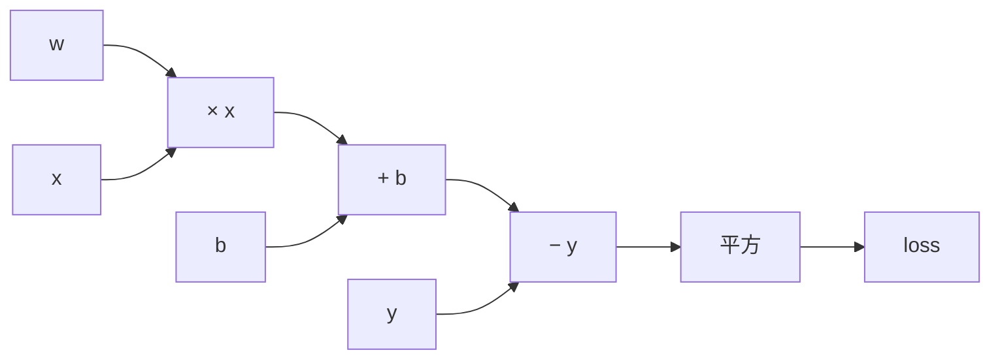

这份讲义假定你已经会：Python、NumPy 的 `shape` / 广播 / 索引、梯度下降、交叉熵、多层感知机（实验四你手写过 MLP 的反向传播）。
本讲只解决一个问题：**从 NumPy 过渡到 PyTorch**。学完这一讲，你要能独立写出一段"用 autograd 训练一个线性模型"的代码。

这一讲不涉及卷积，卷积从第 1 步开始。第 0 步的目标是先把下面这张图里的三个新东西摸熟：

```
NumPy 数组       →      PyTorch 张量
                         ├── 多了 device（CPU / GPU 之间要显式搬运）
                         ├── 多了 requires_grad / 计算图 / 自动求导
                         └── 多了 nn.Module 这类"网络积木"（第 2 步再学）
```

---

## 1. 三处关键差异，先记住

### 差异 1：默认 dtype 不一样

```python
import numpy as np, torch

a = np.zeros(3)          # dtype = float64
b = torch.zeros(3)       # dtype = float32（深度学习默认用 32 位，省显存、算得快）

print(a.dtype, b.dtype)  # float64 float32
```

这会影响什么？PyTorch 的层（`nn.Linear`、`nn.Conv2d`）默认用 `float32` 计算，如果你的数据是
`float64`，一放进模型就会报错：

```python
RuntimeError: mat1 and mat2 must have the same dtype
```

所以真实数据流水线里，统一用 `float32` 训练；**标签**（类别下标）用 `int64`（`torch.long`），
因为 `CrossEntropyLoss` 要求标签是整数类型。

### 差异 2：多了 device

NumPy 数组只存在于内存里；PyTorch 张量可以放在 CPU 或 GPU 上，而且**参与同一次运算的所有张量必须在同一块设备上**。

```python
x = torch.randn(3, 3)                 # CPU
x = x.to("cuda")                      # 搬到 GPU（有 GPU 时）
x = x.to("cpu")                       # 搬回 CPU

torch.cuda.is_available()             # True / False
torch.cuda.get_device_name(0)         # 例如 "NVIDIA GeForce RTX 4050 Laptop GPU"
```

搬到 GPU 后，`x.numpy()` 会报错——NumPy 不认识 GPU 内存，必须先 `.cpu().numpy()`。

### 差异 3：多了自动求导（autograd）

NumPy 只负责算数；PyTorch 会记录"这个张量是由哪些张量、经过什么运算得到的"，
在调用 `loss.backward()` 时沿着记录倒着把梯度算出来。这就是你实验四手写的那套反向传播，
由框架接管了。

---

## 2. 张量基本操作：和 NumPy 对照

先说明：PyTorch 的很多操作和 NumPy **同名同义**，你已经会的部分可以直接迁移。

| 目的 | NumPy | PyTorch |
|---|---|---|
| 从列表创建 | `np.array([[1,2],[3,4]])` | `torch.tensor([[1,2],[3,4]])` |
| 全零 / 全一 | `np.zeros((2,3))` | `torch.zeros(2,3)` |
| 等差序列 | `np.arange(5)` | `torch.arange(5)` |
| 标准正态 | `rng.normal(size=(2,3))` | `torch.randn(2,3)` |
| 形状 | `a.shape` | `a.shape`（同） |
| 类型转换 | `a.astype(np.float32)` | `a.to(torch.float32)` / `a.float()` |
| 改变形状 | `a.reshape(2,3)` | `a.reshape(2,3)` / `a.view(2,3)` |
| 转置 | `a.T` | `a.T` / `a.transpose(0,1)` |
| 拼接 | `np.concatenate([a,b], axis=0)` | `torch.cat([a,b], dim=0)` |
| 求和 | `a.sum()` / `a.sum(axis=1)` | `a.sum()` / `a.sum(dim=1)` |
| 均值 | `a.mean(axis=0)` | `a.mean(dim=0)` |
| 最大值下标 | `a.argmax(axis=1)` | `a.argmax(dim=1)` |
| 元素乘 | `a * b` | `a * b`（同） |
| 矩阵乘 | `a @ b` | `a @ b`（同） |
| 取标量 | `float(a.mean())` | `a.mean().item()` |

**一个高频坑：`view` vs `reshape`。** 两者都能改形状，但 `view` 要求内存是连续的，
如果不确定就用 `reshape`（它会自动复制一份）。另外 `a.T` 只对二维张量是"转置"，
对多维张量只是反转所有维度，图像数据通常要的是 `permute`。

### 形状操作里最常用的四个

```python
x = torch.randn(8, 3, 28, 28)       # 8 张图、3 通道、28×28

x.unsqueeze(1)          # (8,1,3,28,28)  在 dim=1 插一个长度 1 的维度
x.squeeze()             # 去掉所有长度为 1 的维度
x.flatten(1)            # (8, 3*28*28)   从 dim=1 开始压平
x.permute(0, 2, 3, 1)   # (8,28,28,3)    重排维度顺序（常用于显示图像）
```

### 调试第一原则：打印形状

你之后会遇到的 80% 的报错都能靠这一行定位：

```python
print(x.shape, x.dtype, x.device)
```

不要猜形状。打印出来，和公式对一遍。

---

## 3. 图像数据的形状约定：NCHW

PyTorch 的卷积层要求的输入是 **NCHW**：

```
N = batch size（一批几张图）
C = channels（灰度图 1，RGB 图 3）
H = height
W = width
```

MNIST 是灰度图，所以一个 batch 是 `(64, 1, 28, 28)`。而 NumPy 读出来的原始数据通常是
`(N, 28, 28)`，需要先 `unsqueeze(1)` 补通道维。第 3 步会真正处理这件事，这里先记住约定。

---

## 4. 自动求导：把"手写反向传播"交给框架

### 4.1 一个标量例子

```python
x = torch.tensor(2.0, requires_grad=True)   # 告诉 PyTorch：这个张量要参与求导
y = x ** 2 + 3 * x                          # 前向：y = x² + 3x
y.backward()                                # 反向：自动算 dy/dx
print(x.grad)                               # tensor(7.)，因为 dy/dx = 2x + 3 = 7
```

`requires_grad=True` 是开关：只有被标记的张量，PyTorch 才会为它记录计算图、求梯度。
模型参数（卷积核、全连接权重）默认都带这个开关。

### 4.2 计算图：backward 在做什么

以 `loss = (w*x + b - y)^2` 为例，前向计算的同时 PyTorch 建了一张图（mermaid）：



`loss.backward()` 从 `loss` 出发，沿着箭头反向走，每一步乘上该运算的局部导数，
最后把 `d loss/d w` 累积到 `w.grad`。这和实验四你手写的链式法则是同一件事，
只是 PyTorch 自动做了。

### 4.3 两条必须记住的规则

**规则 1：梯度会累积，所以每个训练步都要清零。**

```python
w.grad          # 上一次 backward 留下的梯度
w.grad.zero_()  # 清零；或者用优化器 optimizer.zero_grad()
```

这就是为什么训练循环的标准结构是：

```
optimizer.zero_grad()   # 1. 清空上一步的梯度
loss = model(x) ...     # 2. 前向 + 算损失
loss.backward()         # 3. 反向，梯度写进 .grad
optimizer.step()        # 4. 用梯度更新参数
```

顺序不能乱，`zero_grad` 不能省。**如果你忘了清零，第二步的梯度会加上第一步的残留，
参数更新方向是错的，训练会莫名其妙地抖动/发散。**

**规则 2：只有 `requires_grad=True` 的叶子张量才会被填 `.grad`。**
中间变量（比如 `y`）的梯度默认不会保留，除非你调用 `y.retain_grad()`。
你之后要统计"第一层卷积的梯度范数"，靠的是给卷积权重注册 `register_hook`，
而不是去读中间特征图的 `.grad`。

### 4.4 `torch.no_grad()` 是什么

推理/评估时不需要梯度，用 `with torch.no_grad():` 包起来可以省显存、加速。
另外手动更新参数（不用优化器）时，也要放在 `no_grad` 里，否则对 `w -= ...` 这个
in-place 操作又建图会报错。

```python
with torch.no_grad():
    w -= lr * w.grad      # 手动 SGD 一步
```

---

## 5. 最小训练循环长什么样

把上面拼起来，训练一个 `y = w*x + b` 的线性模型，一个参数更新步长这样：

```python
w = torch.zeros(1, requires_grad=True)
b = torch.zeros(1, requires_grad=True)

# 一个 batch 的前向 + 反向（假设 x, y 是准备好的张量）
loss = ((w * x + b - y) ** 2).mean()
loss.backward()                      # 自动填 w.grad, b.grad

with torch.no_grad():                # 手动更新参数
    w -= 0.1 * w.grad
    b -= 0.1 * b.grad
w.grad.zero_()                       # 清零，为下一轮准备
b.grad.zero_()
```

真正的训练循环只是把这个过程重复 N 次，再加上"每一轮在验证集上评估"。
第 4 步会用 LeNet-5 写正式的 `fit()`；今天的练习先用这个迷你版把 autograd 用熟。

### 和你实验四手写的反向传播对照

| 工作 | 实验四（NumPy 手写 MLP） | 实验五（PyTorch） |
|---|---|---|
| 前向 | 手动保存每层 `(A_prev, Z, A)` | 在 `forward()` 里写层与层怎么连 |
| 反向 | 手动推 δ 递推、写矩阵乘法 | `loss.backward()` |
| 梯度 | 自己算 `dW, db` 并存进字典 | 自动写进 `param.grad` |
| 更新 | 手动 `W -= lr * dW` | `optimizer.step()`（或手动） |
| 校验 | 中心差分数值梯度 | 同样用中心差分（第 5 步还会做） |

所以从这一步开始，你的注意力应该放在**结构和实验设计**上，而不是再推一遍链式法则。
但"数值梯度校验"这个习惯要保留——它能抓出"形状连对了但梯度算错了"这类隐蔽 bug。

---

## 6. GPU 使用：三行代码

```python
device = torch.device("cuda" if torch.cuda.is_available() else "cpu")
x = x.to(device)                # 数据搬到 GPU
model = model.to(device)        # 模型搬到 GPU
```

之后前向、反向、更新都在 GPU 上进行。要注意：

- **模型和数据必须同设备。** 一个在 CPU、一个在 GPU 上，会报
  `Expected all tensors to be on the same device`。
- `.item()` 会把 GPU 上的标量取回 CPU，用于打印/记录 loss，不要每个 batch 都调用太多次，
  会影响速度（在实验五的代码里我们每个 epoch 只记录一次平均损失）。
- 显存不够时把 batch size 调小；本实验 6 GB 完全够用。

---

## 7. 常见坑清单（第 0 步就会踩）

1. `torch.zeros(3)` 是 float32，numpy 的 `np.zeros(3)` 是 float64；混用报 dtype 错。
2. 忘写 `requires_grad=True`，`loss.backward()` 报 "does not require grad"。
3. 忘 `zero_grad()`，梯度累积，训练结果诡异。
4. `w -= lr * w.grad` 没放在 `torch.no_grad()` 里，报 "a leaf Variable that requires grad is being used in an in-place operation"。
5. 标签用了 `float32`，`CrossEntropyLoss` 报错 / 结果不对；标签必须是 int64。
6. 交叉熵的输入是 **logits**（未归一化打分），不要在模型最后加 softmax 再传给 `CrossEntropyLoss`（它内部会做）。
7. 用 `view` 改形状但内存不连续，报 "view size is not compatible"；改用 `reshape`。
8. 在 GPU 张量上直接 `.numpy()`，报错；先 `.detach().cpu()`。
9. `print(tensor)` 打印出来带 `grad_fn=...`，说明它还在计算图里；只想看数值用 `.detach()` 或 `.item()`。
10. 把 `loss`（张量）直接累加进 Python 列表，每个 batch 都保留计算图 → 显存爆。累加前用 `loss.item()`。

---

## 8. 本步任务

打开 `practice/step00_pytorch_warmup.py`，只改 7 个 `TODO`：

| TODO | 任务 | 你会练习什么 |
|---|---|---|
| 1 | `make_tensor` 创建指定内容的 float32 张量 | 创建、dtype |
| 2 | `to_device` 有 GPU 时搬到 cuda | 设备搬运 |
| 3 | `image_batch` 把 numpy 图像批转成 `(N,1,28,28)` 的 float32 张量并缩放到 [0,1] | 数据流水线、unsqueeze、dtype |
| 4 | `reduce_ops` 求和/列均值/行最大值下标/保持维度的行最大值 | dim、keepdim、argmax |
| 5 | `autograd_linear_fit` 用 autograd 训练 `y = 2x + 1` | requires_grad、backward、zero_grad、no_grad |
| 6 | `grad_compare` 用 autograd 和手写公式分别算梯度并比较 | 验证 autograd 和你理解的公式一致 |
| 7 | `matmul_on_device` 在 GPU 上做矩阵乘（无 GPU 时退回 CPU） | 设备、GPU 运算 |

运行：

```bash
cd experiment5/learn/practice
python step00_pytorch_warmup.py
```

全部通过会看到 `7/7 PASS`。没通过时脚本会打印出哪一条 FAIL 和报错，按报错改即可。

### 验收标准

- `7/7 PASS`；
- `autograd_linear_fit` 训练出的 `w ≈ 2`、`b ≈ 1`（误差 < 0.1）；
- 你能口头回答下面三个问题（发给我时顺便写一句答案）：
  1. `loss.backward()` 之后，为什么必须 `zero_grad()`？不清零会发生什么？
  2. `image_batch` 里为什么是 `unsqueeze(1)` 而不是 `unsqueeze(0)`？
  3. 手写公式 `2/N · Xᵀ(Xw − y)` 和 autograd 算出的梯度一致，说明了什么？

### 提交什么给我

1. `python step00_pytorch_warmup.py` 的完整输出；
2. 你写的 `autograd_linear_fit` 和 `grad_compare` 两个函数；
3. 一句"哪里最别扭/最不确定"（这句话最有价值，我能据此调整下一步的讲法）。
