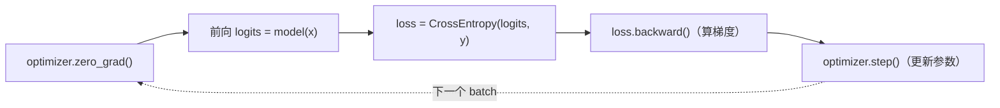

前三步已经把零件都准备好了：**模型**（LeNet-5，第 2 步）、**数据**（DataLoader，第 3 步）、
**损失函数**（交叉熵，实验四推导过）。这一讲把它们接起来，写出训练循环：

```text
for epoch in 1..E:
    train_one_epoch()   # 训练集上每个 batch 更新一次参数
    evaluate()          # 验证集上只评估，不更新
    记录指标，保存验证最优的模型参数
```

学完这一讲，你要能回答：

1. 一个训练 step 里 `zero_grad → forward → loss → backward → step` 这五步各自在做什么？为什么不能乱序？
2. `model.train()` 和 `model.eval()` 有什么区别？在 `evaluate` 里为什么必须用 `torch.no_grad()`？
3. 怎么保证实验可复现？`set_seed` 之外还要注意什么？
4. 为什么要保存"验证集准确率最高"的那一轮，而不是最后一轮？

---

## 1. 三个术语：epoch / batch / iteration

- **batch**：一次前向 + 反向用到的样本数（本实验 64）；
- **iteration / step**：参数更新一次，就是处理一个 batch；
- **epoch**：把训练集完整过一遍。

训练池 54,001 张、batch=64 时：每个 epoch 有 $\lceil 54001/64\rceil = 844$ 个 step（第 3 步例 4 算过）。
所以 **1 epoch = 844 次参数更新**。

---

## 2. 一个 step 的五步



**第 1 步：`zero_grad()`。** PyTorch 的梯度是**累加**的（`.grad += 新梯度`），不是覆盖。
上一个 batch 的梯度如果没有清掉，这一步就会把两次的梯度加起来，更新方向就错了。

**第 2 步：前向。** `logits = model(x)`，得到 `(B, 10)` 的分数。

**第 3 步：损失。** `loss = CrossEntropyLoss()(logits, y)`。**传 logits，不要先 softmax**。

**第 4 步：反向。** `loss.backward()` 自动计算每个参数的梯度，写进 `param.grad`。

**第 5 步：更新。** `optimizer.step()` 用梯度更新参数；Adam/SGD 都在这里完成。

然后进入下一个 batch，重复到整个训练集走完，就是一个 epoch。

---

## 3. 损失、准确率与优化器

### 3.1 交叉熵

设模型对某个样本输出 logits $z\in\mathbb{R}^{10}$，真实类别为 $y$：

$$
p_c=\frac{e^{z_c}}{\sum_{j=1}^{10}e^{z_j}},\qquad
L=-\log p_y .
$$

### 3.2 准确率

$$
\text{acc}=\frac{1}{N}\sum_{n=1}^{N}\mathbb{1}\left[\arg\max_c\, z_{n,c}=y_n\right].
$$

### 3.3 SGD 与 Adam

SGD（本实验还会用到 momentum 版）：

$$
\theta_{t+1}=\theta_t-\eta\nabla_\theta L(\theta_t).
$$

Adam 维护梯度的一阶矩 $m_t$ 和二阶矩 $v_t$，并做偏差修正：

$$
m_t=\beta_1 m_{t-1}+(1-\beta_1)g_t,\quad
v_t=\beta_2 v_{t-1}+(1-\beta_2)g_t^2,
$$

$$
\theta_{t+1}=\theta_t-\eta\frac{m_t/(1-\beta_1^t)}{\sqrt{v_t/(1-\beta_2^t)}+\epsilon},
$$

其中 $\beta_1=0.9$、$\beta_2=0.999$、$\epsilon=10^{-8}$。**Adam 的特点是：不管梯度整体多大，
它先把每个参数的更新量级归一化到约 $\eta$**——这是实验五里"Sigmoid + SGD 学不动、换 Adam 就能学"的原因（第 2 讲会用到）。

---

## 4. 手算例题

### 例 1：单样本的 softmax + 交叉熵

**题目。** 某个样本的 logits $z=[2.0,\ 1.0,\ 0.1]$，真实类别 $y=0$。求 loss。

**第 1 步：算三个指数。**
$e^{2.0}=7.389056$，$e^{1.0}=2.718282$，$e^{0.1}=1.105171$。

**第 2 步：分母。**
$7.389056+2.718282+1.105171=11.212509$。

**第 3 步：softmax。**
$p_0=7.389056/11.212509=0.659001$，
$p_1=2.718282/11.212509=0.242433$，
$p_2=1.105171/11.212509=0.098566$。
三者和 $=1$，验算通过。

**第 4 步：交叉熵。**
$L=-\ln p_0=-\ln 0.659001=0.41703$。

**第 5 步：预测与准确率。** $\arg\max p=0=y$，这个样本预测正确。

### 例 2：一个 batch 的平均损失与准确率

**题目。** 4 个样本、3 个类别，logits 与标签如下：

| 样本 | $z_0$ | $z_1$ | $z_2$ | 真实标签 |
|---|---|---|---|---|
| 0 | 2.0 | 0.5 | 0.1 | 0 |
| 1 | 0.1 | 1.5 | 0.2 | 1 |
| 2 | 0.2 | 0.1 | 0.8 | 2 |
| 3 | 0.1 | 0.2 | 2.0 | 0 |

**第 1 步：逐样本 softmax（直接给结果）。**

| 样本 | $p_0$ | $p_1$ | $p_2$ | 预测 |
|---|---|---|---|---|
| 0 | 0.7285 | 0.1625 | 0.1090 | 0 ✓ |
| 1 | 0.1623 | 0.6583 | 0.1794 | 1 ✓ |
| 2 | 0.2683 | 0.2428 | 0.4889 | 2 ✓ |
| 3 | 0.1138 | 0.1257 | 0.7605 | 2 ✗ |

**第 2 步：逐样本 loss $=-\ln p_y$。**
样本 0：$-\ln 0.7285=0.316779$；
样本 1：$-\ln 0.6583=0.418137$；
样本 2：$-\ln 0.4889=0.715592$；
样本 3：$-\ln 0.1138=2.173736$。

**第 3 步：平均 loss。**
$(0.316779+0.418137+0.715592+2.173736)/4=3.624244/4=0.906061$。

**第 4 步：准确率。** 4 个里对 3 个：$3/4=0.75$。

**第 5 步：注意。** 平均 loss 是"每个样本 loss 的算术平均"，准确率是"预测对的比例"，两者的分母都是 4。
实现时用 `total_loss += loss.item() * batch_size` 再除以总样本数，就是为了处理最后一个不满的 batch。

### 例 3：Adam 第一步到底更新多少

**题目。** 某参数当前梯度 $g_1=0.5$，学习率 $\eta=10^{-3}$，第一次更新（初始 $m_0=v_0=0$）。

**第 1 步：一阶矩。**
$m_1=(1-\beta_1)g_1=0.1\times0.5=0.05$。

**第 2 步：二阶矩。**
$v_1=(1-\beta_2)g_1^2=0.001\times0.25=0.00025$。

**第 3 步：偏差修正。**
$\hat m_1=m_1/(1-0.9)=0.05/0.1=0.5$；
$\hat v_1=v_1/(1-0.999)=0.00025/0.001=0.25$。

**第 4 步：更新量。**
$\Delta\theta=\eta\cdot\hat m_1/(\sqrt{\hat v_1}+\epsilon)=10^{-3}\times0.5/(0.5+10^{-8})\approx10^{-3}$。

**第 5 步：结论。** 第一步的更新量几乎正好等于学习率 1e-3，**与梯度大小 0.5 无关**。
如果梯度变成 0.05 或 5，只要是小批量下的稳定梯度，Adam 的更新量级仍约为 $\eta$——这就是"自适应步长"。

### 例 4：训练时间怎么估

**实测数据（来自实验五主实验）：** LeNet-5 现代结构、全量 54,001 张、batch=64，10 个 epoch 的耗时分别为
3.06 / 2.89 / 2.92 / 2.81 / 3.97 / 3.01 / 3.31 / 3.19 / 3.17 / 3.16 秒，
平均 $3.148$ 秒/epoch（包含每轮的验证集评估）。

**第 1 步：每个 step 的平均耗时。**
$3.148/844\approx0.00373$ 秒 $\approx3.7$ ms（含验证评估分摊）。

**第 2 步：8 个 epoch 要多久。** $8\times3.148\approx25.2$ 秒。

**第 3 步：和 CPU 对比。** 实验四的 MLP 在 CPU 上跑一次 MNIST 全量要数十秒到几分钟；
CNN 在 GPU 上 25 秒能训练 8 轮，这就是为什么第 4 步开始所有实验都用 GPU。

### 例 5：为什么要恢复"验证最优"的模型

**题目。** 3 个 epoch 的验证准确率分别是 $[0.960,\ 0.972,\ 0.965]$。

**第 1 步：找最优。** $\max=0.972$，出现在第 2 个 epoch。

**第 2 步：最后一轮的参数。** 第 3 轮验证准确率回落到 0.965，说明第 2 轮之后开始过拟合。

**第 3 步：正确做法。** 每轮验证后如果当前最优，就
`best_state = copy.deepcopy(model.state_dict())`；训练结束再 `model.load_state_dict(best_state)`。
这样最终报告的模型是**第 2 轮**的参数，不是第 3 轮。

**第 4 步：验收方法。** 恢复之后重新 `evaluate` 验证集，准确率应等于 history 里的 `best_val_acc`（0.972）。

---

## 5. 代码结构

```
set_seed(seed)                   # 固定随机源
device = get_device()            # cuda / cpu
model = LeNet5().to(device)
optimizer = make_optimizer(model, "adam", lr=1e-3)
criterion = nn.CrossEntropyLoss()

for epoch in range(1, epochs + 1):
    tr_loss, tr_acc = train_one_epoch(model, train_loader, optimizer, criterion, device)
    va_loss, va_acc = evaluate(model, val_loader, criterion, device)
    # 记录 history；若 va_acc 创新高，保存 best_state
model.load_state_dict(best_state)   # 恢复验证最优参数
```

`train_one_epoch` 和 `evaluate` 的差别只有三点：

| | `train_one_epoch` | `evaluate` |
|---|---|---|
| 模式 | `model.train()` | `model.eval()` |
| 梯度 | `loss.backward()` + `optimizer.step()` | `torch.no_grad()`，不反向 |
| 随机性 | Dropout 生效、数据随机打乱 | Dropout 关闭、不打乱 |

`model.train()` / `model.eval()` 现在对 LeNet-5 还没有可见影响（没有 Dropout/BN），
但第 5 步加 Dropout、第 6 步加 BN 后，忘记切换模式会导致验证结果完全不对，所以从现在起养成习惯。

---

## 6. GPU 训练的三个注意点

1. **模型和数据必须在同一设备上**：`model.to(device)`，每个 batch `x.to(device)`、`y.to(device)`。
   只搬一个会报 `Expected all tensors to be on the same device`。
2. **每轮计时**：在 epoch 循环里用 `time.perf_counter()` 记录起止时间，方便后面比较不同配置。
3. **别把整份数据一次性搬上 GPU 再乱序**：实验五的 54,001 张 float32 只要 161.5 MiB，其实放得下，
   但标准做法仍然是 CPU 上 DataLoader 取 batch、再逐批搬到 GPU；换更大的数据集时才不用改代码。

另外，如果机器上还有别的进程在抢 GPU（比如另一个训练任务），你的 epoch 时间会显著变长。
做耗时对比实验前先 `nvidia-smi` 看一眼，别把"别人占着卡"误判成"这个配置慢"。

---

## 7. 可复现性

1. `set_seed(seed)`：Python、NumPy、PyTorch、CUDA 四处都设；
2. DataLoader 的 `shuffle=True` 要传固定 `generator`（第 3 步）；
3. `torch.backends.cudnn.deterministic = True` 可以强制确定性算法（会稍慢），实验五的 `engine.set_seed` 里就这么做了；
4. 同一配置重复运行要得到相同结果；如果你发现两次不一样，先检查有没有漏设种子或用了未固定的 DataLoader。

---

## 8. 常见坑

1. **忘 `zero_grad`**：梯度累积，更新方向错，loss 抖动。
2. **`zero_grad` 放在 backward 之后**：这一步的梯度还没用就被清了，参数永远不更新。
3. **评估时忘 `model.eval()`/`no_grad`**：有 Dropout/BN 时结果错，且浪费显存和计算。
4. **评估时调用了 `optimizer.step()`**：验证集被"训练"了，指标虚高。
5. **把 loss 张量直接存进 list**：每个 loss 都带计算图，显存越跑越大；用 `loss.item()`。
6. **batch 最后一个不满时平均算错**：要用"loss × 本 batch 样本数"再除以总样本数。
7. **模型在 CPU、数据在 GPU**（或反过来）：device 不一致报错。
8. **忘了 `.to(device)`**：大模型在 CPU 上训，慢到怀疑人生。
9. **用训练集的 loss 判断模型好坏**：应该看验证集；训练 loss 一直降不代表模型变好。
10. **保存了最后一轮而不是验证最优轮**：最终报告用了过拟合的参数（例 5）。
11. **学习率写错量级**：Adam 常用 1e-3，SGD 常用 0.01~0.1；写反了会不收敛或几乎不动。
12. **算准确率时用 softmax 后再 argmax**：softmax 不改变大小顺序，但多算一步；直接对 logits 取 argmax 即可。

---

## 9. 本步任务

打开 `practice/step04_train.py`，填 6 个 `TODO`：

| TODO | 任务 | 验收 |
|---|---|---|
| 1 | `set_seed` | 同 seed 参数相同、不同 seed 不同 |
| 2 | `get_device` | cuda 可用时 cuda，否则 cpu |
| 3 | `make_optimizer` | sgd / momentum / adam / adamw 四种 |
| 4 | **`train_one_epoch`** | 返回 float、两轮后 loss 下降、参数被更新 |
| 5 | `evaluate` | 返回 float、参数不变、不产生梯度 |
| 6 | **`fit`** | history 完整、loss 下降、best 参数被恢复 |

运行：

```bash
cd experiment5/learn/practice
python step04_train.py
```

全部通过会看到 `6/6 PASS`，大约 10 秒（CPU 上跑 2000 张小子集；真实训练在 GPU 上快得多）。

### 思考题（发我时写一句答案）

1. 如果忘了 `optimizer.zero_grad()`，连续两个 batch 的梯度会变成什么？参数更新方向为什么会错？
2. `evaluate` 里如果不写 `torch.no_grad()`，结果会错吗？会浪费什么？加上 `model.eval()` 又是为了什么？
3. `fit` 里为什么要 `copy.deepcopy(model.state_dict())` 而不是直接 `best_state = model.state_dict()`？
4. 54,001 张训练图、batch=64 时一个 epoch 有多少次参数更新？batch=128 时呢？

### 提交什么给我

1. `6/6 PASS` 的完整输出；
2. 你写的 `train_one_epoch` 和 `fit` 两个函数；
3. 一句"哪里最别扭/最不确定"；
4. 四个思考题的一句话答案。
