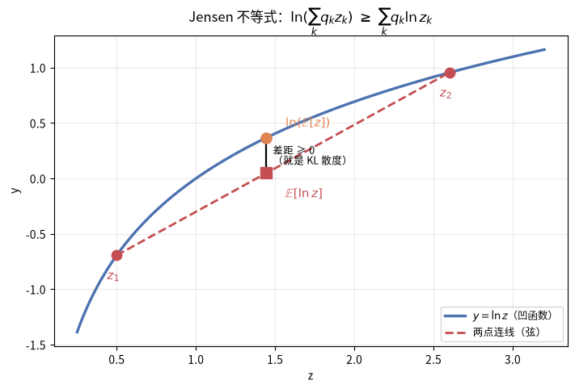
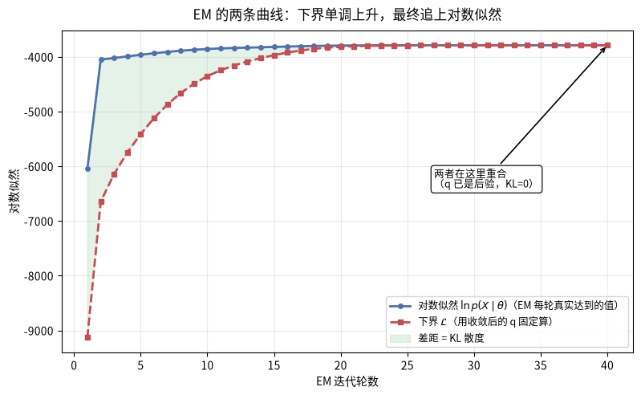
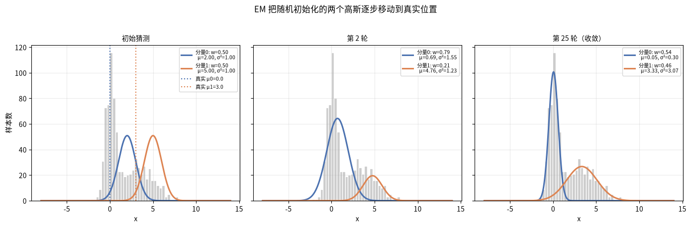

答案叫 **EM 算法**（Expectation-Maximization，期望最大化）。它的思路是**先构造一个更容易最大化的下界，再反复抬高这个下界**，绕开直接最大化困难目标函数这一步。这一讲的重点是搞清两件事：为什么需要下界、以及为什么反复抬高下界就能抬高原来的目标。

## 1. 困难到底在哪

参数估计的标准做法是**最大似然**：找出使观测数据出现概率最大的那组参数。GMM 的似然是对数域上的

$$
\ln p(X\mid\theta)=\sum_{n=1}^{N}\ln\left(\sum_{k=1}^{K}\pi_k\,\mathcal N(x_n\mid\mu_k,\Sigma_k)\right)
$$

如果每个点的 $z_n$（来自哪个分量）已知，问题会变得非常简单——直接按分组统计就能得到闭式解（讲义 05 第 5 节写过）。所以困难完全来自"$\ln$ 里面还有一个 $\sum_k$"这个结构。

想象一下直接对 $\mu_k$ 求导会发生什么。链式法则会给出

$$
\frac{\partial}{\partial\mu_k}\ln p(X\mid\theta)=\sum_{n=1}^{N}\frac{1}{\sum_j\pi_j\mathcal N(x_n\mid\mu_j,\Sigma_j)}\cdot\pi_k\frac{\partial\mathcal N(x_n\mid\mu_k,\Sigma_k)}{\partial\mu_k}
$$

分母上出现了 $\sum_j\pi_j\mathcal N(x_n\mid\mu_j,\Sigma_j)$，也就是**所有**分量的贡献。这意味着 $\mu_k$ 的方程里含有 $\mu_j\ (j\ne k)$——**参数互相耦合，解不开**。这就是讲义 05 说的"鸡生蛋"在数学上的表现。

```text
直接最大化 ln p(X|θ)
  → 对数里有求和
  → 求导后分母包含所有分量
  → 参数互相耦合，无闭式解

EM 的绕法
  → 构造下界 L(q,θ) ≤ ln p(X|θ)
  → 下界里对数在求和内部，好求导
  → 反复抬高下界，间接抬高似然
```

## 2. Jensen 不等式给出的下界

要绕开"对数里有求和"，需要一个能把 $\ln\sum$ 换成 $\sum\ln$ 的工具。这正是 **Jensen 不等式**：因为 $\ln$ 是**凹函数**（开口向下），所以"先平均再取对数"永远不小于"先取对数再平均"：

$$
\ln\left(\sum_k q_k z_k\right)\ \ge\ \sum_k q_k\ln z_k\qquad\text{其中 } q_k\ge0,\ \sum_k q_k=1
$$

几何上就是"弦在曲线下方"：曲线 $y=\ln z$ 上任取两点连一条弦，弦上任意一点的纵坐标都不超过曲线上对应点的纵坐标。



这张图里取 $z_1=0.5$、$z_2=2.6$、权重 $q=(0.55,0.45)$：$\ln(\mathbb E[z])=0.3681$，而 $\mathbb E[\ln z]=0.0487$，两者相差 **0.3194**。**这个差距有确切含义**——它就是下一节要说的 KL 散度。而且注意：**当且仅当所有取到非零权重的 $z_k$ 都相等时，差距为零**（那时弦与曲线相切）。

现在把 Jensen 用到 GMM 的似然上。对每个样本 $x_n$ 引入一组**任意的**权重 $q_{nk}$（满足 $q_{nk}\ge0$、$\sum_k q_{nk}=1$），在 $\ln$ 里面乘上它再除掉它（值不变）：

$$
\ln p(x_n\mid\theta)=\ln\sum_{k=1}^{K}q_{nk}\cdot\frac{\pi_k\mathcal N(x_n\mid\mu_k,\Sigma_k)}{q_{nk}}
$$

现在 $\ln$ 里面是"以 $q_{nk}$ 为权重的加权平均"，可以直接用 Jensen：

$$
\ln p(x_n\mid\theta)\ \ge\ \sum_{k=1}^{K}q_{nk}\ln\frac{\pi_k\mathcal N(x_n\mid\mu_k,\Sigma_k)}{q_{nk}}
$$

对全部样本求和，得到一个**下界**（通常记作 $\mathcal L$ 或 ELBO）：

$$
\mathcal L(q,\theta)=\sum_{n=1}^{N}\sum_{k=1}^{K}q_{nk}\Big[\ln\pi_k+\ln\mathcal N(x_n\mid\mu_k,\Sigma_k)-\ln q_{nk}\Big]\ \le\ \ln p(X\mid\theta)
$$

**这个下界有两个关键好处。** 第一，$\ln$ 现在在求和**里面**了——对 $\mu_k$ 求导时不会再出现"所有分量之和"在分母上的情况，参数解耦了。第二，$q$ 是我们可以自由选择的：对任意 $q$ 这个不等式都成立，所以可以专门挑一个让下界尽可能接近真实似然的 $q$。

### 2.1 下界与似然的差距就是 KL 散度

把差距写出来（这个推导值得跟着走一遍，它解释了 EM 每一步在干什么）：

$$
\begin{aligned}
\ln p(X\mid\theta)-\mathcal L(q,\theta)
&=\sum_{n=1}^{N}\sum_{k=1}^{K}q_{nk}\ln\frac{q_{nk}}{p(z_n=k\mid x_n,\theta)}\\
&=\mathrm{KL}\big(q(Z)\,\big\|\,p(Z\mid X,\theta)\big)
\end{aligned}
$$

第一步是把 $\ln p(X\mid\theta)=\sum_n\ln p(x_n\mid\theta)$ 里的 $\ln p(x_n)$ 用贝叶斯公式写成 $\ln p(x_n,z_n=k)-\ln p(z_n=k\mid x_n)$，第二步整理成 KL 散度的形式。

**KL 散度恒非负**，所以下界永远不超过真实似然；而且**当且仅当 $q$ 等于真实后验时差距为零**。这句话就是 EM 算法的全部设计依据。

## 3. EM 的两步

有了下界，交替优化就顺理成章了：**E 步选 $q$ 让下界贴紧似然，M 步选 $\theta$ 把下界抬到最高。**

### 3.1 E 步：让下界贴紧

固定当前参数 $\theta^{(t)}$，要选一个 $q$ 使下界最大。根据 2.1 节，下界与似然的差距是 KL 散度，而 KL 最小（为 0）当且仅当 $q$ 等于后验。所以最优选择是

$$
q_{nk}=p(z_n=k\mid x_n,\theta^{(t)})=\frac{\pi_k^{(t)}\mathcal N(x_n\mid\mu_k^{(t)},\Sigma_k^{(t)})}{\sum_j\pi_j^{(t)}\mathcal N(x_n\mid\mu_j^{(t)},\Sigma_j^{(t)})}
$$

**这正是讲义 05 定义的责任度 $\gamma_{nk}$。** 所以 E 步（Expectation，期望）的名字来源是：它算的是完全数据对数似然的**期望**（对 $z$ 的分布取期望），而那个期望里的权重就是责任度。

E 步之后，$\mathcal L$ 和 $\ln p(X\mid\theta)$ **恰好相等**（KL=0）。这一点很关键，它是下一节单调性证明的第一步。

### 3.2 M 步：把下界抬到最高

固定 $q_{nk}=\gamma_{nk}$，对 $\theta$ 最大化 $\mathcal L$。好消息是这一步有闭式解。

**更新均值 $\mu_k$。** 只有二次项里的 $\mu_k$ 起作用，对 $\mu_k$ 求导并令其为零：

$$
\sum_{n=1}^{N}\gamma_{nk}(x_n-\mu_k)=0\quad\Longrightarrow\quad \mu_k^{\text{new}}=\frac{\sum_n\gamma_{nk}x_n}{\sum_n\gamma_{nk}}
$$

**这个公式和 k-means 的中心更新形式完全相同**，唯一的区别是权重从 0/1 换成了连续的责任度。记 $N_k=\sum_n\gamma_{nk}$（第 $k$ 个分量的**有效样本数**），上式就是"责任度加权的平均位置"。

**更新方差 $\Sigma_k$。** 同样求导得到

$$
\Sigma_k^{\text{new}}=\frac{1}{N_k}\sum_{n=1}^{N}\gamma_{nk}(x_n-\mu_k^{\text{new}})(x_n-\mu_k^{\text{new}})^{\mathsf T}
$$

一维情形就是 $\sigma_k^2=\frac{1}{N_k}\sum_n\gamma_{nk}(x_n-\mu_k)^2$——责任度加权的方差。注意**必须用刚更新过的 $\mu_k$**：用旧均值不会报错，但会让对数似然在若干轮后开始下降（这是最常见的实现错误，讲义 07 会专门讲）。

**更新混合系数 $\pi_k$。** 这一项带约束 $\sum_k\pi_k=1$用拉格朗日乘子处理，结果是

$$
\pi_k^{\text{new}}=\frac{N_k}{N}
$$

含义很直观：第 $k$ 个分量占的比例等于它分担到的有效样本数占全部样本的比例。

```text
初始化 π, μ, Σ
  → E 步：算责任度 γ_nk（软归属）
  → M 步：用 γ 当权重更新 π, μ, Σ
  → 对数似然仍在明显变化？
       是 → 回到 E 步
       否 → 收敛
```

**注意 EM 与 k-means 的对应关系**：两者的结构完全一样，都是"算归属 → 更新参数 → 再算归属"。区别只在归属是硬的（0/1）还是软的（责任度），以及参数里多了一组 $\Sigma_k$ 和 $\pi_k$。讲义 05 说过 k-means 是 GMM 在等方差各向同性且方差趋于 0 时的极限，这里又看到一次：**k-means 就是硬分配的 EM**。

## 4. 为什么对数似然一定不下降

这是 EM 最重要的性质，也是它比"随便交替优化"可靠的地方。证明只需要三步不等式，每一句都能对应到具体的计算：

$$
\ln p(X\mid\theta^{(t+1)})\ \overset{(1)}{\ge}\ \mathcal L(q^{(t)},\theta^{(t+1)})\ \overset{(2)}{\ge}\ \mathcal L(q^{(t)},\theta^{(t)})\ \overset{(3)}{=}\ \ln p(X\mid\theta^{(t)})
$$

三句话分别解释：

**(1) 下界永远不超过似然。** 这是 Jensen 不等式给的，对任意 $q$ 和 $\theta$ 都成立，与具体取值无关。

**(2) M 步让下界不降。** 因为 M 步的定义就是"固定 $q$，找使 $\mathcal L$ 最大的 $\theta$"，所以换到 $\theta^{(t+1)}$ 之后下界只可能更高或持平。

**(3) E 步让下界贴紧似然。** E 步取 $q$ 等于后验，此时 KL 散度为 0，下界与似然相等。这一步用的是 $\theta^{(t)}$，所以等号右边是 $\ln p(X\mid\theta^{(t)})$。

三步串起来就是 $\ln p(X\mid\theta^{(t+1)})\ge\ln p(X\mid\theta^{(t)})$——**每一轮迭代，对数似然都不会下降**。于是迭代一定会收敛（有上界且单调，加上参数空间的实际有限性）。和 k-means 一样，这保证的是收敛到**局部**最优，不保证全局最优。

### 4.1 用真实的曲线看这件事

下面在一维两分量的数据上（讲义 05 那份：$\mu=(0,3)$、$\sigma^2=(0.25,4)$、权重各 0.5，2000 个样本）从随机初始值 $\mu=(2,5)$、$\sigma^2=(1,1)$ 跑 40 轮 EM：



实线是**每轮真实达到的对数似然** $\ln p(X\mid\theta^{(t)})$，从 $-6046.1$ 升到 $-3789.4$，**逐轮单调不降**。虚线是**下界** $\mathcal L$，从 $-9129.7$ 一路升上来，最后与实线重合。

关于虚线要说明一下它的画法：按定义，E 步之后下界与似然相等，所以如果每轮都用当轮的 $q$ 去算下界，这条虚线和实线会完全重合（我验算过，两者之差在 $10^{-13}$ 量级）。为了让"下界"这个概念在图上看得见，这条虚线是**用收敛后的责任度作为固定的 $q$**、去评估每一轮的参数算出来的。这样画出来是一条**全程有效**的下界（任意 $\theta$ 都满足 $\mathcal L\le\ln p$），并且在最后一轮恰好与似然相等。阴影部分就是 §2.1 那个 KL 散度——它随迭代单调缩小到零。

这张图把 EM 的机制说清楚了：**我们实际上无法直接最大化那条实线（因为求不出解析解），只能通过反复抬高虚线来间接把它顶上去。**

### 4.2 分量怎么移动

同一份数据、同样的随机起点，把两个高斯分量在迭代中的位置画出来：



初始猜测是 $\mu=(2,5)$、$\sigma^2=(1,1)$（左图，两个宽度相同的高斯，位置都不对）。第 2 轮（中图）两个分量已经分别跑到了两个峰附近，但形状还不对——第一个分量的 $\sigma^2$ 还是 1.55，而真实值只有 0.25。到第 40 轮（右图）收敛：

| 参数 | 初始猜测 | 第 40 轮 | 真实值 |
|---|---|---|---|
| $\mu$ | (2.00, 5.00) | (−0.006, 2.919) | (0.00, 3.00) |
| $\sigma^2$ | (1.00, 1.00) | (0.256, 4.095) | (0.25, 4.00) |
| $\pi$ | (0.50, 0.50) | (0.492, 0.508) | (0.50, 0.50) |

参数恢复得很好。**注意 $\sigma^2$ 的变化比 $\mu$ 慢得多**：中图里位置已经基本对了，但方差还在从 1.0 向 0.25 和 4.0 分化。实测下来第二个分量的均值第 10 轮就精确到小数点后两位了，而它的方差要到**第 37 轮**才稳定到三位小数（$\sigma^2$ 从 1.0 慢慢爬到 4.095，真值是 4.0）。一般规律是**方差和协方差需要更多轮迭代才能收敛**，因为它们对责任度的细微变化更敏感。这一点在真实数据上会更明显。

顺带一个有意思的现象：收敛后的 $\mu=(−0.006, 2.917)$ 和真实值 $(0, 3)$ 有微小偏差，而（对这份模拟数据）收敛后的对数似然 $-3789.39$ 甚至**略优于**真实参数的值 $-3790.18$。这不是 bug——EM 求的是**这份样本**的最大似然解，而有限样本下最大似然解不等于生成参数。这和讲义 03 实验三里"估计参数应精确等于经验统计量、而不是设定值"是同一件事。

## 5. 使用 EM 时必须知道的几件事

**初始化决定落到哪个解。** EM 只保证收敛到局部最优，和 k-means 一样对初始值敏感。实践中常用的初始化是：用 k-means 的结果作为初始均值，协方差统一取全体数据的协方差，$\pi_k=1/K$。

**奇异性问题。** 如果某个分量的均值恰好落在某一个样本上、而它的方差趋于 0，那个样本的密度会趋于无穷，对数似然可以发散到 $+\infty$。这是模型退化，并不表示找到了更好的解。必须用协方差正则化（给 $\Sigma_k$ 加一个小量 $\epsilon I$）或方差下限来防止。

**收敛判据用相对变化量。** 对数似然的绝对大小随样本量增长，所以判断"是否收敛"要看 $\lvert\Delta\mathcal L\rvert/\lvert\mathcal L\rvert$，而不是绝对差值。同时设一个最大迭代次数兜底。

**空分量。** 如果某个分量的 $N_k$ 降到接近 0，它的 $\pi_k$ 归零，此后永远无法复活（因为责任度的分子里有 $\pi_k$）。要检测并重置这类分量。

**数值上必须在对数域算。** 讲义 04 已经讲清原因（密度乘积会溢出或下溢）；责任度的计算要用 log-sum-exp 技巧，这也是练习 05 练习 1 的内容。

## 6. 本讲小结

GMM 的参数估计之所以难，是因为对数似然里"$\ln$ 套着 $\sum_k$"，求导后参数互相耦合。EM 的解法是**不直接最大化似然，而是构造一个下界再抬高它**：用 Jensen 不等式把 $\ln\sum$ 变成 $\sum\ln$，得到 $\mathcal L(q,\theta)\le\ln p(X\mid\theta)$，而且下界与似然的差距恰好是 KL 散度。

于是两步交替：**E 步**固定参数、取 $q$ 等于后验（也就是讲义 05 的**责任度**），此时下界贴紧似然；**M 步**固定 $q$、最大化下界，得到三个闭式更新公式——均值是责任度加权的平均位置、方差是责任度加权的方差、混合系数是有效样本比例。M 步的均值公式和 k-means 的中心更新**形式完全相同**，区别只是权重从 0/1 变成连续值。

**单调性**由三步不等式保证：下界 ≤ 似然（Jensen）、M 步抬高下界、E 步让下界贴紧似然，串起来就是对数似然逐轮不降。实测一维数据上从 $−6046.1$ 单调升到 $−3789.4$，参数恢复到 $\mu=(−0.006, 2.919)$、$\sigma^2=(0.256, 4.095)$，与真值 $(0,3)$、$(0.25,4)$ 相符。但要记住：和 k-means 一样，这只保证**局部**最优；此外还有奇异性、空分量、数值下溢这几个必须在实现里处理的问题（讲义 07 展开）。
