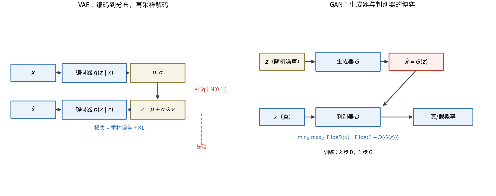

判别模型学 $P(y\mid x)$，生成模型学 $P(x)$ 或 $P(x,y)$。学 $P(x)$ 的好处是能采样新样本、能做密度估计、能半监督与异常检测。这一讲讲三条路线：自编码器（学一个能重构输入的编码）、变分自编码器（把编码压成分布，用变分下界训练）、生成对抗网络（用判别器当损失）。每个公式后面都配逐步手算，共六个算例。

## 1 判别式与生成式

| | 判别式 | 生成式 |
|---|---|---|
| 学什么 | $P(y\mid x)$ | $P(x)$ 或 $P(x,y)$ |
| 代表 | Logistic、SVM、CNN 分类 | 朴素贝叶斯、GMM、VAE、GAN |
| 能采样 | 不能 | 能 |
| 需要的数据 | 标注 | 可以无标注 |

生成模型的核心困难：$P(x)$ 是极高维的密度，直接建模与归一化都不可行。三种绕法对应这一讲的三节：

- 自编码器：不建模密度，只要求"编码再解码能还原"；
- VAE：建模潜变量 $z$，用变分下界绕开不可解的积分；
- GAN：不建模密度，用判别器提供"像不像"的梯度。

## 2 自编码器

结构是"编码器—解码器"：

$$
h=f_\theta(x),\qquad \hat x=g_\phi(h),
$$

损失是重构误差 $L=\lVert x-\hat x\rVert^2$。中间层维度小于输入时叫欠完备，网络被迫学压缩表示；大于输入时是过完备，可能学成恒等映射，需要加噪声或稀疏约束（去噪自编码器、稀疏自编码器）。

**手算 1：线性自编码器的一次更新.** 取一维输入 $x=2$，编码 $h=wx$，解码 $\hat x=vh$，初始 $w=0.5$、$v=1.5$，学习率 $0.1$。

前向：$h=0.5\times2=1$，$\hat x=1.5\times1=1.5$，损失

$$
L=(1.5-2)^2=0.25 .
$$

梯度（链式法则）：

$$
\frac{\partial L}{\partial v}=2(\hat x-x)h=2\times(-0.5)\times1=-1,
$$

$$
\frac{\partial L}{\partial w}=2(\hat x-x)\,v\,x=2\times(-0.5)\times1.5\times2=-3 .
$$

更新：

$$
v\leftarrow1.5-0.1\times(-1)=1.6,
\qquad
w\leftarrow0.5-0.1\times(-3)=0.8 .
$$

再前向一次：$h=1.6$、$\hat x=2.56$，损失 $(0.56)^2=0.3136$——比上一轮大。为什么？学习率对 $w$ 来说偏大，一步从 $0.5$ 跳到 $0.8$，越过了最优点附近。这正是"AE 训练不稳"的一个微型例子。

**线性 AE 与 PCA 的关系.** 若编码解码都是线性的、损失是平方误差，则最优的 $h$ 张成输入的主成分子空间（PCA）。所以线性 AE 可以看作"用梯度下降学 PCA"，非线性 AE 是它的推广。

**两种常见的约束.** 去噪自编码器把输入加噪再要求重构原始输入，网络学到的编码对噪声更鲁棒；稀疏自编码器在损失里加 $\lambda\lVert h\rVert_1$，迫使大多数编码单元为零。

**手算 1.5：用重构误差做异常检测.** 在正常样本上训练 AE 后，正常样本的重构误差约 $0.01$，异常样本（从未见过的类别）约 $0.25$。取阈值 $0.1$，则 $0.25>0.1$ 判为异常。这个方法的问题也在这里：阈值是人为定的，且异常样本若与正常样本相似就会漏检。

## 3 变分自编码器

**潜变量模型.** 假设数据由潜变量生成：$z\sim p(z)=\mathcal N(0,I)$，$x\sim p_\theta(x\mid z)$。要算 $p(x)=\int p(x\mid z)p(z)\mathrm dz$，这个积分对所有 $z$ 不可解，后验 $p(z\mid x)$ 也不可解。

**变分近似.** 用一个可解的网络 $q_\phi(z\mid x)$（编码器）近似后验，然后

$$
\ln p(x)=\ln\int q_\phi(z\mid x)\frac{p_\theta(x,z)}{q_\phi(z\mid x)}\mathrm dz
\ \ge\ \int q_\phi(z\mid x)\ln\frac{p_\theta(x,z)}{q_\phi(z\mid x)}\mathrm dz .
$$

不等号是 Jensen：$\ln\mathbb E[\cdot]\ge\mathbb E[\ln\cdot]$，因为 $\ln$ 是凹函数。右边拆开：

$$
\mathbb E_{q}\Bigl[\ln\frac{p_\theta(x\mid z)p(z)}{q_\phi(z\mid x)}\Bigr]
=\underbrace{\mathbb E_q[\ln p_\theta(x\mid z)]}_{\text{重构项}}
-\underbrace{\mathrm{KL}\bigl(q_\phi(z\mid x)\,\Vert\,p(z)\bigr)}_{\text{正则项}} .
$$

这个下界叫 ELBO。最大化 ELBO = 让重构变好（第一项大）且让编码分布贴近先验（第二项小）。训练时最小化负 ELBO：

$$
\mathcal L=-\mathbb E_q[\ln p_\theta(x\mid z)]+\mathrm{KL}(q_\phi(z\mid x)\Vert p(z)).
$$

**KL 的显式公式.** 取 $q=\mathcal N(\mu,\sigma^2)$、$p=\mathcal N(0,1)$（一维）：

$$
\mathrm{KL}=\frac12\bigl(\mu^2+\sigma^2-1-\ln\sigma^2\bigr).
$$

**手算 2：KL 项.** $\mu=0.5$、$\sigma^2=0.25$：

$$
\mathrm{KL}=\frac12(0.25+0.25-1-\ln0.25)=\frac12(-0.5+1.3863)=0.4431 .
$$

两种极端核对：$\mu=1,\sigma^2=1$ 时 KL $=0.5$；$\mu=0,\sigma^2=4$ 时 KL $=0.5(0+4-1-\ln4)=0.5(3-1.3863)=0.8069$。先验没匹配上，惩罚就大。

**高斯解码器下的重构项.** 若解码器输出 $\mathcal N(\mu_x,\sigma_x^2)$ 而不是伯努利，重构项是

$$
-\ln p(x\mid z)=\frac12\ln(2\pi\sigma_x^2)+\frac{(x-\mu_x)^2}{2\sigma_x^2}.
$$

取 $x=1$、$\mu_x=0.8$、$\sigma_x^2=0.25$：

$$
\frac12\ln(2\pi\times0.25)=\frac12\ln1.5708=0.2258,
\qquad
\frac{(1-0.8)^2}{2\times0.25}=\frac{0.04}{0.5}=0.08,
$$

合计 $0.3058$。与伯努利版本（$0.2231$）不同，高斯版本还要付方差项的代价——方差太大或太小都会被惩罚。

**二维的 KL.** 对角高斯对标准正态的 KL 是各维之和。取 $\mu=(0.5,1.0)$、$\sigma^2=(0.25,1.0)$：

$$
0.4431+0.5=0.9431 .
$$

**重参数化.** 采样 $z\sim\mathcal N(\mu,\sigma^2)$ 这一步不可导，梯度传不回编码器。改写为

$$
z=\mu+\sigma\odot\varepsilon,\qquad \varepsilon\sim\mathcal N(0,1),
$$

随机性移到与参数无关的 $\varepsilon$ 上，$\mu,\sigma$ 就可导了。手算：$\mu=0.3$、$\sigma=0.4$、$\varepsilon=0.5$，则 $z=0.3+0.4\times0.5=0.5$。

**手算 3：VAE 的一次 ELBO.** 二值图像 $x=1$，解码器输出 $\hat x=0.8$（伯努利），后验 $\mu=0.5$、$\sigma^2=0.25$。

重构项（伯努利负对数似然）：

$$
-\ln p(x\mid z)=-\bigl[x\ln\hat x+(1-x)\ln(1-\hat x)\bigr]=-\ln0.8=0.2231 .
$$

KL 项 $=0.4431$。负 ELBO

$$
\mathcal L=0.2231+0.4431=0.6663 .
$$

训练就是让这个数变小：重构更好（$\hat x\to1$）或后验更接近先验（$\mu\to0,\sigma^2\to1$）。

{width=100%}

**β-VAE.** 给 KL 项乘系数 $\beta>1$ 会迫使潜变量更独立、更接近先验，换来更好的解耦表示，代价是重构变模糊。

**CVAE.** 条件 VAE 把标签 $y$ 同时送进编码器与解码器：$q(z\mid x,y)$、$p(x\mid z,y)$。生成时可以指定类别。

## 4 生成对抗网络

**目标.** 生成器 $G$ 把噪声 $z$ 映射成样本，判别器 $D$ 判断真假，二者博弈：

$$
\min_G\max_D\ V(D,G)=\mathbb E_{x\sim p_{\text{data}}}[\ln D(x)]
+\mathbb E_{z\sim p_z}[\ln(1-D(G(z)))] .
$$

**最优判别器的推导.** 把期望写成积分，对每个 $x$ 独立最大化：

$$
V=\int\Bigl[p_{\text{data}}(x)\ln D(x)+p_g(x)\ln(1-D(x))\Bigr]\mathrm dx .
$$

对 $D(x)$ 求导并令其为零：

$$
\frac{p_{\text{data}}}{D}-\frac{p_g}{1-D}=0
\ \Longrightarrow\
D^*(x)=\frac{p_{\text{data}}(x)}{p_{\text{data}}(x)+p_g(x)} .
$$

**代回值函数：与 JSD 的关系.**

$$
\begin{aligned}
V(D^*,G)&=\int p_{\text{data}}\ln\frac{p_{\text{data}}}{p_{\text{data}}+p_g}\\
&\quad+p_g\ln\frac{p_g}{p_{\text{data}}+p_g}\,\mathrm dx\\
&=-2\ln2+2\,\mathrm{JSD}(p_{\text{data}}\Vert p_g).
\end{aligned}
$$

推导的关键一步：把 $\ln\frac{p}{p+q}$ 写成 $\ln\frac{p}{m}-\ln2$，其中 $m=(p+q)/2$，两项合并正好是 $2\mathrm{JSD}$。所以固定 $G$ 时，最优判别器让值函数等于"负的 $2\ln2$ 加上两倍 JS 散度"；生成器的目标就是把这个 JS 散度压到 0。

**手算 4：两个原子上的 GAN.** 数据分布 $p=(0.8,0.2)$（两个取值上的概率），生成分布 $q=(0.2,0.8)$。

最优判别器：逐点算 $D^*=\frac{p}{p+q}$，得 $(0.8,0.2)$。

值函数：

$$
\begin{aligned}
V&=0.8\ln0.8+0.2\ln0.2+0.2\ln0.2+0.8\ln0.8\\
&=2(0.8\ln0.8+0.2\ln0.2)=2(-0.1785-0.3219)=-1.0008 .
\end{aligned}
$$

JS 散度：$m=(0.5,0.5)$，

$$
\mathrm{KL}(p\Vert m)=0.8\ln1.6+0.2\ln0.4=0.3760-0.1833=0.1927,
$$

$\mathrm{KL}(q\Vert m)$ 相同，故 $\mathrm{JSD}=0.1927$。验证公式：

$$
-2\ln2+2\times0.1927=-1.3863+0.3854=-1.0009\ \approx\ V .
$$

两者一致（四舍五入差 $10^{-4}$）。JS 散度最大值为 $\ln2=0.6931$，对应两分布完全不重叠；训练的目标是把它压到 0。

**训练算法.** 每轮先训练 $k$ 步判别器（用真实样本与生成样本），再训练 1 步生成器（只更新 $G$，让 $D(G(z))$ 变大）。课件给的伪代码就是这四步：采样、更新 $D$、采样、更新 $G$。

**判别器与生成器的梯度.** 判别器的损失是二元交叉熵。真实样本 $D(x)=0.7$ 时损失 $-\ln0.7=0.3567$，对 $D$ 的梯度 $-1/0.7=-1.4286$（往大推）；生成样本 $D(G(z))=0.6$ 时损失 $-\ln(1-0.6)=0.9163$，梯度 $1/0.4=2.5$（往小推）。两个梯度方向相反、量级差近一倍，这就是"判别器容易被生成样本带偏"的一个具体来源。

原始 minimax 目标下，生成器的梯度在 $D$ 很自信时饱和（$\ln(1-D)\to$ 常数）；实践中改用非饱和损失

$$
\max_G\ \mathbb E_{z}[\ln D(G(z))],
$$

梯度不再消失，这是训练 GAN 的默认做法。

**手算 4.5：生成器的一步更新.** 生成器输出 $\hat x=\theta z$，取 $\theta=0.5$、$z=1$，则 $\hat x=0.5$。判别器给出 $D(0.5)=0.4$，且在这一点 $D'(0.5)=+0.4$（$D$ 随 $\hat x$ 增大而上升）。

生成器用非饱和损失 $\mathcal L_G=-\ln D(\hat x)$：

$$
\frac{\partial\mathcal L_G}{\partial\hat x}=-\frac{D'(\hat x)}{D(\hat x)}=-\frac{0.4}{0.4}=-1,
\qquad
\frac{\partial\mathcal L_G}{\partial\theta}=-1\times z=-1 .
$$

梯度下降 $\theta\leftarrow0.5-0.1\times(-1)=0.6$：生成器把输出推大，让 $D$ 更可能判真。这一步就是 GAN 里"生成器只听判别器的梯度"的具体形态。

**模式崩溃.** 生成器发现"只生成少数几个足以骗过 $D$ 的样本"就能拿高分，于是输出多样性塌缩。这是 GAN 的结构性问题，minimax 目标本身没有"覆盖所有模式"的强制项。

## 5 条件生成与图像翻译

**CGAN** 把条件 $y$（类别、文本、另一张图）拼进 $G$ 与 $D$ 的输入：$G(z,y)$、$D(x,y)$。

**DCGAN** 是第一个稳定训练卷积 GAN 的结构：生成器用转置卷积逐层上采样，判别器用步长卷积下采样，中间加 BatchNorm，激活用 ReLU/LeakyReLU，去掉全连接层。

**手算 5：DCGAN 生成器的参数量.** 输入 $z$（100 维）→ 全连接成 $4\times4\times1024$ → 转置卷积 $8\times8\times512$ → $16\times16\times256$ → $32\times32\times128$ → $64\times64\times3$。

第一层（线性映射到 $4\times4\times1024=16384$ 维）：

$$
100\times16384+16384=1{,}638{,}400+16{,}384=1{,}654{,}784 .
$$

每个输出单元一个偏置，所以偏置是 $16384$ 个，不是 $1024$ 个。

转置卷积 $4\times4$、步长 2，每层参数 $(4\times4\times C_{\text{in}}+1)\times C_{\text{out}}$：

$$
8\times8\times512:\ (16\times1024+1)\times512=8{,}389{,}120,
$$

$$
16\times16\times256:\ (16\times512+1)\times256=2{,}097{,}408,
$$

$$
32\times32\times128:\ (16\times256+1)\times128=524{,}416,
$$

$$
64\times64\times3:\ (16\times128+1)\times3=6{,}147 .
$$

合计 $1{,}654{,}784+8{,}389{,}120+2{,}097{,}408+524{,}416+6{,}147=12{,}671{,}875$，约 $12.67$ 百万参数——GAN 的生成器本身就是个小网络。

**pix2pix** 是条件 GAN 做图像翻译：输入一张图，输出另一张图（线稿→上色、白天→黑夜）。损失 = 条件 GAN 损失 + L1 重构，L1 负责"像原图"，GAN 损失负责"真实感"。

**CycleGAN** 做无配对翻译（马与斑马之间互相转换）：两个生成器 $G:X\to Y$、$F:Y\to X$，两个判别器 $D_X,D_Y$。损失含对抗项与循环一致性项：

$$
\begin{aligned}
\mathcal L&=\mathcal L_{\text{GAN}}(G,D_Y)+\mathcal L_{\text{GAN}}(F,D_X)\\
&\quad+\lambda\bigl(\lVert F(G(x))-x\rVert_1+\lVert G(F(y))-y\rVert_1\bigr).
\end{aligned}
$$

**手算 6：合成损失.** 取 $\lambda=10$、$\mathcal L_{\text{GAN}}=0.7$、循环项 $0.3$：

$$
\mathcal L=0.7+10\times0.3=3.7 .
$$

循环项被放大 10 倍，是因为"翻译过去再翻回来要还原"这个约束比"像不像"更硬。

## 6 VAE 与 GAN 的对比

| | VAE | GAN |
|---|---|---|
| 目标 | 最大化 ELBO | 极小极大博弈 |
| 训练稳定性 | 稳定（有明确损失） | 不稳定（需调平衡） |
| 样本质量 | 偏模糊（平均效应） | 锐利 |
| 密度估计 | 有（近似） | 无 |
| 模式覆盖 | 好 | 易模式崩溃 |
| 潜空间 | 有显式 $z$，可插值 | 有 $z$，但结构不受约束 |

选择：要密度、要潜变量、要稳定训练选 VAE；要高质量样本选 GAN；两者结合是 VAE-GAN（用 GAN 的判别器给 VAE 当损失）。

## 6.5 生成模型的应用

| 任务 | 用哪种 | 说明 |
|---|---|---|
| 图像超分/去噪 | AE、GAN | 重构损失保内容，对抗损失保锐度 |
| 图像翻译 | pix2pix、CycleGAN | 配对/无配对的转换 |
| 数据增强 | VAE、GAN | 生成额外训练样本，缓解小样本 |
| 异常检测 | AE、VAE | 重构误差或似然作为异常分数 |
| 表示学习 | AE、VAE | 编码器输出作为特征，用于下游分类 |

## 7 失效案例

**AE 学成恒等.** 过完备且无约束时，AE 直接把输入复制到输出，编码毫无意义；加噪声（去噪 AE）或稀疏约束才有表示学习效果。

**VAE 后验坍塌.** KL 项把 $q$ 压得与先验几乎一样，编码器不再携带信息，解码器只能靠先验生成——重构项无法改善。缓解：KL 退火、β<1、Free-bits。

**GAN 判别器过强.** $D$ 太容易分开真假时，$G$ 的梯度趋近零（饱和），训练停滞。用非饱和损失 $\max_G\mathbb E[\ln D(G(z))]$ 或 WGAN 缓解。

**评估困难.** 生成质量没有唯一指标；IS 只看单样本质量不看覆盖，FID 用特征分布距离，但依赖预训练网络。

## 8 自测

1. 写出 ELBO 的推导，说明 Jensen 不等式用在哪。
2. 算 $\mu=0.5,\sigma^2=0.25$ 时对标准正态的 KL。
3. 用 $x=1,\hat x=0.8,\mu=0.5,\sigma^2=0.25$ 算 VAE 的负 ELBO。
4. 推导最优判别器 $D^*$，并说明值函数与 JSD 的关系。
5. 用 $p=(0.8,0.2)$、$q=(0.2,0.8)$ 算 $V(D^*,G)$ 与 JSD，验证 $-2\ln2+2\mathrm{JSD}$。
6. CycleGAN 的损失由哪几项组成？用 $\lambda=10$ 的例子算总损失。

## 9 答案

1. $\ln p(x)=\ln\mathbb E_q[p(x,z)/q(z\mid x)]\ge\mathbb E_q[\ln(p(x,z)/q(z\mid x))]$，Jensen 用在 $\ln$ 是凹函数这一步；拆开得重构项减 KL。
2. $0.5(0.25+0.25-1-\ln0.25)=0.4431$。
3. 重构 $-\ln0.8=0.2231$，KL $0.4431$，负 ELBO $0.6663$。
4. 对 $D$ 逐点求导 $p_d/D-p_g/(1-D)=0$，得 $D^*=p_d/(p_d+p_g)$；代回得 $-2\ln2+2\mathrm{JSD}$。
5. $D^*=(0.8,0.2)$，$V=-1.0008$；$m=(0.5,0.5)$，JSD $=0.1927$；$-2\ln2+2\mathrm{JSD}=-1.0009$，一致。
6. 两个对抗项 + $\lambda$ 乘两个循环一致性项；$0.7+10\times0.3=3.7$。

## 附录：公式速查

| 模型 | 损失/目标 | 关键量 |
|---|---|---|
| 自编码器 | $\lVert x-\hat x\rVert^2$ | 编码 $h=f(x)$、解码 $\hat x=g(h)$ |
| VAE | $-\mathbb E_q\ln p(x\mid z)+\mathrm{KL}(q\Vert p)$ | $\mathrm{KL}=\frac12\sum(\mu^2+\sigma^2-1-\ln\sigma^2)$ |
| 重参数化 | $z=\mu+\sigma\odot\varepsilon$ | $\varepsilon\sim\mathcal N(0,1)$ |
| GAN | $\min_G\max_D\ \mathbb E\ln D(x)+\mathbb E\ln(1-D(G(z)))$ | $D^*=\frac{p_d}{p_d+p_g}$ |
| GAN 最优值 | $-2\ln2+2\mathrm{JSD}$ | $\mathrm{JSD}\in[0,\ln2]$ |
| CycleGAN | 两个对抗项 $+\lambda$ 两个循环项 | 常见 $\lambda=10$ |

背这六行就能应付这一章的计算题：KL、负 ELBO、$D^*$、$V$ 与 JSD 的换算、循环损失的合成，都是套公式加代入。
