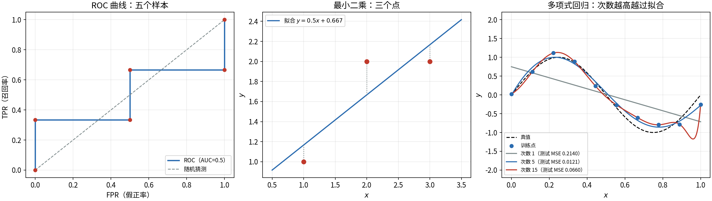

新版课件第 3 份 86 页，一半在讲"怎么评价模型"（准确率、P/R/F1、ROC/AUC、MAE/MSE/$R^2$），一半在讲"线性回归与逻辑回归"。这些内容旧课件没有系统讲，但考试最爱出小计算题：给你一个混淆矩阵算 F1，给你几组分数画 ROC，给你几个点解正规方程。这一讲按"定义 → 公式 → 手算 → 陷阱"组织，共八个算例。

## 1 混淆矩阵与四个率

二分类的预测与真实标签交叉，得到四个数：

| | 预测正 | 预测负 |
|---|---|---|
| 真实正 | TP | FN（漏报） |
| 真实负 | FP（误报） | TN |

四个常用指标：

$$
\text{准确率}=\frac{TP+TN}{TP+FN+FP+TN},
\qquad
\text{精确率 }P=\frac{TP}{TP+FP},
$$

$$
\text{召回率 }R=\frac{TP}{TP+FN},
\qquad
F_1=\frac{2PR}{P+R}.
$$

精确率回答"报出来的里面有多少是真的"，召回率回答"真的里面报出来多少"。两者此消彼长，$F_1$ 是调和平均，偏向较小的那个。

**手算 1：** 某体检模型在 1000 人上给出 $TP=40$、$FN=10$、$FP=20$、$TN=930$。

准确率：

$$
\frac{40+930}{1000}=\frac{970}{1000}=0.97 .
$$

精确率：

$$
P=\frac{40}{40+20}=\frac{40}{60}=0.6667 .
$$

召回率：

$$
R=\frac{40}{40+10}=\frac{40}{50}=0.8 .
$$

$F_1$：

$$
F_1=\frac{2\times0.6667\times0.8}{0.6667+0.8}=\frac{1.0667}{1.4667}=0.7273 .
$$

特异度 $TN/(TN+FP)=930/950=0.9789$。

这个例子说明**准确率会骗人**：970 人判对，但精确率只有 $0.667$——因为负类有 950 人，占绝大多数，模型只要"倾向于判负"就能拿到高准确率。

**Cohen kappa（科恩卡帕）：扣掉"随机也能对"的部分.** 准确率把"碰巧判对"也算进去。kappa 用随机一致性 $p_e$ 校正：

$$
\kappa=\frac{p_o-p_e}{1-p_e},
$$

$p_o$ 是观测一致率（即准确率），$p_e$ 是按两边的边际分布算出的随机一致率。用上面的混淆矩阵：$p_o=0.97$；真实正类比例 $50/1000=0.05$，预测正类比例 $60/1000=0.06$，于是

$$
p_e=0.05\times0.06+0.95\times0.94=0.003+0.893=0.896,
$$

$$
\kappa=\frac{0.97-0.896}{1-0.896}=\frac{0.074}{0.104}=0.7115 .
$$

kappa 的常见分档：$<0.2$ 差、$0.2\sim0.4$ 一般、$0.4\sim0.6$ 中等、$0.6\sim0.8$ 好、$>0.8$ 很好。$0.7115$ 属于"好"——比裸准确率 $0.97$ 的信息量大得多。

## 2 阈值、P-R 曲线

分类器的原始输出是分数，取不同阈值会得到不同的 $(P,R)$。把阈值从高到低扫一遍，得到 P-R 曲线。

用同一组分数：正类样本分数 $0.9,0.7,0.5$，负类 $0.8,0.6$。阈值取 $0.85,0.75,0.65,0.55,0.45$：

| 阈值 | TP | FP | 精确率 $P$ | 召回率 $R$ |
|---|---|---|---|---|
| 0.85 | 1 | 0 | $1/1=1.000$ | $1/3=0.333$ |
| 0.75 | 1 | 1 | $1/2=0.500$ | $0.333$ |
| 0.65 | 2 | 1 | $2/3=0.667$ | $2/3=0.667$ |
| 0.55 | 2 | 2 | $2/4=0.500$ | $0.667$ |
| 0.45 | 3 | 2 | $3/5=0.600$ | $1.000$ |

精确率不单调——这是 P-R 曲线的常态（负类样本插入时精确率会掉）。

## 3 ROC 与 AUC

ROC 画的是 $TPR=R$ 对 $FPR=FP/(FP+TN)$。同一组数据：

| 阈值 | FPR | TPR |
|---|---|---|
| 1.00 | 0.00 | 0.00 |
| 0.85 | 0.00 | 0.333 |
| 0.75 | 0.50 | 0.333 |
| 0.65 | 0.50 | 0.667 |
| 0.55 | 1.00 | 0.667 |
| 0.45 | 1.00 | 1.000 |

把点连成阶梯曲线，AUC 是曲线下面积。用梯形法逐段算：

$$
(0,0)\to(0,0.333):\ 0,
$$

$$
(0,0.333)\to(0.5,0.333):\ 0.5\times0.333=0.1667,
$$

$$
(0.5,0.333)\to(0.5,0.667):\ 0,
$$

$$
(0.5,0.667)\to(1,0.667):\ 0.5\times0.667=0.3333,
$$

$$
(1,0.667)\to(1,1):\ 0 .
$$

合计 $0.1667+0.3333=0.5$。

**配对法验证.** AUC 等于"随机取一个正样本与一个负样本，正样本分数更高的概率"。正类 3 个、负类 2 个，共 6 对：

- 正 $0.9$：高于 $0.8$ 和 $0.6$，赢 2 对；
- 正 $0.7$：高于 $0.6$、低于 $0.8$，赢 1 对；
- 正 $0.5$：都低于，赢 0 对。

$\mathrm{AUC}=3/6=0.5$，与梯形法一致。

**陷阱.** 这组数据的 AUC 恰好 $0.5$，等于随机猜测——虽然阈值 $0.45$ 时召回率能到 $1$。AUC 衡量的是"排序能力"，不是"某个阈值下的性能"。

**秩公式.** AUC 还有一个等价算法：把所有样本按分数排序，记正类的秩（从 1 开始），

$$
\mathrm{AUC}=\frac{\sum_{i\in\text{正}}r_i-\frac{n_+(n_++1)}{2}}{n_+n_-}.
$$

上例正类分数 $0.9,0.7,0.5$ 的秩是 $5,3,1$，和为 $9$：

$$
\mathrm{AUC}=\frac{9-\frac{3\times4}{2}}{3\times2}=\frac{9-6}{6}=0.5 .
$$

**一个更好的分类器.** 正类分数改成 $0.9,0.8,0.7$、负类 $0.6,0.5$：每个正类都高于每个负类，6 对全赢，$\mathrm{AUC}=1.0$。分数排序完全正确时 AUC 到 1，完全反序时到 0。

**什么时候用哪个指标.** 类别平衡看准确率；类别不平衡看 $P/R/F_1$ 与 AUC；只关心排序（推荐、检索）看 AUC；关心概率是否准（风控定价）看对数损失或 Brier 分数。**考试写"用准确率"之前先看类别比例。**

{width=100%}

## 4 多类：宏平均与微平均

三类混淆矩阵（行是真实类，列是预测类）：

$$
C=\begin{pmatrix}8&1&1\\1&9&0\\2&0&8\end{pmatrix}.
$$

准确率 $=\mathrm{tr}(C)/\sum C=25/30=0.8333$。

逐类算 $P,R,F_1$：第一类 $P=8/11=0.7273$、$R=8/10=0.8$、$F_1=0.7619$；第二类 $P=9/10=0.9$、$R=0.9$、$F_1=0.9$；第三类 $P=8/9=0.8889$、$R=8/10=0.8$、$F_1=0.8421$。

**宏平均**：三类 $F_1$ 直接取平均

$$
\frac{0.7619+0.9+0.8421}{3}=0.8347 .
$$

**微平均**：先把所有类的 TP、FP、FN 加起来再算，等于总准确率 $0.8333$。

宏平均把每个类看得一样重，微平均被样本多的类主导。类别不平衡时两者会差很多，报告里要写清楚用的哪个。

## 5 回归度量

四个指标：

$$
\mathrm{MAE}=\frac1n\sum\lvert y_i-\hat y_i\rvert,
\qquad
\mathrm{MSE}=\frac1n\sum(y_i-\hat y_i)^2,
$$

$$
\mathrm{RMSE}=\sqrt{\mathrm{MSE}},
\qquad
R^2=1-\frac{\sum(y_i-\hat y_i)^2}{\sum(y_i-\bar y)^2}.
$$

**手算 2：** $y=(3,5,7)$，$\hat y=(2.5,5,8)$。

MAE：

$$
\frac{\lvert3-2.5\rvert+\lvert5-5\rvert+\lvert7-8\rvert}{3}=\frac{0.5+0+1}{3}=0.5 .
$$

MSE：

$$
\frac{0.25+0+1}{3}=\frac{1.25}{3}=0.4167,
\qquad
\mathrm{RMSE}=\sqrt{0.4167}=0.6455 .
$$

$R^2$：$\bar y=5$，$SST=(3-5)^2+0+(7-5)^2=8$，$SSE=1.25$，

$$
R^2=1-\frac{1.25}{8}=0.8438 .
$$

**解释.** $R^2=0.8438$ 表示模型解释了 $84.38\%$ 的方差；$R^2<0$ 是可能的（模型比"直接预测均值"还差）。MSE 对大误差敏感（平方放大），MAE 更稳健；RMSE 与 $y$ 同量纲。

## 6 线性回归与正规方程

模型 $\hat y=w_0+w_1x_1+\cdots+w_dx_d=Xw$，损失

$$
L(w)=\lVert Xw-y\rVert^2 .
$$

对 $w$ 求梯度并令其为零：

$$
\begin{aligned}
\nabla_wL&=2X^{\mathsf T}(Xw-y)=0\\
&\Longrightarrow X^{\mathsf T}Xw=X^{\mathsf T}y\\
&\Longrightarrow w=(X^{\mathsf T}X)^{-1}X^{\mathsf T}y .
\end{aligned}
$$

这就是正规方程。几何上，$Xw$ 是 $X$ 的列空间里离 $y$ 最近的点，残差 $y-Xw$ 与列空间正交——最小二乘就是投影。

**手算 3：三个点的正规方程.** $x=(1,2,3)$，$y=(1,2,2)$，设计矩阵

$$
X=\begin{pmatrix}1&1\\1&2\\1&3\end{pmatrix},
\qquad
X^{\mathsf T}X=\begin{pmatrix}3&6\\6&14\end{pmatrix},
\qquad
X^{\mathsf T}y=\binom{5}{11}.
$$

解方程 $3w_0+6w_1=5$、$6w_0+14w_1=11$：

$$
\begin{aligned}
w_0&=\frac{5-6w_1}{3},\\
6\cdot\frac{5-6w_1}{3}+14w_1&=11
\Rightarrow 10-12w_1+14w_1=11\\
&\Rightarrow w_1=0.5,
\end{aligned}
$$

$$
w_0=\frac{5-3}{3}=0.6667 .
$$

闭式公式核对：$\bar x=2$、$\bar y=5/3$，

$$
w_1=\frac{\sum(x_i-\bar x)(y_i-\bar y)}{\sum(x_i-\bar x)^2}
=\frac{(-1)(-0.667)+0+(1)(0.333)}{1+0+1}=\frac{1}{2}=0.5 .
$$

**概率解释.** 设 $y=w^{\mathsf T}x+\varepsilon$、$\varepsilon\sim\mathcal N(0,\sigma^2)$，则对数似然

$$
\ln L=-\frac{n}{2}\ln(2\pi\sigma^2)-\frac{1}{2\sigma^2}\sum(y_i-w^{\mathsf T}x_i)^2 .
$$

最大化似然等价于最小化平方误差——这就是"最小二乘等于高斯噪声下的最大似然"。

**梯度下降解.** $w\leftarrow w-\eta\cdot\frac{2}{n}X^{\mathsf T}(Xw-y)$。手算一步：$w=(0,0)$、$X$ 同上、$y$ 同上，$\eta=0.1$。$Xw=0$，$X^{\mathsf T}(Xw-y)=X^{\mathsf T}(-y)=(-5,-11)$，$w\leftarrow(0,0)-0.1\times\frac{2}{3}(-5,-11)=(0.3333,\ 0.7333)$。

## 7 多项式回归与过拟合

把 $x$ 扩展成 $(1,x,x^2,\dots,x^d)$ 再做线性回归，就是多项式回归；模型对参数仍是线性的，所以正规方程照用。

**手算 4：过拟合的数字.** $y=\sin(2\pi x)$，10 个训练点、噪声 $0.2$：

| 次数 | 训练 MSE | 测试 MSE |
|---|---|---|
| 1 | 0.2027 | 0.2140 |
| 5 | 0.0064 | 0.0121 |
| 15 | 0.0000 | 0.0660 |

次数 15 把训练误差压到 0，测试误差却比次数 5 差 5 倍多——经典的过拟合。次数 1 是欠拟合：训练与测试都差。选择的依据只能是**验证集/交叉验证**，不能看训练误差。

**偏差-方差分解.** 期望测试误差可以拆成三项：

$$
\mathbb E[(y-\hat f)^2]=\sigma^2_{\text{噪声}}+\text{bias}^2(\hat f)+\mathrm{Var}(\hat f).
$$

取 $\sigma^2=0.04$、$\text{bias}^2=0.01$、$\mathrm{Var}=0.02$，总误差 $0.07$。若换更复杂的模型：bias 降到 $0.002$、方差升到 $0.05$，总误差 $0.092$——更差。若加数据：方差降到 $0.005$，总误差 $0.055$——更好。这三个数字解释了"过拟合与欠拟合"的算术本质：**误差是三项之和，换模型只是在三项之间挪权重**。

## 8 正则化

**岭回归（L2）.** 损失加 $\lambda\lVert w\rVert^2$，正规方程变为

$$
w=(X^{\mathsf T}X+\lambda I)^{-1}X^{\mathsf T}y .
$$

**手算 5：** 同一组三点，$\lambda=1$，截距不惩罚：

$$
X^{\mathsf T}X+\lambda I=\begin{pmatrix}3&6\\6&15\end{pmatrix}.
$$

解 $3w_0+6w_1=5$、$6w_0+15w_1=11$：由第一式 $w_0=(5-6w_1)/3$，代入得 $10-12w_1+15w_1=11$，$w_1=0.3333$，$w_0=1.0$。

对比无正则的 $(0.6667,0.5)$：斜率被压小、截距被抬高，这就是"收缩"。$\lambda\to\infty$ 时斜率趋于 0（模型退化为常数）。

**Lasso（L1）** 加 $\lambda\lVert w\rVert_1$，会把部分系数压到恰好 0，起到特征选择作用；代价是没有闭式解，要用近端梯度或坐标下降。

## 9 逻辑回归

分类用 sigmoid：$p=\sigma(w^{\mathsf T}x)$，$\sigma(z)=1/(1+e^{-z})$。损失是交叉熵

$$
L=-\bigl[y\ln p+(1-y)\ln(1-p)\bigr],
\qquad
\nabla_wL=(p-y)x .
$$

**手算 6：一步更新.** $x=1$、$w=0$、$b=0$、$y=1$、$\eta=1$。

前向：$z=0$，$p=0.5$，损失 $-\ln0.5=0.6931$。

梯度：$(p-y)x=(0.5-1)\times1=-0.5$，$w\leftarrow0-1\times(-0.5)=0.5$。

再前向：$p=\sigma(0.5)=0.6225$，损失 $-\ln0.6225=0.4741$。损失从 $0.6931$ 降到 $0.4741$。

注意：**这里没有"正规方程"**。逻辑回归的损失关于 $w$ 非线性，只能迭代（梯度下降、牛顿法/IRLS）。这是线性回归与逻辑回归最重要的区别。

## 9.5 评估协议：K 折与网格搜索

**K 折交叉验证.** 把数据分成 $K$ 份，每次留一份做验证、其余训练，最后平均。10 个样本、$K=5$ 时每折 2 个样本；五折准确率若为 $0.90,0.80,0.85,0.95,0.70$，则

$$
\bar{acc}=\frac{0.90+0.80+0.85+0.95+0.70}{5}=0.84,
$$

标准差 $0.0962$——报告"均值 ± 标准差"比只报一个数更诚实。分层 K 折（stratified）保证每折的类别比例与总体一致，类别不平衡时必用。

**网格搜索.** 两个超参数各 3 个候选，共 $3\times3=9$ 组；每组做一次 $K$ 折，就是 $9\times5=45$ 次训练。选交叉验证均值最高的一组，再用全部训练数据重训一次。

**三个常见错误：**

1. **数据泄漏**：先标准化再用交叉验证，标准化时用了全部数据（含验证集）的均值方差，分数会虚高。正确做法是把标准化放进每一折内部。
2. **用测试集调参**：测试集只能用一次。调参看验证集。
3. **只报一个数**：小数据集上一次划分的方差很大，至少给均值与标准差，或给多次重复实验。

## 10 自测

1. 混淆矩阵 $TP=40,FN=10,FP=20,TN=930$，算准确率、P、R、F1，并解释为什么准确率高而 P 低。
2. 用五个分数（正 $0.9,0.7,0.5$，负 $0.8,0.6$）算 AUC，用两种方法并核对。
3. $y=(3,5,7)$、$\hat y=(2.5,5,8)$，算 MAE、MSE、RMSE、$R^2$。
4. 三点 $(1,1),(2,2),(3,2)$，写正规方程并解出系数。
5. 同样的数据加岭回归 $\lambda=1$（截距不惩罚），系数变成多少？为什么变小？
6. 逻辑回归用 $x=1$、$w=0$、$y=1$、$\eta=1$ 走一步，损失如何变化？

## 11 答案

1. 准确率 $0.97$，$P=0.6667$，$R=0.8$，$F_1=0.7273$；负类占 950/1000，模型偏向判负也能拿高准确率，但报出的阳性里三分之一是假的。
2. 阈值法梯形面积 $0.1667+0.3333=0.5$；配对法 $3/6=0.5$。
3. MAE $0.5$，MSE $0.4167$，RMSE $0.6455$，$R^2=0.8438$。
4. $X^{\mathsf T}X=\begin{pmatrix}3&6\\6&14\end{pmatrix}$、$X^{\mathsf T}y=(5,11)$；解得 $w_0=0.6667$、$w_1=0.5$。
5. $w_0=1.0$、$w_1=0.3333$；L2 惩罚把系数向 0 收缩，斜率变小、截距相应抬高以补偿。
6. $p=0.5$、损失 $0.6931$；梯度 $-0.5$，$w=0.5$；$p=0.6225$、损失 $0.4741$。

## 附录：公式速查

| 量 | 公式 | 备注 |
|---|---|---|
| 精确率 | $TP/(TP+FP)$ | 报出的阳性中真的比例 |
| 召回率 | $TP/(TP+FN)$ | 真阳性中被报出的比例 |
| $F_1$ | $2PR/(P+R)$ | 调和平均 |
| kappa | $(p_o-p_e)/(1-p_e)$ | 扣随机一致 |
| FPR | $FP/(FP+TN)$ | ROC 横轴 |
| AUC（秩） | $(\sum r_+-\frac{n_+(n_++1)}2)/(n_+n_-)$ | 等价于配对法 |
| MAE/MSE | $\frac1n\sum|y-\hat y|$、$\frac1n\sum(y-\hat y)^2$ | MSE 放大误差 |
| $R^2$ | $1-SSE/SST$ | 可为负 |
| 正规方程 | $w=(X^{\mathsf T}X)^{-1}X^{\mathsf T}y$ | 最小二乘闭式解 |
| 岭回归 | $w=(X^{\mathsf T}X+\lambda I)^{-1}X^{\mathsf T}y$ | 截距不惩罚 |
| 逻辑回归梯度 | $(p-y)x$ | 无闭式解 |
| 偏差-方差 | $\sigma^2+\text{bias}^2+\text{var}$ | 三项之和 |

这十二行覆盖本章所有计算题；答题时按"列数据 → 代公式 → 保留中间量 → 用恒等关系验算（如 $F_1$ 介于 $P$ 与 $R$ 之间、AUC 两种算法一致）"的顺序写。
