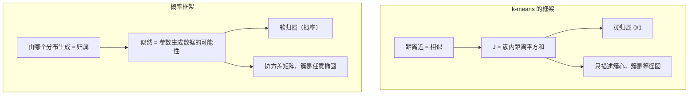
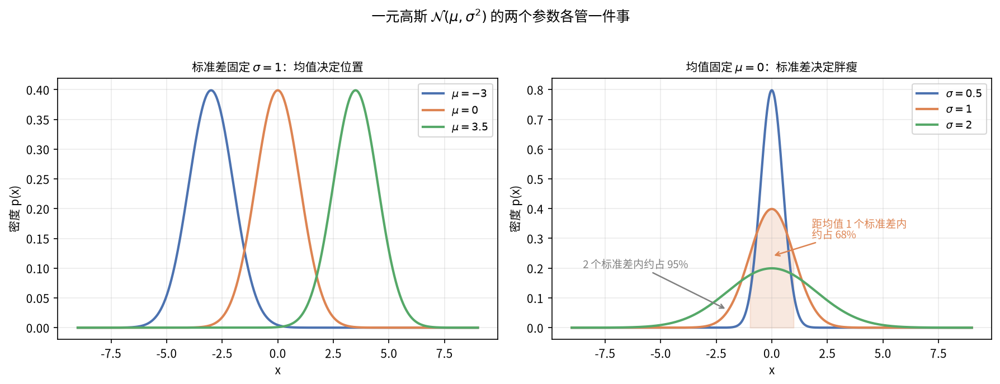
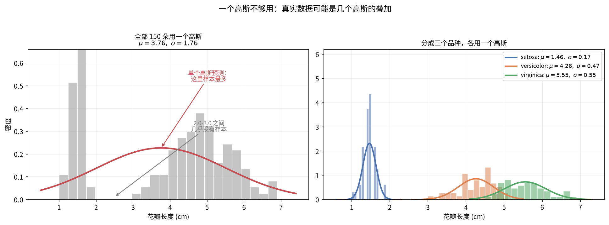
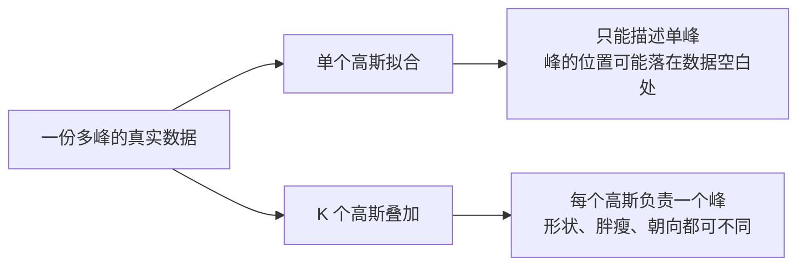
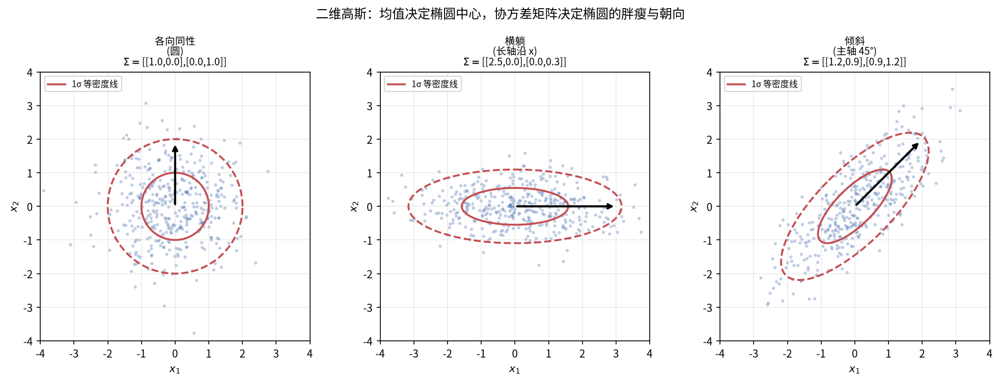

讲义 01 到 03 都在用同一个框架：把"相似"定义成"距离近"，然后想办法让簇内距离最小。这一讲换一个完全不同的角度提问：**假设数据是由若干个概率分布生成的，那么每个点最可能来自哪一个？**

这个角度会带来三样 k-means 给不了的东西：一个能比较不同 $K$ 的客观标准（似然）、一种表达"我没有把握"的方式（概率而不是 0/1 归属）、以及对簇形状的完整描述（协方差矩阵而不只是一个中心点）。这一讲先把"概率分布"和"高斯"这两件事的直觉建立起来，下一讲再把它们拼成混合高斯模型。

## 1. 为什么要引入概率

先看 k-means 留下的三个具体问题，它们都能用概率的语言自然解决。

**第一，硬归属无法表达不确定性。** 讲义 02 里提到，落在两个簇边界附近的点，k-means 会给它一个武断的归属——$r_{nk}$ 只能是 0 或 1。但那个点究竟属于哪一边，其实没有把握。在概率框架下，"这个点属于第 $k$ 个簇"变成一个**概率**，可以取 0.5、0.7、0.95，把"有多确定"表达出来。这个量在下一讲叫**责任度**。

**第二，$J$ 无法跨 $K$ 比较。** 讲义 03 的练习 6 已经看到后果：$J$ 随 $K$ 单调不增，$K$ 给大了 $J$ 反而更小，所以没法用 $J$ 来选 $K$。而概率模型给出的是**似然**——它衡量"这组参数生成当前数据的可能性有多大"，天然就能在不同复杂度的模型之间比较（配合罚项）。这是 BIC/AIC 那一类模型选择准则的基础。

**第三，$J$ 只描述簇内紧致度，不描述簇的形状。** k-means 中每个簇只有一个中心点 $\mu_k$，等价于假设簇是"以 $\mu_k$ 为圆心的等径圆"。概率模型会给每个簇配一个完整的协方差矩阵 $\Sigma_k$，于是椭圆的长短轴、朝向都能被描述出来。讲义 02 那张 Voronoi 图里"边界只能是直线"的限制，正是这个假设的直接后果。



## 2. 两个必须先分清的词：密度与似然

这两个词在日常讨论里经常被混用，但在数学上是**同一个函数、两种读法**，混起来会导致后面 EM 的推导看不懂。

**密度（density）** 是固定参数、把数据当自变量。一元高斯密度是

$$
p(x)=\frac{1}{\sqrt{2\pi\sigma^2}}\exp\left(-\frac{(x-\mu)^2}{2\sigma^2}\right)
$$

给定 $\mu$ 和 $\sigma$，它告诉你"在位置 $x$ 附近出现样本的可能性有多大"。$\mu$ 决定峰值在哪，$\sigma$ 决定曲线的胖瘦。



右图里阴影部分标出了**68-95 规则**：距离均值一个标准差以内的区域大约包含 68% 的样本，两个标准差以内约 95%。这个规则后面很有用——它给出了"$\sigma$ 在业务上意味着什么"的直观：如果某批数据用 $\mu=4.26,\sigma=0.47$ 的高斯描述，那么"花瓣长度在 3.32 到 5.20 之间"这句话覆盖了大约 95% 的样本。

**似然（likelihood）** 反过来：固定数据、把参数当自变量。对一组数据 $x_1,\dots,x_N$，似然是

$$
L(\mu,\sigma)=\prod_{n=1}^{N}p(x_n\mid\mu,\sigma)
$$

它问的是"如果参数取这一组值，生成我手上这份数据的可能性有多大"。**同一份数据，换个参数就换个似然值**，于是可以比较哪组参数更好——这正是"最大似然估计"的思路：找出使 $L$ 最大的那组参数。

注意两件事。第一，似然是**所有样本密度的乘积**（因为假设样本独立），而不是求和。第二，乘积带来严重的数值问题，第 5 节专门讲。

## 3. 为什么是高斯：一个不够用，多个就够了

这里要回答一个必须想清楚的问题：**凭什么假设数据服从高斯分布？** 现实数据显然不都服从。

答案分两层。第一层，**单个高斯确实经常不够用**。看 Iris 花瓣长度的真实分布：



左图把 150 朵花放在一起，用一个高斯去拟合。结果是灾难性的：这个高斯说"样本最多的地方在 3.76 附近"，但真实数据在 2.0 到 3.0 之间**几乎是空的**——因为那里正好是 setosa 和 versicolor 之间的间隔。这个高斯还严重低估了 1.5 附近那根最高的柱子。**一个高斯只能描述单峰、对称的分布，而有多个簇的数据天然是多峰的。**

第二层，**多个高斯的叠加可以描述几乎任何形状**。右图按品种分成三组，每组各配一个高斯，拟合得相当好（三个品种的参数分别是 $1.46\pm0.17$、$4.26\pm0.47$、$5.55\pm0.55$）。这就是混合高斯模型的基本思想：**不要求每个簇都服从高斯，只要求每个簇内部服从高斯**。这个假设比"整体服从高斯"弱得多，也合理得多——同一品种的花，尺寸确实围绕一个平均值波动，这正是高斯的适用场景。



顺带说明高斯在数学上受欢迎的三个原因：它只有两个参数（均值和方差）却表达能力不弱；独立高斯的联合分布仍是高斯，解析性质好；以及在只知道均值和方差的约束下，高斯是熵最大的分布——换句话说，**在信息最少的前提下，选高斯是最"保守"的假设**。

## 4. 从一维到多维：协方差矩阵决定椭圆的形状

把一元高斯推广到 $D$ 维，密度变成

$$
p(x)=\frac{1}{(2\pi)^{D/2}\lvert\Sigma\rvert^{1/2}}\exp\left(-\frac{1}{2}(x-\mu)^{\mathsf T}\Sigma^{-1}(x-\mu)\right)
$$

其中 $\mu$ 是 $D$ 维均值向量，$\Sigma$ 是 $D\times D$ 协方差矩阵。指数里那一项 $(x-\mu)^{\mathsf T}\Sigma^{-1}(x-\mu)$ 叫**马氏距离**（Mahalanobis distance）的平方，它是欧氏距离在"各维尺度不同、彼此相关"情况下的推广。

$\Sigma$ 的作用可以看得很具体：二维高斯中，**马氏距离等于常数的点集是一个椭圆**。



三张图用的 $\Sigma$ 不同，椭圆的形状就完全不同：

- $\Sigma=\begin{pmatrix}1&0\\0&1\end{pmatrix}$：特征值 1 和 1，长短轴比 1.00 —— 圆，各方向方差相同。
- $\Sigma=\begin{pmatrix}2.5&0\\0&0.3\end{pmatrix}$：特征值 0.3 和 2.5，长短轴比 8.33 —— 横躺的细长椭圆，$x_1$ 方向方差大。
- $\Sigma=\begin{pmatrix}1.2&0.9\\0.9&1.2\end{pmatrix}$：特征值 0.3 和 2.1，长短轴比 7.00，主轴倾斜 45° —— 非对角元不为零，表示两维**相关**。

图里的黑色箭头是最大特征值对应的特征向量，指向椭圆的长轴方向。这三张图合起来说明：**协方差矩阵完整地描述了簇的形状**，而 k-means 只有一个中心点，相当于强行假设 $\Sigma$ 是"所有簇共用的同一个 $\sigma^2I$"。这就是为什么在 Iris 四维数据上 GMM 的 ARI（0.90）明显高于 k-means（0.73）——真实簇不是等径球。

## 5. 数值陷阱：密度乘积会溢出或下溢

前面说似然是密度的乘积。这个"乘积"在代码里会出问题，而且**两个方向都会出问题**。

**上溢**：如果平均密度大于 1，连乘会迅速涨到浮点数表示不了的大数。用 electricity 数据集的 `nswprice` 列（45312 个样本）实测：

```
单个样本对数密度: 最大 2.300  最小 -275.213  平均 1.800
平均每个密度 8.3285
150 个密度的乘积 : 6.487e+145
300 个密度的乘积 : 4.527e+275
全部 45312 个乘积: inf          <- float64 直接溢出
```

**下溢**：如果平均密度小于 1（高维数据必然如此），连乘会迅速掉到 0。用 10 维标准正态、距离原点 1 个单位的点举例（每个点的密度约 $6.9\times10^{-7}$）：

| 相乘的样本数 | 乘积 |
|---|---|
| 1 | 6.881e-07 |
| 10 | 2.378e-62 |
| 20 | 5.657e-124 |
| 更多 | 下溢为 0 |

维数越高，单个密度越小得快：$D=50$ 时一个标准差处的密度就只有 $1.5\times10^{-31}$，$D=100$ 时是 $2.4\times10^{-62}$。

不过实测下来，**真正的危险不在"单个点的密度太小"，而在"连乘的样本太多"**。单个密度要到 $D=500$（半径 1 处）或 $D=131$（半径 3 处）才会自身下溢到 0；但把 5000 个样本的密度连乘起来，**即使在 $D=2$ 也已经下溢**：

| 维数 D | 单点密度（半径 1） | 5000 个样本的连乘 |
|---|---|---|
| 2 | 5.855e-02 | 下溢为 0 |
| 10 | 6.881e-07 | 下溢为 0 |
| 20 | 4.734e-13 | 下溢为 0 |

原因很直白：每个密度都小于 1，乘 5000 次就是 $5000\times\log_{10}(0.0586)\approx-14189$ 个数量级。

**两个方向都致命，而解法是同一个：取对数。** 乘积的对数等于对数的和，于是

$$
\ln L=\sum_{n=1}^{N}\ln p(x_n)
$$

加法不会溢出也不会下溢（只要每一项本身在合理范围内），而且把"连乘一大堆小数"变成"累加一大堆数"，稳定性好得多。GMM 的对数似然就是在这个形式上计算的：

$$
\ln p(X\mid\theta)=\sum_{n=1}^{N}\ln\left(\sum_{k=1}^{K}\pi_k\,\mathcal N(x_n\mid\mu_k,\Sigma_k)\right)
$$

**注意这个式子里有一个 $\ln$ 套 $\sum$ 的结构**（对数在求和外面）。这是下一讲的全部困难所在：直接对它求导得不到闭式解，必须引入隐变量和 EM 算法。而数值上，$\sum_k$ 这一步要用一种叫 log-sum-exp 的技巧来做（先减去最大值再取指数），否则即使每一项的对数都正常，直接 $\exp$ 回来再相加仍会下溢。

## 6. 本讲小结

k-means 用"距离最近"定义簇，概率框架用"由哪个分布生成"定义簇。后者带来三个 k-means 没有的能力：**软归属**（用概率表达不确定性）、**可跨 $K$ 比较的似然**（模型选择的基础）、**描述任意椭圆簇的协方差矩阵**。

必须分清**密度**和**似然**：同一个函数，密度是固定参数看数据，似然是固定数据看参数。似然是密度的**乘积**，这个乘积在数值上会溢出（平均密度大于 1 时，如 electricity 的 45312 个样本）或下溢（高维时必然），**因此一切计算都必须在对数域进行**，把乘积变成求和。

单个高斯只描述单峰对称分布，而带簇的数据天然是多峰的（Iris 花瓣长度的例子：单个高斯的峰落在 2.0-3.0 那段空白区）。**混合高斯模型的思路是不要求整体服从高斯，只要求每个簇内部服从高斯**——协方差矩阵则完整刻画了每个簇的形状（长短轴比、朝向）。

下一讲把这三件事拼起来：$K$ 个高斯按比例混合、引入"这个点属于哪个高斯"的隐变量、并推出计算责任度的公式。然后讲义 06 讲 EM 算法怎么把参数估出来。

## 7. 动手练习

以下练习都只依赖 NumPy，不需要新的库。

**练习 1（写一元高斯）**：实现 `normal_pdf_1d(x, mu, sigma)` 和它的对数版本 `normal_logpdf_1d(x, mu, sigma)`。验证两件事：对标准正态（$\mu=0,\sigma=1$），$x=0$ 处的密度应该是 $1/\sqrt{2\pi}\approx0.3989$；对数版本在 $x=0$ 处应该是 $-0.9189$。再用 Iris 花瓣长度的 setosa 组（$\mu=1.46,\sigma=0.17$）算一下，看看 $x=1.46$ 和 $x=3.0$ 处的对数密度差多少。

**练习 2（看清"一个高斯不够"）**：把 Iris 花瓣长度的 150 个值拿来，用样本均值和样本标准差作为参数，画一张"直方图 + 单个高斯密度曲线"的图（参考 `figures/fig11_one_vs_three_gaussians.png` 左图）。然后按品种分成三组，各画一条密度曲线叠加在同一张图上。**用眼睛找出左图那个高斯错在哪里**，并把观察写下来。

**练习 3（亲手制造下溢）**：写一段代码，计算 $D$ 维标准正态在距离原点 $r$ 处的对数密度：

$$
\ln p=-\frac{D}{2}\ln(2\pi)-\frac{r^2 D}{2}
$$

（提示：对标准正态，马氏距离平方就是 $\lVert x\rVert^2=r^2D$）。统计 $D$ 从 1 到 600 时密度的值，找出密度首次小于 `np.finfo(float).tiny` 的 $D$（提示：它比直觉大得多，别急着下结论）。然后把半径改成 $r=3$ 再算一遍，比较两个临界维数。

最后回答：如果一个 **2 维**数据集的样本数有 5000，直接连乘密度会发生什么？这个结果和高维有关系吗？

**练习 4（马氏距离与椭圆）**：取 $\Sigma=\begin{pmatrix}2.5&0\\0&0.3\end{pmatrix}$，写代码算出满足 $(x-\mu)^{\mathsf T}\Sigma^{-1}(x-\mu)=1$ 的点集，画出来确认它是一个横躺的椭圆。然后用 `np.linalg.eigh(Σ)` 检查特征值和特征向量，验证"半轴长度 = 特征值的平方根、半轴方向 = 特征向量方向"。再换成 $\Sigma=\begin{pmatrix}1.2&0.9\\0.9&1.2\end{pmatrix}$，看椭圆怎么倾斜。

**练习 5（思考题，不写代码）**：假设一份二维数据的真实结构是一个"细长的斜椭圆"。如果强行用 k-means（$K=1$）去描述它，那么
1. $J$ 会是什么量？它和协方差矩阵有什么关系？
2. 为什么说 k-means "丢掉了"协方差的信息？

（提示：$K=1$ 时 k-means 唯一要做的就是把中心放在均值处，$J$ 等于所有点到均值的距离平方和。这个量能告诉你椭圆的**大小**，但能告诉你它的**朝向**吗？）
