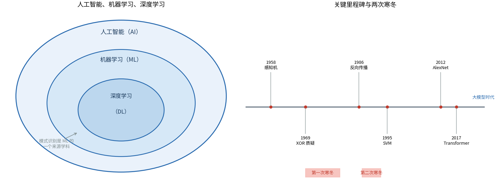

## 1 概念层级

三个词是包含关系：

- **人工智能（AI）**：让机器表现出智能行为的总目标；
- **机器学习（ML）**：不写死规则，让模型从数据中学；
- **深度学习（DL）**：用多层神经网络做机器学习。

**模式识别**是 ML 的一个来源学科，侧重"分类与描述"；它与 ML 高度重叠，区别只在历史渊源与侧重点（PR 更强调特征与判决，ML 更强调学习算法）。

{width=100%}

**发展史**:

| 年份 | 事件 | 意义 |
|---|---|---|
| 1958 | Rosenblatt 感知机 | 第一个可训练的分类器 |
| 1969 | Minsky 指出 XOR 不可分 | 第一次寒冬的导火索 |
| 1986 | 反向传播普及 | 多层网络可训练 |
| 1995 | 统计学习理论、SVM | 小样本、核方法 |
| 2012 | AlexNet | 深度学习在 ImageNet 上爆发 |
| 2017 | Transformer | 注意力取代循环 |

两次寒冬（约 1969–1980、1987–1993）的成因相同：算力与数据不足，期望过高，承诺落空。

## 2 数据集与标签

数据集由样本组成，每个样本是"特征 + 标签"：

$$
\mathcal D=\{(x_1,y_1),(x_2,y_2),\dots,(x_N,y_N)\},
\qquad x_i\in\mathbb R^d,\ y_i\in\{1,\dots,c\}.
$$

**ground truth 与 gold standard.** ground truth 是"通过直接观察得到的真实结果"，gold standard 是"被公认为最可靠的参照"。机器学习里更常用 ground truth；用 gold standard 时，意思是它"足以代表 ground truth"（例如医学上的活检诊断）。

**标签的三种来源：** 人工标注、传感器采集、弱监督/规则生成。人工标注最贵，也最需要一致性检验。

## 3 标注一致性

### 3.1 皮尔逊相关系数：只量线性相关，不量一致

两个评委对 5 个样本打分：$a=(0.5,1.6,2.5,2.5,2.4)$、$b=(1.5,2.6,3.5,3.5,3.4)$。

先看差值：$b-a=(1,1,1,1,1)$，每个样本都正好高 1.0。

两个序列的均值：$\bar a=9.5/5=1.9$，$\bar b=14.5/5=2.9$。

$a$ 的偏差是 $(-1.4,-0.3,0.6,0.6,0.5)$，偏差平方和

$$
1.96+0.09+0.36+0.36+0.25=3.02,
$$

方差 $3.02/4=0.755$，标准差 $\sigma_a=\sqrt{0.755}=0.8689$。$b$ 的偏差与 $a$ 完全相同（因为 $b=a+1$），所以 $\sigma_b=0.8689$。

协方差（偏差乘积之和除以 $n-1$）：

$$
\operatorname{cov}(a,b)=\frac{1.96+0.09+0.36+0.36+0.25}{4}=\frac{3.02}{4}=0.755 .
$$

于是

$$
r=\frac{0.755}{0.8689\times0.8689}=\frac{0.755}{0.755}=1.0 .
$$

**结论：$r=1$，但两个评委每个样本都差 1 分。** 皮尔逊相关系数对"整体平移"不敏感——它衡量的是"变化趋势是否一致"，不是"数值是否相同"。所以评价标注一致性要用 kappa，不用 Pearson。

### 3.2 Cohen’s kappa：两个人的离散一致性

课件里 50 个奖学金申请，评委 A、B 各判 Yes/No：

| | B 判 Yes | B 判 No |
|---|---|---|
| A 判 Yes | 20 | 5 |
| A 判 No | 10 | 15 |

观测一致率：

$$
p_o=\frac{20+15}{50}=\frac{35}{50}=0.7 .
$$

随机一致率：A 判 Yes 的比例 $25/50=0.5$，B 判 Yes 的比例 $30/50=0.6$，于是

$$
p_e=0.5\times0.6+0.5\times0.4=0.3+0.2=0.5 .
$$

（第二项是"都判 No"的随机概率：A 判 No 比例 $0.5$，B 判 No 比例 $0.4$。）

$$
\kappa=\frac{p_o-p_e}{1-p_e}=\frac{0.7-0.5}{1-0.5}=\frac{0.2}{0.5}=0.4 .
$$

kappa $=0.4$ 属于"中等一致"。注意 $p_o=0.7$ 看起来不低，但扣掉随机一致后只剩 $0.4$。

### 3.3 Fleiss' kappa：多个评价者

评价者超过两人时，逐 item 算一致性再平均。公式：

$$
\begin{aligned}
P_i&=\frac{\sum_{j=1}^{k}n_{ij}(n_{ij}-1)}{n(n-1)},&
\bar P&=\frac1N\sum_{i=1}^{N}P_i,\\
P_e&=\sum_{j=1}^{k}p_j^2,&
\kappa&=\frac{\bar P-P_e}{1-P_e}.
\end{aligned}
$$

其中 $N$ 是 item 数、$n$ 是评价者数、$k$ 是等级数，$n_{ij}$ 是第 $i$ 个 item 被判为第 $j$ 级的次数，$p_j$ 是第 $j$ 级的总占比。

**手算：课件 p25 的例子.** $N=10$、$n=14$、$k=5$。每行是一个 item 在 5 个等级上的人次：

| item | 1 | 2 | 3 | 4 | 5 | $P_i$ |
|---|---|---|---|---|---|---|
| 1 | 0 | 0 | 0 | 0 | 14 | 1.000 |
| 2 | 0 | 2 | 6 | 4 | 2 | 0.253 |
| 3 | 0 | 0 | 3 | 5 | 6 | 0.308 |
| 4 | 0 | 3 | 9 | 2 | 0 | 0.440 |
| 5 | 2 | 2 | 8 | 1 | 1 | 0.330 |
| 6 | 7 | 7 | 0 | 0 | 0 | 0.462 |
| 7 | 3 | 2 | 6 | 3 | 0 | 0.242 |
| 8 | 2 | 5 | 3 | 2 | 2 | 0.176 |
| 9 | 6 | 5 | 2 | 1 | 0 | 0.286 |
| 10 | 0 | 2 | 2 | 3 | 7 | 0.286 |
| 合计 | 20 | 28 | 39 | 21 | 32 | |

**第 1 步：$p_j$.** 总人次 $10\times14=140$：

$$
p_1=\frac{20}{140}=0.1429,\quad
p_2=\frac{28}{140}=0.2000,\quad
p_3=\frac{39}{140}=0.2786,
$$

$$
p_4=\frac{21}{140}=0.1500,\quad
p_5=\frac{32}{140}=0.2286 .
$$

**第 2 步：逐行 $P_i$.** 以 item 2 为例：$n=(0,2,6,4,2)$，

$$
\sum_jn_{ij}(n_{ij}-1)=2+30+12+2=46,
$$

分母 $n(n-1)=14\times13=182$，$P_2=46/182=0.2527$。item 1 的 $n=(0,0,0,0,14)$：$14\times13=182$，$P_1=1.000$。

**第 3 步：$\bar P$.**

$$
\begin{aligned}
\bar P&=\frac{1.000+0.253+0.308+0.440+0.330}{10}\\
&\quad+\frac{0.462+0.242+0.176+0.286+0.286}{10}=0.3780 .
\end{aligned}
$$

**第 4 步：$P_e$.**

$$
\begin{aligned}
P_e&=0.1429^2+0.2^2+0.2786^2+0.15^2+0.2286^2\\
&=0.0204+0.0400+0.0776+0.0225+0.0523=0.2128 .
\end{aligned}
$$

**第 5 步：kappa.**

$$
\kappa=\frac{0.3780-0.2128}{1-0.2128}=\frac{0.1652}{0.7872}=0.2099 .
$$

**结论：$\kappa=0.21$，只算"一般"——14 个评价者对 5 级量表的一致性很弱。** 这个例子正好说明：标注不是越多越好，评价者之间先要统一标准。

## 4 数据划分

**三个集合的分工：** 训练集学参数；验证集选模型、调超参数；测试集只在最后用一次，报告结果。

**留出法**：随机按比例切分（如 $70\%/15\%/15\%$）。优点是简单，缺点是结果依赖这一次切分——换一个随机种子，准确率可能差几个百分点。

**K 折交叉验证**：把训练集分成 $K$ 份，每次留一份做验证、其余训练，得到 $K$ 个分数后取平均。$K$ 通常取 5 或 10。

**手算：五折的结果.** 五次准确率为 $0.90,0.80,0.85,0.95,0.70$：

$$
\bar{acc}=\frac{0.90+0.80+0.85+0.95+0.70}{5}=\frac{4.20}{5}=0.84 .
$$

标准差（样本标准差，除以 $n-1$）：

$$
\begin{aligned}
s^2&=\frac{(0.06)^2+(-0.04)^2+(0.01)^2}{4}
+\frac{(0.11)^2+(-0.14)^2}{4}=0.00925,\\
s&=\sqrt{0.00925}=0.0962 .
\end{aligned}
$$

报告写成 $0.84\pm0.0962$。只看 $0.84$ 会掩盖"某一折只有 $0.70$"这个事实。

**分层抽样（stratified K-fold）**：保证每一折的类别比例与总体一致。100 个样本、20 个正类，五折时每折 20 个样本，其中正类 $20/5=4$ 个、负类 $80/5=16$ 个。类别不平衡时必用，否则可能出现某一折没有正类。

**手算：数据泄漏的差别.** 1000 个样本，特征均值 $\mu=10$、标准差 $\sigma=2$。若先对全部数据标准化再划分，验证集的信息（均值、方差）泄漏进训练；若在每折内部标准化，训练折用自己算的 $\mu,\sigma$。两种做法在随机数据上差别不大，但在**时间序列或分组数据**上会让分数虚高几个百分点。判断标准很简单：**任何用到了验证集/测试集信息的步骤，都必须放进"每折内部"**。

## 5 网格搜索

超参数是训练前设定的量（学习率、正则系数、树的深度、$k$ 近邻的 $k$）。网格搜索把所有组合都试一遍。

**训练次数.** 超参数 A 有 3 个候选、B 有 5 个候选：共

$$
3\times5=15
$$

组。每组用 5 折交叉验证，需要

$$
15\times5=75
$$

次训练。若再加一个 4 候选的超参数，就是 $3\times5\times4\times5=300$ 次——这是网格搜索的代价，也是后来用随机搜索、贝叶斯优化的原因。

**流程四步**：确定评价指标 → 对每个组合做 K 折取均值 → 选均值最高的组合 → 用全部训练数据重训一次，最后在测试集上报告。

**伪标签的筛选.** 半监督的常用做法是"伪标签"：用已训练的模型给无标签样本打分，置信度超过阈值 $\tau$ 的加进训练集。取 $\tau=0.9$，四个无标签样本的预测概率为 $0.95,0.92,0.70,0.99$：前两个与最后一个被接收（3 个），$0.70$ 被拒绝。接收率 $3/4=0.75$。阈值越低接收越多、但噪声越大——这是半监督最典型的权衡。

### 一次完整的模型选择流程

设三个候选模型、两个超参数、5 折交叉验证，数据 1000 个样本（其中 200 个留作测试）。

**第 1 步：划分.** 800 个训练 + 200 个测试（测试集锁起来，直到最后）。

**第 2 步：搜索.** 每个模型有 $3\times3=9$ 组超参，三个模型共 $27$ 组；每组 5 折，共

$$
27\times5=135
$$

次训练。

**第 3 步：比较.** 三个模型的交叉验证均值分别是 $0.80,0.84,0.82$，标准差 $0.03,0.02,0.05$。选第二个：均值最高，方差也最小。

**第 4 步：重训与测试.** 用 800 个样本、选定的超参数重训一次，在 200 个测试样本上得到 $0.83$。报告写"交叉验证 $0.84\pm0.02$，测试 $0.83$"，两个数都给，因为前者用于选择、后者用于最终评价。

这个流程里有三个容易错的点：搜索阶段不能碰测试集；比较时不能只看均值不看方差；最后必须重训（交叉验证的 $K$ 个模型没有一个用了全部训练数据）。

## 6 学习范式

| 范式 | 数据 | 典型任务 |
|---|---|---|
| 监督学习 | 全部带标签 | 分类、回归、序列标注 |
| 无监督学习 | 全无标签 | 聚类、降维、密度估计 |
| 半监督学习 | 少量标签 + 大量无标签 | 标注昂贵时的分类 |
| 主动学习 | 无标签池 + 可查询专家 | 选最有价值的样本去标注 |

**半监督的直觉**：无标签样本虽没有 $y$，但能告诉模型"数据分布长什么样"（聚类假设：同一簇多半同类；流形假设：高维数据落在低维流形上）。

**主动学习的核心是"挑样本"**：优先标注模型最不确定的样本。不确定性用熵衡量：

$$
H(p)=-p\log_2p-(1-p)\log_2(1-p).
$$

**手算：熵.** $p=0.5$ 时 $H=1$ bit（最不确定）；$p=0.7$ 时

$$
\begin{aligned}
H&=-0.7\log_2 0.7-0.3\log_2 0.3\\
&=0.7\times0.5146+0.3\times1.7370\\
&=0.3602+0.5211=0.8813;
\end{aligned}
$$

$p=0.9$ 时 $H=0.9\times0.1520+0.1\times3.3219=0.1368+0.3322=0.4690$；$p=0.99$ 时 $H=0.0808$。

**结论：$p$ 越接近 $0.5$ 越该标注。** 主动学习就是按熵从大到小排队，标注前 $B$ 个，再重训。

## 6.5 计算环境里的算术

**显存占用.** 一个 2500 万参数（$P=25\times10^6$）的模型，用单精度（4 字节）：

$$
\text{参数显存}=P\times4=100\ \text{MB}.
$$

Adam 还要存一阶、二阶矩各一份，加上梯度：

$$
\text{总计}\approx P\times4\times3=300\ \text{MB}\ (\text{不含激活}).
$$

输入批量 $B=64$、$224\times224\times3$ 的 RGB 图：单张 $224\times224\times3=150{,}528$ 个数，一批

$$
64\times150{,}528\times4\ \text{B}=38{,}535{,}168\ \text{B}\approx36.8\ \text{MiB}.
$$

所以"显存不够"通常来自**激活值**：每一层的中间结果都要留着做反向传播，批量翻倍、分辨率翻倍，激活就成倍涨。

## 7. 十个易错点

1. 把 Pearson 相关当成一致性——它允许整体平移。
2. kappa 用 $p_o$ 冒充——不扣随机一致会高估。
3. 用测试集调超参数——测试集只能用一次。
4. 先标准化再划分——数据泄漏。
5. 类别不平衡只看准确率——负类占多数时准确率会骗人。
6. 把验证集结果当最终结果——验证集参与过模型选择。
7. 忽略随机种子——小数据上换种子能差好几个百分点。
8. 网格搜索忘乘折数——训练次数是"组合数 × 折数"。
9. 半监督阈值设太低——伪标签噪声把模型带偏。
10. 主动学习只挑难的——过度自信的错误样本也会被漏掉。

## 8 概念题

1. **AI、ML、DL 的关系？** AI 是总目标，ML 是让模型从数据学的方法，DL 是用多层网络的 ML 子集，三者是包含关系。
2. **ground truth 与 gold standard 的区别？** 前者是直接观测的真实结果，后者是被公认为最可靠的参照；ML 里更常用前者。
3. **为什么标注一致性不能用 Pearson 相关？** Pearson 只衡量线性趋势，对整体平移不敏感；两个评委每个样本差 1 分时 $r=1$，但显然不一致。
4. **Cohen 与 Fleiss kappa 的适用场景？** 两人用 Cohen，多人用 Fleiss；都扣除了随机一致。
5. **训练集、验证集、测试集的分工？** 训练学参数，验证选模型与超参，测试只报告一次。
6. **K 折交叉验证为什么比留出法稳定？** 每个样本都参与训练与验证，结果对单次划分不敏感。
7. **分层抽样的作用？** 保持每折类别比例与总体一致，类别不平衡时避免某折缺类。
8. **网格搜索的代价怎么算？** 组合数 × 折数 ×（可选）重复次数。
9. **半监督学习利用了什么假设？** 聚类假设与流形假设。
10. **主动学习为什么有效？** 只标注信息量大的样本，用更少标注换更高精度；不确定性可用熵排序。

## 9 自测

1. 50 人、A 判 25 个 Yes、B 判 30 个 Yes、一致 35 人，算 Cohen’s kappa。
2. 用第 3.3 节的表，手算 item 4 的 $P_i$，并说明分母为什么是 182。
3. 五折准确率 $0.90,0.80,0.85,0.95,0.70$，算均值与标准差。
4. 100 个样本、20 个正类，分层五折每折有几个正类？
5. 3 个超参数分别有 3、5、4 个候选，5 折交叉验证要训练几次？
6. $p=0.8$ 时熵是多少？与 $p=0.6$ 比哪个更该标注？

## 10 答案

1. $p_o=0.7$、$p_e=0.5\times0.6+0.5\times0.4=0.5$，$\kappa=0.4$。
2. item 4 的 $n=(0,3,9,2,0)$：$3\times2+9\times8+2\times1=6+72+2=80$，$P_4=80/182=0.440$；分母 $n(n-1)=14\times13=182$ 是"从 14 个评价者里取两个有序对"的总数。
3. 均值 $0.84$，标准差 $0.0962$。
4. 每折 20 个样本、正类 $20/5=4$ 个。
5. $3\times5\times4=60$ 组，$\times5=300$ 次。
6. $H(0.8)=0.8\times0.3219+0.2\times2.3219=0.2575+0.4644=0.7219$；$H(0.6)=0.9710$，$p=0.6$ 更接近 0.5，更该标注。

## 附录：公式速查

| 量 | 公式 | 备注 |
|---|---|---|
| Pearson | $r=\frac{\operatorname{cov}(a,b)}{\sigma_a\sigma_b}$ | 只量线性相关 |
| Cohen kappa | $(p_o-p_e)/(1-p_e)$ | 两人 |
| Fleiss kappa | $(\bar P-P_e)/(1-P_e)$ | 多人；$P_i=\frac{\sum n_{ij}(n_{ij}-1)}{n(n-1)}$ |
| $P_e$ | $\sum_j p_j^2$ | $p_j$ 为第 $j$ 类占比 |
| K 折均值 | $\frac1K\sum_k acc_k$ | 报告均值 ± 标准差 |
| 标准差 | $s=\sqrt{\frac{1}{K-1}\sum(acc_k-\bar{acc})^2}$ | 分母 $K-1$ |
| 网格训练次数 | 组合数 $\times$ 折数 | 再加重复次数 |
| 分层每折正类 | 正类总数 $/K$ | 保持比例 |
| 熵 | $-p\log_2p-(1-p)\log_2(1-p)$ | 越接近 0.5 越大 |
| 显存（参数） | $P\times4$ 字节 | fp32；Adam 再加两倍 |
