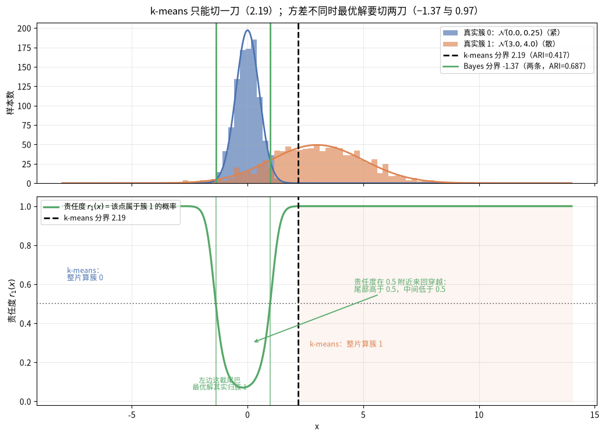
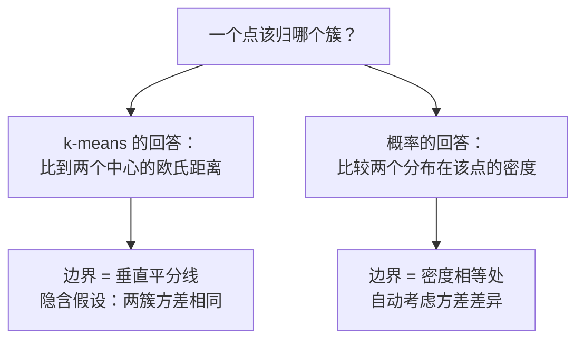
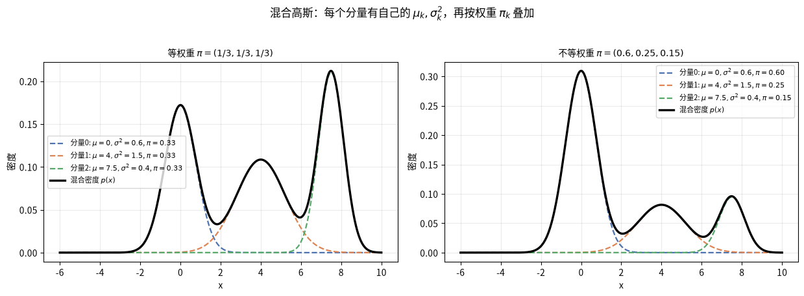
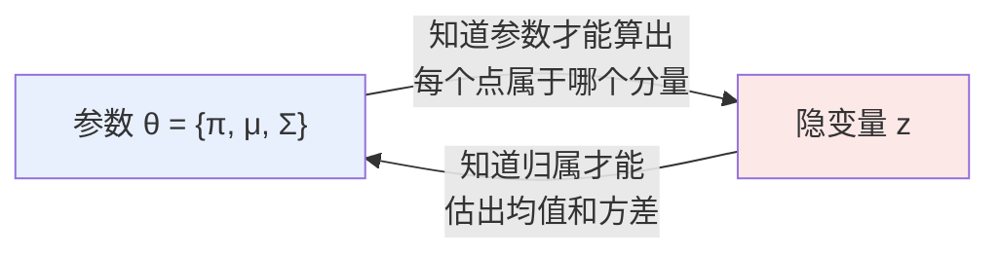

讲义 04 建立了两个工具：**密度**（给定参数，某处出现样本的可能性）和**协方差矩阵**（描述椭圆形状）。这一讲把它们拼成模型：**假设数据由 $K$ 个高斯按比例混合生成，然后问每个点最可能来自哪一个。**

这个模型叫**混合高斯模型**（Gaussian Mixture Model，GMM）。它比 k-means 多出三样东西：软归属（概率而不是 0/1）、每个簇自己的协方差矩阵（椭圆而不是等径圆）、以及一个能跨 $K$ 比较的似然。这一讲先把模型和"责任度"讲清楚，下一讲讲怎么估参数（EM 算法）。

## 1. 为什么需要 GMM：一个 k-means 会分错的例子

讲义 02 说过 k-means 的决策边界是**垂直平分线**——两个中心连线的中点垂线。这在"两个簇大小相当、形状相似"时是对的，但不满足这个条件时会切错。

看一个具体的反例：一维数据，两个簇的均值分别在 0 和 3，但**方差相差 8 倍**——簇 0 是 $\mathcal N(0,0.25)$（标准差 0.5，很紧），簇 1 是 $\mathcal N(3,4)$（标准差 2.0，很散），两者各占一半。

上图是数据的真实分布。黑色虚线是 k-means 收敛后的分界点，**2.19**；绿色实线是理论上的最优分界点，**0.97**。两者差了 1.2 个单位，后果很严重：

| 方法 | 分界点 | 各簇点数 | ARI |
|---|---|---|---|
| 真实情况 | — | [1008, 992] | 1.0000 |
| k-means | 2.19 | [1362, 638] | **0.4171** |
| Bayes 最优（用真实参数） | 0.97 | [1105, 895] | **0.6871** |

**k-means 把簇 0 的 1008 个点全部正确划出**（因为它很紧、离得远），但**簇 1 只认对了 638 个**——剩下 354 个被划给了簇 0。原因是那个中点式分界：簇 1 的方差大，它的样本向左延伸到 0 附近，而 k-means 的边界在 2.19，把这些点全判给了簇 0。

**为什么最优分界点不是中点？** 因为两个簇的"势力范围"不同。簇 0 很紧，它在 $x=1$ 处的密度已经衰减到接近 0；簇 1 很散，它在 $x=1$ 处仍有可观的密度。所以从 $x$ 大约是 0.97 开始，"这个点来自簇 1"的可能性就超过了簇 0。k-means 只比较"到中心的距离"，而在 $x=2$ 处，到中心 0 的距离是 2、到中心 3 的距离是 1，所以它认为属于簇 1——**它没有考虑 $\sigma$ 的差别**。

### 1.1 一个容易想不到的细节：最优划分可能有两条分界线

上面说"最优分界在 0.97"，其实**不完整**。把两个分量的对数密度之差写出来：

$$\ln\big(\pi_0\mathcal N(x\mid\mu_0,\sigma_0^2)\big)-\ln\big(\pi_1\mathcal N(x\mid\mu_1,\sigma_1^2)\big)
=\text{常数}-\frac{(x-\mu_0)^2}{2\sigma_0^2}+\frac{(x-\mu_1)^2}{2\sigma_1^2}$$

当 $\sigma_0\ne\sigma_1$ 时，$x^2$ 的系数是 $\frac{1}{2}\left(\frac{1}{\sigma_1^2}-\frac{1}{\sigma_0^2}\right)$。这里 $\sigma_1>\sigma_0$，所以系数为负——**这是一条开口向下的抛物线**。开口向下的抛物线有两个零点而不是一个，于是：

$$
\ln(\pi_0 p_0)>\ln(\pi_1 p_1)\quad\text{只在两个零点}\textbf{之间}\text{成立}
$$

代入本讲的参数（$\sigma_0=0.5$、$\sigma_1=2$），两个零点是 **$-1.3745$ 和 $0.9745$**。也就是说，**Bayes 最优划分是"簇 1 占两边的尾巴、簇 0 占中间"**：

- $x<-1.3745$：归簇 1（离得远，但簇 1 的密度衰减得慢，仍然赢）
- $-1.3745<x<0.9745$：归簇 0
- $x>0.9745$：归簇 1

这个结论有点反直觉：数轴最左边那一小截尾巴，反而应该归给中心在 3 的那个簇。原因就是它太散了——在 $x=-3$ 处，簇 0 的密度是 $e^{-18}$ 量级，而簇 1 的密度是 $e^{-4.5}$ 量级，后者大得多。

**当两个簇方差相同时，抛物线的二次项系数为零，退化成一条直线，零点只剩一个**——这时分界才是一个点，也就是 k-means 那种"切一刀"的形式。所以"分界是一个点"这件事本身就是等方差假设的产物，方差不同的时候最优边界可以是两段甚至更复杂。

顺带说明：即使知道真实参数、用上了完整的两条分界，Bayes 划分的 ARI 也只有 0.6871，达不到 1.0——因为重叠区里两个品种的样本本来就混在一起，**任何划分都不可能完全恢复真实标签**。这是信息本身的限制，不是算法的缺陷。

一般化地说：**k-means 的分界等价于 GMM 在所有簇共用同一个各向同性协方差时的特殊情况**。一旦各簇的协方差不同（大小不同、形状不同、朝向不同），k-means 的分界就不再最优。

## 2. 模型的完整定义

现在把 GMM 写清楚。它的生成过程分两步：

1. 先按概率 $\pi_k$ 选一个分量：$p(z=k)=\pi_k$，其中 $\pi_k\ge0$ 且 $\sum_{k=1}^K\pi_k=1$；
2. 再从被选中的那个高斯里抽出一个样本：$p(x\mid z=k)=\mathcal N(x\mid\mu_k,\Sigma_k)$。

对不可观测的 $z$ 求和，得到单个样本的边缘密度：

$$
p(x\mid\theta)=\sum_{k=1}^{K}\pi_k\,\mathcal N(x\mid\mu_k,\Sigma_k)
$$

这里 $\theta=\{\pi_k,\mu_k,\Sigma_k\}_{k=1}^K$ 是全部待估参数，共 $K$ 组。$\pi_k$ 叫**混合系数**，可以理解为"第 $k$ 个分量在总体里占的比例"。

这张图展示了权重的作用。左图三个分量等权（各 1/3），混合密度是三条虚线等比例叠加；右图权重改成 $(0.6,0.25,0.15)$，第一个分量的峰立刻变成主导，另外两个变成小峰。**注意每个分量都有自己的 $\mu_k$ 和 $\sigma_k^2$**（图中标注了具体值），这正是 k-means 做不到的——k-means 里所有簇共用一个隐含的"宽度"。

三个参数各管一件事，和讲义 04 讲一元高斯时一致：$\pi_k$ 决定每个分量**占多少比例**，$\mu_k$ 决定它**在哪里**，$\Sigma_k$ 决定它**什么形状**。

## 3. 隐变量：明明观测到了 $x$，为什么还说有未知量

模型里出现了 $z$，它表示"这个样本是哪个分量生成的"。**这个量观测不到**——我们只看到花瓣长度 4.8 cm，看不到"它来自第几个高斯"。这类变量叫**隐变量**（latent variable）。

这里有一个必须想清楚的逻辑，它是整个问题难度的来源：

**如果我们知道每个点的 $z$，参数估计会变得非常简单。** 那就退化成讲义 01 讲的情形：有标签了，直接分组算均值和方差就行，有闭式解（后面第 5 节会写出来）。

**但 $z$ 恰恰是我们想求的东西。** 参数估计需要知道 $z$，而推断 $z$ 又需要先有参数。这就是讲义 02 里 k-means 遇到的那个"鸡生蛋"问题，只是换了个形式：

k-means 用交替优化解开了这个循环（分配步 / 更新步）。GMM 用的还是交替优化，只是每一步变成概率版本——**E 步**算 $z$ 的概率分布，**M 步**更新参数。这就是讲义 06 的 EM 算法。

## 4. 责任度：软归属的精确含义

在交替优化里，"每个点属于哪个分量"这一步由**责任度**（responsibility）回答。它的定义是给定样本 $x_n$ 后，第 $k$ 个分量的**后验概率**：

$$
\gamma_{nk}=p(z_n=k\mid x_n)=\frac{\pi_k\,\mathcal N(x_n\mid\mu_k,\Sigma_k)}{\sum_{j=1}^{K}\pi_j\,\mathcal N(x_n\mid\mu_j,\Sigma_j)}
$$

逐部分读这个式子。分子 $\pi_k\mathcal N(x_n\mid\mu_k,\Sigma_k)$ 是"第 $k$ 个分量生成这个点的**联合**概率"——既要它被选中（$\pi_k$），又要它抽出这个值（密度）。分母是"所有分量生成这个点的概率之和"，也就是 $p(x_n)$ 本身。所以这是一个标准的贝叶斯公式：**后验 = 似然 × 先验 / 归一化常数**。

两个必须记住的性质：$\gamma_{nk}\in[0,1]$，并且对每个点有 $\sum_k\gamma_{nk}=1$。也就是说，责任度是"把 1 个单位的归属权分配给 $K$ 个分量"，而不是各自独立的分数。

### 4.1 用刚才那个例子看责任度

回到第 1 节的数据，用**真实的参数**算责任度 $r_1(x)$（属于簇 1 的概率）：

| x | $p_0(x)$ 簇0密度 | $p_1(x)$ 簇1密度 | $r_1(x)$ |
|---|---|---|---|
| −3.0 | 0.000000 | 0.002216 | 1.0000 |
| −2.0 | 0.000268 | 0.008764 | 0.9704 |
| **−1.3745** | 0.018237 | 0.018240 | **0.5000** |
| 0.0 | 0.797885 | 0.064759 | 0.0751 |
| 0.5 | 0.483941 | 0.091325 | 0.1588 |
| **0.9745** | 0.119422 | 0.119443 | **0.5000** |
| 1.5 | 0.008864 | 0.150569 | 0.9444 |
| 2.0 | 0.000268 | 0.176033 | 0.9985 |
| 3.0 | 0.000000 | 0.199471 | 1.0000 |

注意中间几行：$x=0$ 处责任度只有 0.075（几乎肯定属于簇 0），到 $x=0.5$ 升到 0.159，越过 0.5 的位置正是 0.9745。这正是"我不确定"的区域：看两列密度，在 $x=0.5$ 到 $1.5$ 之间它们是同一量级（0.48 对 0.09、0.009 对 0.15），硬归属无法表达这种犹豫。

还要注意最上面两行：$x=-2.0$ 处责任度是 0.970，**属于簇 1**。这个反直觉的结果就是 1.1 节讲的两条分界造成的——左边的尾巴归簇 1。所以责任度曲线的形状是"高—低—高"：在两端接近 1，中间（$x$ 从 −1.37 到 0.97）低于 0.5。

下图把责任度画成曲线，和 k-means 的分界叠在一起对比：

看下面那张图。绿色曲线是 $r_1(x)$：两端接近 1，中间（$x$ 约从 −1.37 到 0.97）塌到 0.5 以下，最低点在 $x=0$ 附近（约 0.075）。**这条曲线是连续过渡的，不是 0/1 跳变**——这就是软归属。两条绿色竖线标出了它穿越 0.5 的两个位置。

k-means 相当于把曲线在 $x=2.19$ 处硬切成 0 和 1（黑色虚线），而且**切在了错误的位置**：按责任度，$x=1.0$ 已经偏向簇 1（0.528），而 k-means 把 2.19 之前的点全判给簇 0。它也没有能力表达"左边那截尾巴应该归簇 1"这种非单点分界的结构。

### 4.2 责任度与"硬归属"的关系

责任度是一个连续量，要得到最终的聚类划分（比如和真实标签比较、或者画图），通常取**最大责任度对应的分量**：

$$
\hat z_n=\arg\max_k \gamma_{nk}
$$

这一步有时叫"硬分配"。它和 k-means 的分配步形式相同，区别在于依据从"距离最近"换成了"责任度最大"。

**一个重要的联系**：可以证明，在"所有分量协方差相同且为 $\sigma^2I$、且 $\sigma\to0$"的极限下，责任度退化成 0/1 的硬分配，而此时 $\arg\max_k\gamma_{nk}$ 恰好等于"离哪个中心最近"。也就是说：

$$
k\text{-means} = \text{GMM 在「等方差、各向同性、方差趋于 0」时的极限情形}
$$

这个等式解释了很多事：为什么 k-means 的边界是直线（等方差对称的结果）、为什么它处理不了大小不同的簇（等方差假设被破坏）、以及为什么它的目标是 $J$ 而 GMM 的目标是似然（前者是后者在极限下的代理）。讲义 02 里说"k-means 是硬分配的 EM"，指的就是这件事。

## 5. 参数估计：有 $z$ 就简单，没 $z$ 就难

这一节把"难在哪"讲具体，下一讲解决它。

**假设 $z$ 已知**（也就是每个点都带着"来自第几个分量"的标签）。那参数估计有闭式解，就是分组统计：

$$
\pi_k=\frac{N_k}{N},\qquad \mu_k=\frac{1}{N_k}\sum_{n\in\text{第}k\text{组}}x_n,\qquad \Sigma_k=\frac{1}{N_k}\sum_{n\in\text{第}k\text{组}}(x_n-\mu_k)(x_n-\mu_k)^{\mathsf T}
$$

其中 $N_k$ 是第 $k$ 组的样本数。三个式子的含义都很直白：混合系数是比例，均值是组内平均，协方差是组内（有偏）协方差。这和 k-means 的更新步一模一样，只是现在有了协方差。

**但 $z$ 未知。** 我们只有 $x$，于是只能写出边缘似然：

$$
\ln p(X\mid\theta)=\sum_{n=1}^{N}\ln\left(\sum_{k=1}^{K}\pi_k\,\mathcal N(x_n\mid\mu_k,\Sigma_k)\right)
$$

这个式子的困难**全部集中在"对数里面还有一个求和"**：$\ln\sum_k$ 这个结构使得对 $\mu_k$ 求导时，分母上会出现 $\sum_j\pi_j\mathcal N(x_n\mid\mu_j,\Sigma_j)$，也就是参数会互相耦合，得不到闭式解。

这就是隐变量问题的典型形态：**能观测的数据给出的是"求和之后的对数"，而我们要的对数在求和外面。** EM 算法的思路是绕开它——不直接最大化这个困难的似然，而是构造一个更容易最大化的下界，通过反复抬高下界来间接抬高似然。而下界的构造正好用到了责任度 $\gamma_{nk}$。

好消息是，虽然似然本身难，但它对参数是有界的（不像 k-means 的 $J$ 有组合爆炸），而且 EM 的每一步都有闭式解——这是讲义 06 的内容。

## 6. 本讲小结

混合高斯模型假设数据由 $K$ 个高斯按比例 $\pi_k$ 混合生成。写成密度就是 $p(x)=\sum_k\pi_k\mathcal N(x\mid\mu_k,\Sigma_k)$，三组参数各管比例、位置、形状。它比 k-means 强的地方在于**每个分量有自己的协方差矩阵**，因此分界会考虑各簇的宽度——第 1 节的例子里，k-means 把分界切在 2.19（ARI 0.417），而考虑方差后的最优分界是 −1.37 和 0.97 两条（ARI 0.687）。方差不同时"最优边界是一个点"这个前提本身就不成立。

但模型里引入了观测不到的**隐变量** $z$（每个点来自哪个分量），使得"参数估计"和"推断归属"互相依赖，形成鸡生蛋的循环。**责任度** $\gamma_{nk}=p(z_n=k\mid x_n)$ 是打破这个循环的关键量：它是软归属，取值在 $[0,1]$ 且对每个点求和为 1，由贝叶斯公式算出（先验 $\pi_k$ 乘该分量的密度，再归一化）。落在重叠区的点责任度接近 0.5，明确属于某簇的点接近 1——这是硬归属给不了的信息。

最后要记住两个结构性的点。第一，**k-means 是 GMM 在等方差各向同性且方差趋于 0 时的极限**，所以它是 GMM 的特例而不是竞争方法。第二，**GMM 的困难在于对数里面有求和**：如果 $z$ 已知，参数有闭式解（分组统计即可）；$z$ 未知时似然无法直接求导，必须用 EM 通过优化一个下界来间接求解。

## 7. 动手练习

**练习 1（实现责任度）**：写一个函数 `responsibility(x, mu0, var0, mu1, var1, w0, w1)`，返回 $x$ 属于第二个分量的责任度。一维情形下后验是

$$
\gamma_1(x)=\frac{w_1\mathcal N(x\mid\mu_1,\sigma_1^2)}{w_0\mathcal N(x\mid\mu_0,\sigma_0^2)+w_1\mathcal N(x\mid\mu_1,\sigma_1^2)}
$$

用讲义第 4 节的表验证：$x=1.0$ 时应该得到约 0.528，$x=2.0$ 时约 0.999。

**注意数值稳定**：直接按上式算，当密度很小时分子分母都会变成 0，得到 `nan`。正确做法是在对数域做——先算 $\ln(w_k)+\ln\mathcal N$，减去两者的最大值再取指数（这是 log-sum-exp 技巧）。**请实现对数域版本**，并验证 $x=10$ 时不会出现 `nan`（$x=10$ 离两个中心都很远，直接算会下溢）。

**练习 2（看分界错在哪）**：用 `dg.make_synthetic_data` 生成讲义第 1 节那份数据（$\mu=(0,3)$、$\sigma^2=(0.25,4)$、权重各 0.5）。跑 `kmeans`，打印它的两个中心、分界点、ARI、各簇点数。然后用你练习 1 的函数，找出责任度等于 0.5 的那个 $x$（用二分法或扫描）。两者差多少？各簇点数分别差多少？

**注意**：责任度等于 0.5 的位置有**两个**（因为两个簇方差不同）。请把它们都找出来（提示：在 −40 到 40 之间粗扫，找函数变号的区间，再在每个区间里二分）。只有一个分界时 ARI 是多少？用两个分界呢？

**练习 3（软归属长什么样）**：把练习 1 的责任度函数画成曲线（$x$ 从 -8 到 14）。在图上标出：k-means 的分界点、责任度等于 0.5 的点、以及责任度落在 $[0.4,0.6]$ 的区间。**那个区间里有多少个样本？** 数一数，并回答：k-means 对这些点做了什么？这样做合理吗？

**练习 4（权重的作用）**：把练习 1 的参数里 $w_0,w_1$ 改成 $(0.9,0.1)$，重新算责任度和 $r=0.5$ 的分界点。分界点往哪个方向移动了？为什么？然后改成 $(0.1,0.9)$ 再看一次。**这个实验说明 $\pi_k$ 在分界中起什么作用？**（提示：先验大的分量"势力范围"更大。）

**练习 5（一维 vs 二维的二维高斯）**：取 $\mu_0=(0,0)$、$\Sigma_0=0.5I$ 和 $\mu_1=(3,3)$、$\Sigma_1=2I$，权重各 0.5，用 `dg.make_synthetic_data` 生成 2000 个二维点。然后**不用任何聚类算法**，直接用真实参数算每个点的责任度，取 $\arg\max$ 作为划分，算 ARI。再跑 `kmeans`（$K=2$）算 ARI。比较两个结果。**再试一次：把 $\Sigma_1$ 改成 $0.5I$（两个簇方差相同）**，看 k-means 的 ARI 是否追上来。这个对比能定量说明"k-means 的损失随两簇方差差异增大而增大"。
