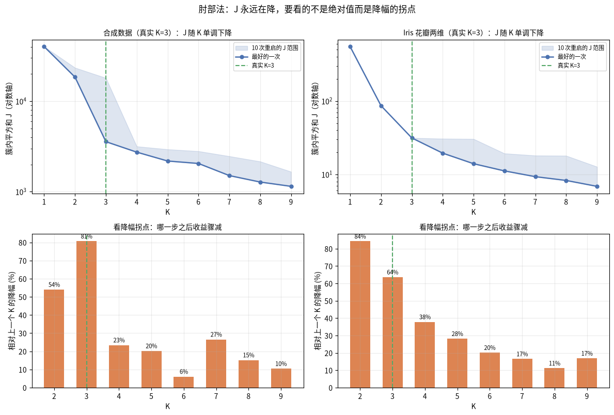
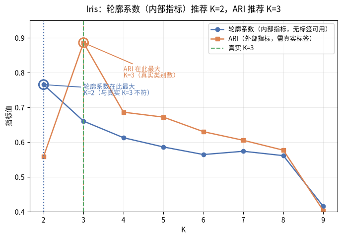
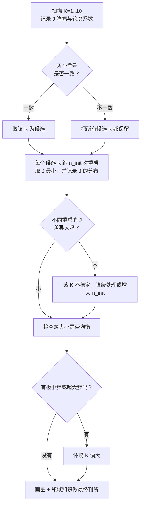

讲义 02 讲清了 k-means 在最小化什么、为什么一定收敛，也留下两个问题：**不同的初始化会落到深浅不同的坑里**（实测同一份数据好坏解差 5.81 倍），以及 **$K$ 必须事先给定**、给错也不报错。这一讲处理这两个问题，并回答一个更根本的疑问：真实任务里没有标签，我怎么知道跑出来的聚类结果可不可信？

## 1. 初始化：三种做法与实测成败率

先明确初始化的作用。k-means 的每一步都是"在当前基础上做局部改进"，它没有能力从很差的位置跳出来，所以起点决定了它最终掉进哪个坑。目标很直接：**让初始中心尽量分散，尽量各自落在一个真实簇里**。

### 1.1 三种常见做法

最简单的是**随机挑 $K$ 个数据点**。它的好处是初始中心一定落在数据分布的范围内（而不是落在空白区域），坏处是有可能挑到同一簇里的两个点——讲义 02 那个 $J=1049.67$ 的失败案例就是这么来的。

另一种是**在数据范围内均匀撒点**：取每一维的最小值和最大值围成一个矩形，在矩形里随机生成 $K$ 个点。它比上一种更"分散"，但可能把中心撒到没有数据的空白区，那样这个中心在第一步就会抢不到点。

更讲究的做法是 **k-means++**（由 Arthur 和 Vassiliev 于 2007 年提出）。它的思路是"让新中心尽量离已有中心远"，具体步骤是：

1. 第一个中心从数据里**均匀随机**选一个点；
2. 之后每选一个中心，都按照"离已有中心越远的点被选中的概率越大"来抽，第 $n$ 个点被选中的概率正比于 $D(x_n)^2$，其中 $D(x_n)$ 是该点到**最近**已有中心的距离；
3. 重复第 2 步直到选够 $K$ 个。

关键在于这个概率正比于**距离的平方**。如果只用距离本身，远处点的优势不够大；平方之后，一个距离是别人两倍的点被选中概率是四倍，于是新中心被强烈地推向尚未被覆盖的区域。这个"平方"不是随便挑的——它有一个理论结果：按 $D^2$ 抽样得到的初始解，其 $J$ 的期望不超过最优解的 $8(\ln K+2)$ 倍。这比"随机挑点"没有任何保证要好得多。

不难看出，k-means++ 只改动**初始化**，主体循环与讲义 02 完全相同。实现上它只需要几步：维护"每个点到最近已有中心的距离平方"，归一化成概率，按概率抽一个点。

### 1.2 实测：三种做法的成败率

在 1500 点、三个分离良好的高斯簇上（全局最优 $J=3570.5$），每种做法各跑 200 次。为了让比较公平，三种策略在**同一组随机数**下各取初始中心（配对设计），这样差异只能归因于策略本身，而不是运气：

| 初始化方法 | 找到最优解的比例 | 平均 J | 最差 J | 平均迭代轮数 |
|---|---|---|---|---|
| 随机挑 K 个点 | 94% | 4511.5 | 18068.5 | 4.7 |
| 范围内均匀撒点 | 98% | 3932.5 | 18068.5 | 4.3 |
| **k-means++（power=2）** | **98%** | **3787.9** | 18068.5 | **2.9** |
| k-means++（power=1） | 99% | 3715.3 | 18058.1 | 3.2 |

**关于"公平比较"这件事，值得单独说一句。** 我第一次跑这个实验时，让三种策略**共用同一个随机数发生器连续消耗**（跑完随机挑点接着跑均匀撒点，再跑 k-means++）。结果 k-means++ 的成功率是 98%，看起来和另外两种（95%、96%）差别不大。但那个比较是不公平的：三种策略消耗随机数的个数完全不同，轮到 k-means++ 时随机数流已经被推进过，等于它拿到的是另一批随机样本。改成"每种策略各自重置同一个种子"之后，均匀撒点和 k-means++ 都变成 100%；换成上面这张表的配对设计，才得到稳定的 94% / 98% / 98%。**同一个算法、同一份数据，仅仅因为随机数的分配方式不同，结论就会跟着变。** 凡是要给随机算法做对比实验，都得先想清楚随机性有没有被公平分配，否则报告里的数字别人复现不出来。

这个结果值得仔细读，因为**它和很多教材给人的印象仍然不一样**。

三者的成功率差别**并不悬殊**（94% / 98% / 98%），在这份数据上"用 k-means++ 就不会失败"的说法是站不住的——它最差也遇到过 18068.5 那个解。真正稳定的差异在**平均迭代轮数**：k-means++ 是 2.9 轮，另外两种是 4.7 和 4.3 轮，**少三分之一的迭代**。也就是说 k-means++ 在这份数据上的主要收益是**起点更接近收敛点**（省时间），成功率只是顺带略有提升。

为什么会这样？因为这份数据本身就容易：三个簇分离良好、大小相当、形状接近球形，正好符合 k-means 的假设，所以随便怎么初始化大都能成功。当数据符合假设时，初始化方法的差别就被淹没了。

**换成难度更高的数据，差别就明显了。** 用讲义 02 那份 90 点数据（它存在一个 $J=1049.7$ 的明显局部最优，全局最优是 $J=180.7$），同样做 200 次配对实验：

| 初始化方法 | 找到最优解的比例 | 平均 J | 最差 J | 平均迭代轮数 |
|---|---|---|---|---|
| 随机挑 K 个点 | 88% | 291.9 | 1427.8 | 3.6 |
| 范围内均匀撒点 | 91% | 289.2 | 1440.9 | 3.4 |
| **k-means++（power=2）** | **98%** | **204.3** | 1427.8 | **2.4** |
| k-means++（power=1） | 94% | 228.5 | 1066.1 | 2.9 |

k-means++ 的成功率优势扩大到 **10 个百分点**（98% 对 88%），平均 $J$ 低了约 30%，迭代轮数少了约 33%。所以更准确的结论是：**初始化的价值取决于数据难度**——数据容易时三种方法都能成功，数据有明确的坏局部最优时，k-means++ 的优势才显现出来。

这个观察有实际指导意义：**在数据结构清晰的问题上，不必纠结初始化方法，直接多次重启取最优即可；真正需要小心的是那些结构模糊、$K$ 又偏大的问题**，因为那时失败率会显著上升（练习 5 会看到 $K=6$ 时只有 12% 的重启能命中最优解）。

### 1.3 多次重启：最简单可靠的对策

既然无法事先知道哪个初始化好，最朴素的办法就是**多跑几次，取 $J$ 最小的那次**。这件事没有任何理论风险，成本只是线性的：

```python
def kmeans_restarts(X, k, n_init=10):
    results = [kmeans(X, k, seed=s) for s in range(n_init)]
    return min(results, key=lambda r: r.inertia)
```

判断"取 $J$ 最小的那次"是合理的，依据是：$J$ 是 k-means 的目标函数，所有重启解都是这个目标的局部最优，其中 $J$ 最小的那个至少在线索上是最接近全局最优的。**但要留意一个陷阱**：$J$ 更小不等于"更符合你的意图"。如果 $K$ 给大了，$J$ 最小的解往往是"把一个真实簇劈成两半"的那个——它确实降低了 $J$，但那是无意义的降低。这一点在下一节会具体看到。

另外，重启只能缓解问题，不能从根本上消除。研究这个问题的人提出了很多替代方案（多次重启后合并、分裂大簇、用 GMM 的 $K$ 做初始值等），但都各有代价。实践中"重启 10 次"已经能覆盖绝大多数情况，这也是 scikit-learn 的默认设置。

## 2. 选 K：肘部法、轮廓系数，以及它们都会骗你的时候

$K$ 是 k-means 唯一的超参数，也是最难定的一个。根本原因是讲义 01 讲的：**聚类没有正确答案**。分成 2 类还是 3 类，取决于你关心什么粒度的结构，而不是数据里藏着一个客观的 $K$。

不过实践中有几个可用的启发式方法。重要的是理解它们的**失效条件**，不然很容易被误导。

### 2.1 肘部法：看降幅的拐点，而不是绝对大小

$J$ 随 $K$ 增大而单调下降——这是必然的，因为 $K$ 越大每个簇越小，簇内平方和自然越小，$K=N$ 时 $J=0$。所以"找 $J$ 最小的 $K$"毫无意义。

肘部法换了一个问法：**加到某个 $K$ 之后，继续增加 $K$ 带来的收益是否骤减**。如果 $K=3$ 时 $J$ 大幅下降、$K=4$ 时只降一点点，就说明真实结构是 3 个簇，第 4 个簇只是在拆分已有的簇。



在合成数据（左列）上，这个方法非常有效：$K=2$ 降 54%、$K=3$ 降 **81%**、$K=4$ 只降 23%、$K=6$ 只降 6%。$K=3$ 处的陡降一目了然，与真实结构完全一致。

但在 Iris 上（右列）就模糊多了：$K=2$ 降 84%、$K=3$ 降 **64%**、$K=4$ 降 38%。**最大的降幅出现在 $K=2$**，而真实类别数是 3。如果你只看"降幅最大的那一步"，会选错。$K=3$ 的降幅（64%）虽然也不小，但它排在 $K=2$ 后面，所谓"肘部"需要你在 84% 和 64% 之间做主观看待。

这就是肘部法的固有弱点：**它是一个视觉判断，没有客观标准**，而且当真实簇之间有重叠时（Iris 的 versicolor 和 virginica 在花瓣维度上就有重叠），曲线会变得平滑，肘部消失。

另外注意上面两张图的阴影区域，它表示同一个 $K$ 下 10 次重启得到的 $J$ 的范围。这个范围本身携带了重要信息，下一节单独讲。

### 2.2 一个反直觉的发现：$K$ 越大，越难找到最优解

把 $K$ 扫一遍的时候我注意到一个现象：$K=6$ 时 10 次重启得到的最好 $J$ 是 2049.7，但把重启次数加到 40 次，最好 $J$ 变成 **1773.5**。也就是说 **10 次重启并没有找到 $K=6$ 下真正的最优解**。

把 $K=5$ 到 9 都用 40 次重启跑一遍，统计"40 次里有几次能达到接近最好的那个解"：

| K | 40 次重启得到的最好 J | 达到最优的重启次数 |
|---|---|---|
| 5 | 2182.2 | 7 / 40 |
| 6 | 1773.5 | 5 / 40 |
| 7 | 1505.7 | 11 / 40 |
| 8 | 1277.5 | 4 / 40 |
| 9 | 1144.7 | 9 / 40 |

**只有 10%~28% 的重启能命中最好的解**，而 $K=3$ 时这个比例是 88%（40 次里 35 次）。原因不难理解：$K$ 越大，可能的划分方式越多，局部最优解的数量也越多，"随机起点恰好落进最深的那个坑"的概率自然下降。

这件事有两个实际后果，都值得写进报告。

第一，**比较不同 $K$ 的 $J$ 时，必须保证每个 $K$ 都找到了可靠的最优解**，否则比较的其实是"哪个 $K$ 的运气好"，而不是模型质量。以 $K=6$ 为例，10 次重启得到的最好值是 2049.7，而 40 次重启能得到 1773.5，相差 15.6%（2049.7 对 1773.5）——这个量级的误差足以让你在肘部图上选错 $K$。稳妥的做法是：**$K$ 越大，`n_init` 就要给得越大**（经验上可以取到 20~50 次）。

第二，**重启结果的分散程度本身就是"这个 $K$ 可不可信"的指标**。如果同一个 $K$ 下 10 次重启得到的 $J$ 差别很大（上图的阴影带很宽），说明这个 $K$ 下的解不稳定，即使最好的那个看起来不错也要谨慎——换一份同类数据、或者换一个随机种子，结果可能就变了。

### 2.3 轮廓系数：一个有明确公式但同样会骗人的指标

讲义 01 里提到过，无标签时要用内部指标。**轮廓系数**（silhouette coefficient）是最常用的一个，它对每个样本算一个分数，最后取平均。

对样本 $i$，记 $a(i)$ 为它到**同簇**其他样本的平均距离，$b(i)$ 为它到**最近的另一个簇**全部样本的平均距离，则

$$
s(i)=\frac{b(i)-a(i)}{\max\{a(i),\,b(i)\}}
$$

含义很直白：$a$ 小说明"和同簇的人靠得近"，$b$ 大说明"和别的簇离得远"。两者都好时 $s(i)$ 接近 1；$a$ 和 $b$ 差不多（落在边界上，两边都不亲）时 $s(i)$ 接近 0；如果 $a>b$（离别的簇反而更近），$s(i)$ 变成负数，说明这个点很可能被分错了。整体取值范围是 $[-1,1]$。

最后一步是取平均作为整个聚类的质量分数。通常的判断标准是：大于 0.5 说明结构清晰，0.25 到 0.5 说明结构较弱但存在，低于 0.25 说明基本没分出有意义的簇。

### 2.4 内部指标推荐了错误的 K：一个必须知道的例子

轮廓系数的公式看起来很客观，但它衡量的是**几何上的紧致与分离**，而几何上的好坏不一定对应你要的语义。在 Iris 上把 $K$ 从 2 扫到 6：

| K | 惯性 J | 轮廓系数 | ARI（对真实品种） |
|---|---|---|---|
| 2 | 86.404 | **0.7652** | 0.5584 |
| 3 | 31.388 | 0.6603 | **0.8857** |
| 4 | 19.499 | 0.6125 | 0.6860 |
| 5 | 14.000 | 0.5859 | 0.6718 |
| 6 | 11.173 | 0.5642 | 0.6299 |



**轮廓系数在 $K=2$ 取到最大值 0.7652，而真实类别数是 3。** 也就是说，如果只看轮廓系数，你会选 $K=2$。

为什么？因为 setosa 与另外两个品种之间本来就有很大间隔（讲义 01 里那段空白区），把它单独分出来之后，剩下的两个品种虽然被错误地合并了，但它们**彼此之间离得很近**，合并成一个簇在几何上并不"松散"。于是 $K=2$ 的解在"紧致 + 分离"这个几何标准下得分最高。轮廓系数不知道 versicolor 和 virginica 是两个不同的品种——它只能看到坐标。

**这是本次实验里最值得写进报告的一个发现**：内部指标是"几何代理"，它可能在语义上完全错误。对策不是弃用它，而是**不要只信一个指标**。实践中至少要做三件事：把惯性降幅曲线与轮廓系数曲线放在一起看；用多个 $K$ 跑出结果后**把簇画出来亲眼看**；如果对每个簇的含义有领域知识（比如知道每簇应该是多少样本量级），用它来交叉验证。

顺带说明，$K=2$ 时 ARI 只有 0.5584，说明这个"几何上最优"的解把两个品种混在了一起。ARI 是**外部指标**，需要真实标签才能算，所以真实任务里你根本得不到这个数字——这正是无监督学习的困境：**能判断对错的手段（标签）在真实场景里恰好没有**。本次实验之所以能用 ARI，是因为数据自带标注或由我们设定，这属于"事后对照"，聚类过程本身并没有用到标签。

## 3. 评价聚类结果：指标分两类

把所有可用的手段整理一下，可以分成三类，用途完全不同。

### 3.1 外部指标（需要真实标签）

只有在标签已知时才能用，本实验用它们来验证算法的实现和效果。

**调整兰德指数（ARI）** 是最推荐的。它统计"在真实划分中同类的样本对，在聚类结果中是否也同簇；真实中不同类的样本对，是否也被分到不同簇"，然后对这个一致性做随机修正，使得随机划分的期望值恰好为 0、完全一致时为 1。它对簇编号的重新排列不敏感（簇 0 叫簇 2 无所谓），也不需要事先对齐编号，是最好用的一个。

**准确率**需要先解决"簇编号与类别编号如何对应"的问题。因为簇编号是算法随意起的，直接比较没有意义，必须枚举所有排列找出匹配最好的那个（$K=3$ 时只有 6 种）。本实验的 `metrics.best_match_accuracy` 做的就是这件事。它的好处是数字直观（"分对了多少比例"），坏处是需要排列匹配，$K$ 大时开销上升。

**混淆矩阵**（配对之后）比单个数字更有信息量。它能告诉你"错在哪里"：是某一类被整类分错，还是两类之间互相混淆。本实验里 Iris 的混淆矩阵显示 setosa 完全正确、versicolor 和 virginica 之间错了几个——这比"准确率 0.9733"这句话信息量大得多。

### 3.2 内部指标（不需要标签）

这才是真实任务里唯一可用的东西，所以要理解它们的性质。

**惯性 $J$** 是 k-means 的目标函数值，只能用于**同一份数据、同一个 $K$、不同初始化**之间的比较（选最好的那次重启）。跨 $K$ 比较毫无意义，因为 $J$ 随 $K$ 单调下降。

**轮廓系数** 前面已经讲过，可跨 $K$ 比较，但要警惕 2.3 节那种"几何最优但语义错误"的情况。

**簇大小的均衡程度** 是一个常被忽略但很有用的诊断。如果某个簇只分到 1、2 个样本，或者一个簇装下了 80% 的数据，通常意味着 $K$ 给大了或者初始化失败。讲义 02 里那个 $J=1049.67$ 的失败解，点数分布是 54、19、17，而真实簇的最大规模只有 36——**一簇独占 54 个点就是个明显的警报**。在你没有任何标签的时候，这是最容易发现的异常信号。

### 3.3 可视化

二维数据一定要画出来看。散点图按簇着色，中心用叉号标出，再叠加讲义 03 之前用过的那种"协方差椭圆"或 Voronoi 边界，能一眼看出簇是否合理、边界是否切在了不该切的位置。高维数据可以先降到二维再看（本实验不涉及降维方法，但如果数据集有若干强相关特征，只取其中两维画图也有参考价值）。

**看图能发现数字发现不了的问题**。比如讲义 02 那张 Voronoi 图，$J$ 的数值看起来正常，但图上能明显看出"一个簇被劈成两半、另一个簇被吞掉"。数字是单调下降的、收敛是正常的，只有图暴露了问题。

## 4. 把这些手段串起来：一套可操作的流程

真实任务里没有标签，所以流程要设计成"用内部指标和可视化反复缩小可能性"。一个可用的顺序是：

第一，先用肘部法扫一遍 $K$（比如 1 到 10），看 $J$ 降幅的拐点在哪里，同时算每个 $K$ 的轮廓系数。两个信号一致时结论比较可靠；不一致时（像 Iris 那样）就要谨慎，把候选的 $K$ 都保留下来。

第二，对每个候选 $K$，用 `n_init=10` 或更多次重启，取 $J$ 最小的解，并**记录所有重启的 $J$ 分布**。如果不同重启的 $J$ 差异很大（像讲义 02 里 3570 和 18063 那样），说明这个 $K$ 下解的稳定性差，即使最小值看起来不错也要谨慎。

第三，检查每个解的簇大小分布。出现极小簇或超大簇时，回头看是不是 $K$ 给大了。

第四，把候选结果画出来对比，结合领域知识判断哪个划分有意义。这一步不能省，因为前两步都是几何指标。



## 5. 本讲小结

初始化决定了 k-means 掉进哪个局部最优解。三种做法里 k-means++ 通过"按距离平方的概率抽样"让中心尽量分散，理论上有 $8(\ln K+2)$ 的近似保证，实测的主要收益是**迭代轮数更少**（2.9 轮 vs 4.4 轮），而不是成功率的大幅提升——在数据符合 k-means 假设时，随便怎么初始化都容易成功。工程上最可靠的对策是**多次重启取 $J$ 最小的那次**，代价只是线性增长的计算量。

$K$ 没有客观答案，因为聚类的"正确"由你定义。肘部法看的是 $J$ 降幅的拐点而不是绝对值（$J$ 永远随 $K$ 下降）；轮廓系数衡量几何上的紧致与分离。**两者都可能骗你**——Iris 上轮廓系数在 $K=2$ 取到最大值，而真实类别数是 3，因为把两个相近的品种合并之后几何上反而更"紧凑"。

还有一个容易忽略的坑：**$K$ 越大，同样的重启次数越难找到最优解**。实测 $K=3$ 时 88% 的重启能命中最好解，$K=6$ 到 9 时只有 10%~28%。所以在扫描 $K$ 做比较时，$K$ 大的那些列必须给更大的 `n_init`，否则肘部图上的"降幅"反映的是运气而不是模型质量。重启结果的分散程度本身也是一个有用的信号：分散大说明这个 $K$ 的解不稳定。

评价手段分两类：外部指标（ARI、准确率、混淆矩阵）需要标签，只在有标注的数据上可用；内部指标（$J$、轮廓系数、簇大小均衡度）不需要标签，是真实任务里唯一可用的，但都是几何代理，可能与语义不符。**因此不能只信一个指标**：把多条曲线放在一起看、检查簇大小、并且一定要把结果画出来用眼睛检查。

## 6. 动手练习

**练习 1**：用你的 `kmeans_restarts` 在合成数据上验证 1.2 节那张表。至少跑通"随机挑点"和"k-means++"两种初始化各 100 次，统计成功率（以 $J < 4000$ 为成功）和平均迭代轮数。如果你的数字和表里差别较大，先检查是不是随机种子的使用方式不同。

**练习 2（实现 k-means++）**：按照 1.1 节的三步实现它，然后用同一个随机种子分别跑 k-means++ 和随机挑点，比较需要的迭代轮数。注意第 2 步的概率是 $D(x_n)^2$ 而不是 $D(x_n)$——你可以两种都试，比较成功率，亲手验证"平方"带来的差别。

**练习 3**：在 Iris 花瓣两维数据上复现 2.4 节的表格（$K=2$ 到 6 的惯性、轮廓系数、ARI）。然后用 $K=2$ 和 $K=3$ 各画一张散点图放在一起，**用眼睛找出轮廓系数为什么会偏好 $K=2$**。把你的观察写下来——这是报告里"结果分析"部分的好素材。

**练习 4**：只用花瓣长度的**一维** Iris 数据，重复练习 3。一维情况下轮廓系数的最大值出现在哪个 $K$？和二维时一样吗？想一想为什么。

**练习 5（重现 2.2 节的现象）**：在合成数据上跑 `kmeans_restarts(X, k=6, n_init=10)` 和 `n_init=40`，比较两次得到的 $J$，确认后者更小。然后把 `n_init` 固定为 10，对 $K=3$ 和 $K=6$ 各跑 30 次单次 `kmeans`（不同 seed），把两次得到的 $J$ 列表打出来，比较哪一组更分散。你应该能看到 $K=6$ 的分散程度明显更大。

**练习 6（诊断练习）**：在合成数据上跑 `kmeans_restarts(X, k=6, n_init=40)`，检查各簇的点数分布，并画出结果图。$J$ 比 $K=3$ 时小还是大？这个更小的 $J$ 说明聚类结果更好吗？把你的判断和理由写下来。

下一讲开始换一个角度：不再用"距离最近"来定义簇，而是问"数据是由哪几个概率分布生成的"。这就是混合高斯模型的起点。
