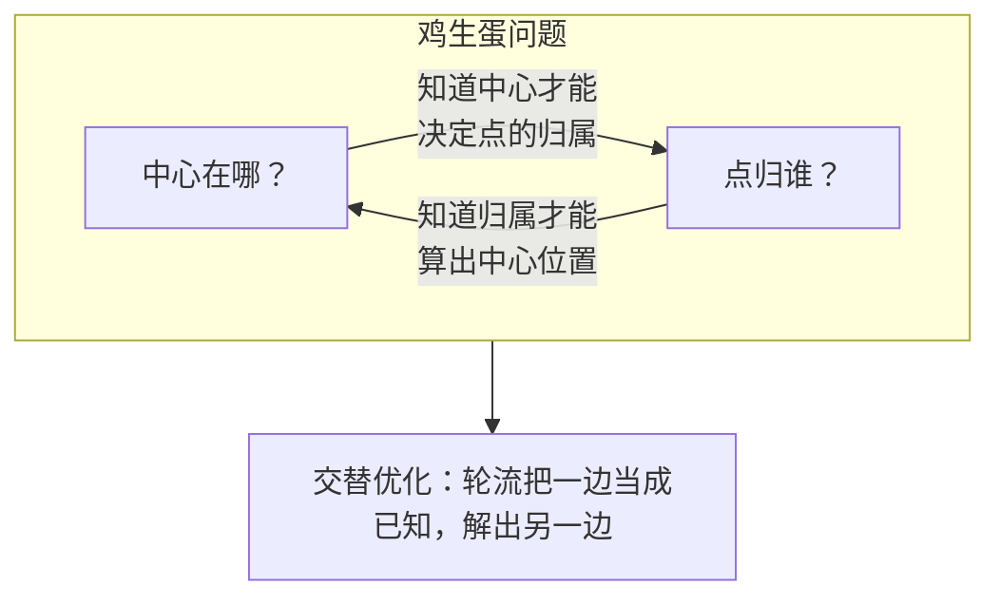
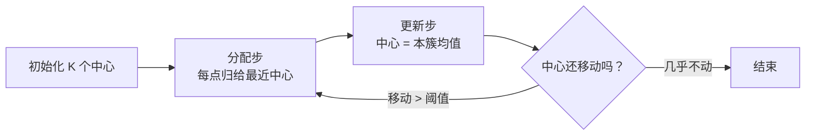
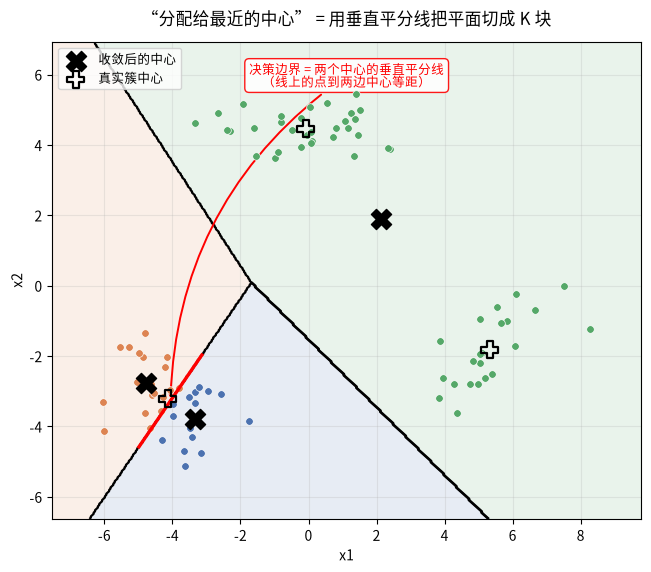
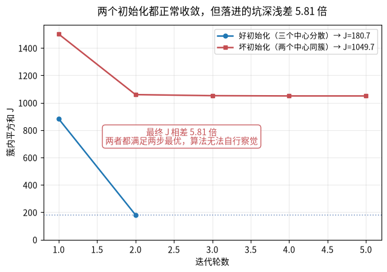
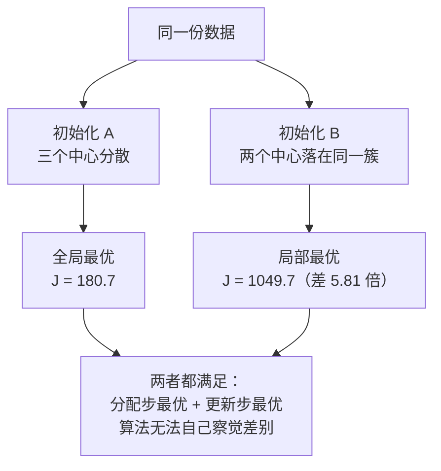

讲义 01 留下了两个概念：**距离**（衡量"相似"）和**无标签**（没有现成答案）。这一讲用它们来定义第一个聚类算法。重点不是"怎么写代码"，而是先把**k-means 到底在最小化哪个量**搞清楚——只要这件事清楚了，两步迭代的公式就是自然推导出来的，而不是需要背下来的规定。

## 1. 把聚类要求写成一句话

讲义 01 里说，聚类要求"同组的样本彼此相似，不同组的样本彼此不相似"。现在要把它变成数学。

假设已经知道要分成 $K$ 组。把第 $k$ 组的**中心**记为 $\mu_k$（一个和样本同维度的向量）。k-means 用了一个非常直接的思路：**不直接要求"同组的点彼此相似"，而是要求"每个点离它所属组的中心尽可能近"**。这两件事差不多是一回事，但后者可以写成公式——因为"离中心近"是每个点各自的事情，而"彼此相似"是两两之间的事情（$N^2$ 个约束，难以处理）。

于是聚类的目标变成：找一组中心 $\{\mu_1,\dots,\mu_K\}$，以及给每个点指定一个组，使得**所有点到各自中心的距离平方之和最小**。

## 2. 目标函数：簇内平方和

把"每个点属于哪个组"也写成变量。引入 $r_{nk}$，它只有两个取值：$r_{nk}=1$ 表示第 $n$ 个点属于第 $k$ 组，$r_{nk}=0$ 表示不属于。因为每个点只能属于一个组，所以对每个 $n$ 都有 $\sum_{k=1}^K r_{nk}=1$。

要最小化的量就是**簇内平方和**（within-cluster sum of squares），通常记作 $J$：

$$
J=\sum_{n=1}^{N}\sum_{k=1}^{K} r_{nk}\,\lVert x_n-\mu_k\rVert_2^2
$$

逐项读这个式子：最外层对 $N$ 个点求和，内层对 $K$ 个组求和；由于 $r_{nk}$ 是 0/1 开关，内层实际上只在"该点真正所属的那一组"上留下非零项，所以每个点只贡献一项——**它到自己中心的距离平方**。

这里出现了一个贯穿全实验的结构性困难：**未知量有两组，而且它们互相纠缠**。你要知道中心的位置才能决定每个点归谁，但你又需要知道归属才能算出中心在哪。这就是典型的"鸡生蛋"问题。k-means 用**交替优化**解开它——先随便信一边，用它算另一边，再用新的一边回过头修原来那边，反复来回。

顺便说明为什么不能暴力求解。$J$ 里有两类变量：连续的中心坐标，和离散的归属开关。离散的那部分有 $K^N$ 种可能的组合（每个点都有 $K$ 个选择）。$N=1500$、$K=3$ 时这是 $3^{1500}$，比宇宙的原子数还多。就算中心坐标是连续的，也没法靠枚举归属来求解。交替优化之所以有效，是因为**固定其中一组时，另一组的最优解有闭式公式**，而且这两个公式恰好互为对方的"最优回应"。



## 3. 两步迭代：固定一边，解另一边

### 第一步（分配步）：固定中心，求最优归属

假设中心 $\{\mu_k\}$ 已经给定，问每个点应该归谁。

关键观察：**每个点的归属是独立的**。$J$ 是对 $n$ 求和的，而约束 $\sum_k r_{nk}=1$ 只涉及第 $n$ 个点自己。所以可以让每个点单独做决定，不必考虑其他点。

对第 $n$ 个点，它贡献给 $J$ 的项是 $\sum_k r_{nk}\lVert x_n-\mu_k\rVert^2$。因为只有一个 $r_{nk}$ 能为 1，要让它最小，就应该把那个 1 放在**距离平方最小**的位置：

$$
r_{nk}=\begin{cases}1,& k=\arg\min_j \lVert x_n-\mu_j\rVert^2\\ 0,& \text{否则}\end{cases}
$$

用人话说：**每个点归给离它最近的中心**。这一步没有参数可调，算出来就是最优的。

### 第二步（更新步）：固定归属，求最优中心

现在反过来了：假设每个点归谁已经定下来（等价于把点分成了 $K$ 堆），问每一堆的中心应该放在哪里最好。

同样地，**每一堆的中心也是独立的**——$J$ 是对 $k$ 求和的，第 $k$ 个中心只影响第 $k$ 堆那些点的贡献。所以可以对每个 $k$ 单独求解：

$$
\min_{\mu_k}\sum_{n:\,r_{nk}=1}\lVert x_n-\mu_k\rVert^2
$$

也就是"找一点，使得到这一堆所有点的距离平方和最小"。这个问题的答案是**几何重心**，也就是算术平均值。推导很简单：把目标函数对 $\mu_k$ 求导（它关于 $\mu_k$ 是个二次函数，只有一个极小值点）：

$$\frac{\partial}{\partial \mu_k}\sum_{n\in\text{第}k\text{堆}}\lVert x_n-\mu_k\rVert^2
=2\sum_{n\in\text{第}k\text{堆}}(\mu_k-x_n)=0$$

$$
\Longrightarrow\quad \mu_k=\frac{1}{|\text{第}k\text{堆}|}\sum_{n\in\text{第}k\text{堆}}x_n
$$

用人话说：**把每个中心移到它那一堆点的平均位置**。

这就是 k-means 的全部内容。把两步合起来，算法是：

```
随选择 K 个初始中心
重复直到收敛：
    分配步：每个点归给离它最近的中心
    更新步：每个中心移到它那一堆点的平均位置
```

注意这两步都不是"启发式"或"经验做法"，而是**在固定另一边时精确求解子问题**。这个性质是下一节收敛性证明的关键。



## 4. 为什么会停下来：单调性与有限步收敛

讲义 01 说过，无监督学习里"正确"由你定义。那么按上面这个定义，k-means 能不能保证越跑越好、而且一定会停？可以，证明分三段。

**第一段：分配步不会让 $J$ 变大。** 固定中心时，每个点都被分给了使自身距离平方最小的中心。对每个点来说，它贡献的那一项不可能变得更小，所以总和 $J$ 不可能变大：$J(\text{新归属},\mu)\le J(\text{旧归属},\mu)$。

**第二段：更新步也不会让 $J$ 变大。** 固定归属时，我们把中心换成了"使该堆内距离平方和最小"的那个点（均值）。既然它是最小值点，换过去之后 $J$ 也不会变大：$J(\text{归属},\mu^{\text{新}})\le J(\text{归属},\mu^{\text{旧}})$。

把两段接起来就是

$$
J^{(t+1)}\le J^{(t)}
$$

也就是说**目标函数每一步都不上升**。

**第三段：只能下降有限次。** $J\ge0$ 有下界，而且 $J$ 的取值是**有限多个**：归属方式只有 $K^N$ 种，每种归属对应的最优中心是唯一确定的均值，所以可能的 $J$ 值至多 $K^N$ 个。一个不上升、有下界、且只能取有限多个值的数列，必然在有限步内到达一个不再下降的值。**所以 k-means 一定会在有限步内停下来。**

这里要特别小心两个"但是"，它们是初学者最常见的误解来源。

**"停下来"不等于"找到全局最优"。** 上面的证明只是说 $J$ 不再下降，这说明到达的是一个**局部最优**（更准确说是交替优化的驻点）：在这个点上，单独改归属或单独改中心都不能改善。但它可能是全局最优，也可能是个很糟的解。k-means 的目标函数**不是凸的**——如果把最终的 $J$ 画成"初始中心"的函数，它有很多个坑，每个坑底都满足"两步都不能再改善"，但坑的深浅差别很大。讲义 03 会用真实数据展示这一点。

**"$J$ 不再变化"也不等于"归属不再变化"。** 有可能出现 $J$ 相同但归属在两种状态之间来回跳的情况（例如某些点恰好落在两个中心的垂直平分线上，归属可以任选）。所以工程实现里通常用**中心是否还在移动**作为停止判据，而不是用 $J$ 是否变化，并且额外设一个最大迭代次数的上限兜底。

## 5. 一边看一边算：把两步走一遍

现在动手看实际的迭代过程。用讲义 01 生成的那类数据（三个高斯簇，90 个点），给定三个初始中心 $(0,-3)$、$(0,4)$、$(5,0)$，运行演示脚本：

```bash
cd learn
python demo02_kmeans_steps.py
```

输出是：

```
第 1 轮 分配后: J =   882.02   各簇点数 [36, 32, 22]
          中心移动距离: [4.146 0.463 1.856]   (最大 4.146)
第 2 轮 分配后: J =   180.66   各簇点数 [36, 32, 22]
          中心移动距离: [0. 0. 0.]   (最大 0.000)
          中心几乎不再移动 → 可以停止
```

逐行读这个过程。第一轮：点被分配给三个初始中心后，$J=882.02$，三堆分别有 36、32、22 个点。然后中心移动了：第一个中心移动了 4.146（移动最多），第二和第三个分别移动 0.463 和 1.856。移动距离的差别说明了初始中心离真实簇心有多远。

第二轮：重新分配后 $J$ 降到 180.66，**降低了 80%**。这次三个中心一步都没动（移动距离全为 0），说明"分配步给出的归属"和"更新步给出的中心"已经互相吻合了，算法停止。

注意一个现象：**两轮之间的各簇点数没变**（都是 36、32、22）。但这不代表第一轮白做了——点数虽然一样，中心的位置变了，而 $J$ 从 882 降到 181 主要就是中心移动带来的。这说明 $J$ 的下降可以来自两步中的任何一步，不要只盯着归属变化。

你可以自己换初始中心再跑，观察三件事：初始中心离真实簇心越远，$J$ 越大、需要的轮数越多；最终收敛到的 $J$ 是否相同；如果给一组很差的初始中心会怎样。

```bash
# 换一组初始中心
python demo02_kmeans_steps.py "0,0" "1,1" "-1,0"
```

## 6. 几何视角：决策边界是垂直平分线

"分配给最近的中心"这句话在几何上有一个干净的等价描述。两个中心 $\mu_a$ 和 $\mu_b$ 之间，到它们距离相等的点构成一条直线——**连接这两点的线段的垂直平分线**。落在 $\mu_a$ 那一侧的点归 $a$，另一侧归 $b$。

所以 $K$ 个中心就把整个平面切成 $K$ 块，每块是一个**凸多边形**（对于 $K=2$ 就是两半）。这种划分叫 **Voronoi 划分**。



这张图里，白线就是决策边界，背景颜色表示"这一片区域的点会归给哪个中心"。图中画的是**收敛之后**的状态，注意它有几个特点：

**边界一定是直线**。这直接来自"欧氏距离最近"这个判据。如果真实的两个簇之间存在弯曲的边界（比如一个簇包围另一个簇），k-means 就无能为力了——它只能用直线去切。这是 k-means 的**球形假设**的几何体现。

**图中的结果是错的，而且这个错误值得研究**。黑叉是收敛后的中心，空心十字是三个真实簇的中心。可以看到：左下角那个真实簇被两个中心劈成了两半（图中红色线段附近），而右下角的真实簇（真实中心在 $(5.3,-1.8)$）竟然被左边那个跑到 $(2.1,1.9)$ 的中心抢走了一大片。这是**局部最优**：这个解满足"分配步和更新步都最优"，但它明显不是我们想要的答案。

## 7. 局部最优：同一份数据，不同的答案

上一节那张图不是我用特殊数据造出来的，它就是演示脚本里一组普通的初始中心导致的。运行：

```bash
python demo02_kmeans_steps.py "-3.653,-4.688" "-4.154,-2.034" "0.8,4.469"
```

这组初始中心的来历很有意思：它就是从数据里随机挑的三个点（第 11、71、88 个）。其中**前两个恰好都落在同一个真实簇里**。于是那个真实簇被两个中心瓜分，而另外两个真实簇只能抢剩下的一个中心。最终 $J=1049.67$（点数是 16、20、54）。

这里有个细节值得说明，免得你复现时对不上数：上面命令里的坐标是**三位小数**（精确值是 $-3.65332$、$-4.68820$ 等等）。用三位小数时第一轮的 $J$ 是 1501.42，用精确值是 1501.56，差了 0.14。我核对过，**两者的归属完全相同，差异全部来自中心坐标本身的舍入误差**——归属一样，但点算到自己中心距离时的起点差了 0.0004，90 个点累积起来就是 0.14。两条路径最终都收敛到 $J=1049.6741$，结果一致。这个现象本身说明 $J$ 是初始中心的连续函数，小小的输入扰动会平滑地传导到目标函数上，这与下面要讲的"局部最优"是两回事。

对比一下：从同一份数据里随机挑三个点作初始中心，跑 50 次，结果是

| 最终 $J$ | 出现次数 | 各簇点数 | 结果 |
|---|---|---|---|
| 180.7 | 45 次 | 22, 32, 36 | 正确划分（与三个真实簇一致） |
| 1049.2 | 1 次 | 17, 19, 54 | 错误划分 |
| 1049.6 | 1 次 | 17, 19, 54 | 错误划分 |
| 1049.7 | 3 次 | 16, 20, 54 | 错误划分 |

**10 次里有 1 次会拿到差 5.81 倍的解**，而两者的区别仅仅在于随机选了哪三个点。请特别注意错误划分的点数分布（54, 19, 17 这一类）：其中一簇装进了 54 个点，远超真实簇的最大规模（36），这正是"两个真实簇被合并、另一个被劈开"的典型体征。也就是说**光看点数的悬殊程度，就能大致判断是否掉进了局部最优**——这在没有真实标签的真实任务里是一个可用的诊断手段。

把好、坏两次初始化的 $J$ 下降曲线画在一起，这个差别就很直观：



注意两条曲线的形状：**坏初始化那条也在正常下降**（1501.6 → 1059.5 → 1051.7 → 1049.8 → 1049.7），第 2 轮之后下降就很微弱了，但每一轮确实都在降低。它没有任何异常迹象——不会报错，不会震荡，也不会警告你"我可能找错了"。这就是局部最优问题的真实后果：你完全可能拿着一个糟糕的结果却以为一切正常。

这件事的直接推论是：**k-means 不能只跑一次**。工程上的标准做法是"随机重启多次，取 $J$ 最小的那次"，以及"用一个更好的初始化方法（k-means++）来降低碰撞概率"。这两件事都在讲义 03 里展开。



## 8. k-means 的假设（它的适用边界）

把前面的讨论收拢一下，可以看出 k-means 隐含了三条假设。知道这些假设，就能预判什么时候它不适用——这是实验报告里"分析"部分的重要内容。

**第一，簇是球形的，而且大小相当。** 因为判据是欧氏距离，决策边界是直线，每个簇被分到的区域近似于"以中心为圆心的等径圆"。如果真实簇是细长的椭圆、或者大小相差很多倍，k-means 会切错。这一点在本次实验的 GMM 部分会形成鲜明对比：GMM 为每个簇单独估计一个协方差矩阵，因此能描述椭圆的朝向和长短轴。

**第二，每个点只能属于一个簇（硬分配）。** $r_{nk}$ 只有 0 和 1，没有"60% 属于这簇、40% 属于那簇"这种表达。对于落在两个簇边界附近的点，k-means 给它一个武断的归属，而它究竟属于哪边其实没有把握。GMM 给出的**责任度**（一个 0 到 1 之间的数）正是为了表达这种不确定性。

**第三，$K$ 必须事先给定。** k-means 不会告诉你数据分成几类最合适，它只会按照你给的 $K$ 去分。给错 $K$ 的时候它也不会报错——$K$ 给大了会把一个真实的簇劈开，给小了会把两个真实的簇合并，而两种情况下 $J$ 都照样单调下降、正常收敛。怎么选 $K$ 是讲义 03 的内容。

## 9. 本讲小结

k-means 要做的事可以概括为：**在给定 $K$ 的前提下，最小化簇内平方和 $J=\sum_n\sum_k r_{nk}\lVert x_n-\mu_k\rVert^2$**。

这个目标函数里，归属 $r_{nk}$ 和中心 $\mu_k$ 互相纠缠，无法一次求出，于是采用**交替优化**：固定中心时，最优归属是"每个点归给最近的中心"；固定归属时，最优中心是"该簇所有点的均值"。两步都是精确求解子问题，因此 $J$ 单调不增；又因为 $J$ 有下界且只能取有限多个值，算法**必然在有限步内停止**。

但要记住三个边界：**停止只意味着局部最优**（不同的初始化会落到不同深浅的坑里，实测同一份数据好坏解能差 5.81 倍）；**决策边界只能是直线**（无法处理弯曲或嵌套的簇）；**$K$ 必须事先给定**且给错也不会报错。

## 10. 动手练习

**练习 1**：用演示脚本试三组不同的初始中心，各跑一次，记录最终 $J$ 和迭代轮数。至少找到一组能落进局部最优的（提示：让两个初始中心落在同一个真实簇里）。

**练习 2**：只用**花瓣长度（一维）**和 Iris 数据运行 k-means（$K=3$）。一维情况下"中心"就是三个数。观察它最终把三个数放在哪里，然后和讲义 01 里你观察到的"空白区、重叠区"对照：setosa 分开是否容易？versicolor 和 virginica 会不会被合并？

**练习 3（手算）**：取三个一维点 $x_1=1,\ x_2=2,\ x_3=10$，初始中心为 $\mu_1=1,\ \mu_2=2$。

1. 做一次分配步：每个点归给哪个中心？
2. 做一次更新步：新的两个中心是多少？
3. 计算分配前后的 $J$，确认它没有变大。
4. 再迭代一轮，看看是否收敛。最终两个中心在哪里？此时 $J$ 是多少？请想清楚：这个解是全局最优吗？如果初始中心改成 $\mu_1=1,\ \mu_2=10$，结果会不同吗？

**练习 4**：不写代码，只用文字回答：如果数据的真实结构是"一个大圆环，里面套着一个小圆"，k-means 用 $K=2$ 能正确分出来吗？为什么？（提示：从决策边界只能是直线这一点出发。）

**练习 5**：实现 `kmeans.py`。这一讲的公式已经给全了，实现时注意三件事：用广播一次算出 $(N,K)$ 的距离矩阵而不是写双重循环；记录每轮的 $J$ 以便验证单调性；处理"某一簇没分到任何点"的情况（均值没有定义，不能让它变成 `nan`）。实现完之后，用练习 1 里那组能落进局部最优的初始中心验证：你的实现应当也能复现 $J=1049.67$ 这个结果——**能复现"错误答案"才说明你的实现和算法一致**。

下一讲解决本讲留下的两个问题：初始化怎么选才不容易掉坑里，以及 $K$ 到底该怎么定。
