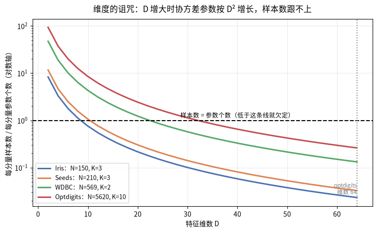
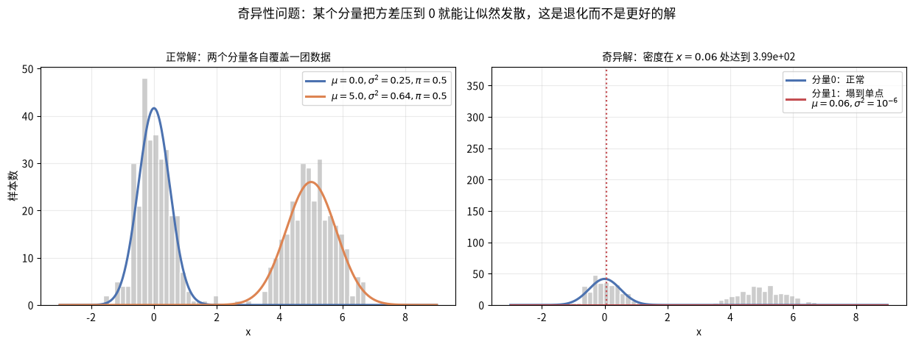
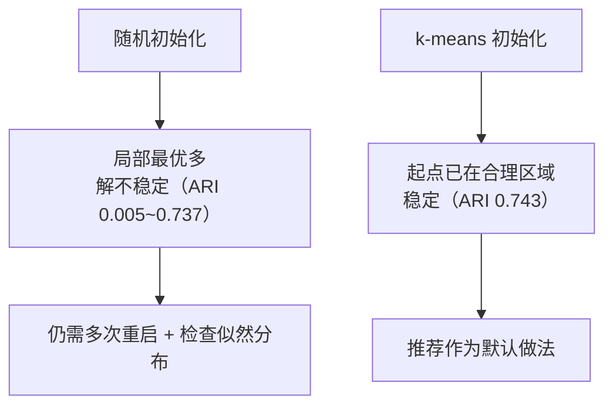
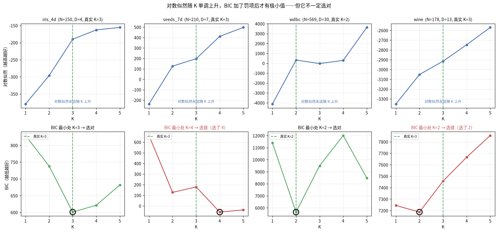
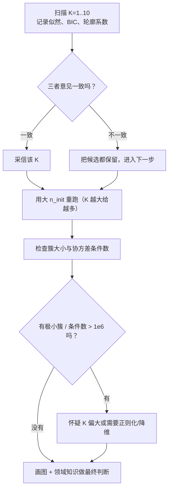

前六讲把 k-means 和 GMM/EM 的原理讲完了。这一讲做两件事：**第一，把"在真实数据上会踩的坑"集中整理一遍**——其中大部分在讲义里已经零散出现过，这里给出全貌；**第二，把前面所有内容串成一条可执行的实验流程**，对应实验要求的第三个问题（在 UCI 数据集上用 GMM 聚类）。

这一讲不引入新的数学，只是把已知的东西用到会出问题的地方。

## 1. 真实数据带来的四类麻烦

前面讲原理时用的都是自己生成的数据，它们"干净"得过分。真实数据集的麻烦主要有四类，每一类都在前六讲里有对应。

### 1.1 量纲：某一维垄断距离

**讲义 01 讲过原理，讲义 03 的练习 4 见过后果。** 核心事实是：欧氏距离把所有维度**等权**相加，所以数值范围大的维度会主导距离。

实测数据（Iris 四列，对全部两两距离平方和的贡献占比）：

| 数据 | 第 0 列 | 第 1 列 | 第 2 列 | 第 3 列 |
|---|---|---|---|---|
| 原始 | 0.150 | 0.041 | **0.681** | 0.127 |
| 只把第 0 列乘 1000 | **1.000** | 0.000 | 0.000 | 0.000 |
| 标准化后 | 0.250 | 0.250 | 0.250 | 0.250 |

注意第一行：即使四列单位相同、范围相近，花瓣长度仍然独自占了 68%。**所以标准化不只是"统一单位"，它同时解决了"某一维信息量大因而该被重视"之外的另一种失衡。**

标准化的做法是按列做 z-score：$x_j'=(x_j-\mu_j)/\sigma_j$。两个必须注意的实现细节：常数列（$\sigma_j=0$）会让除法产生 `nan`，要单独置 0；统计量只能从训练数据算一次，然后用于测试数据。

### 1.2 特征选择：无关特征会稀释距离

讲义 03 练习 4 的结果很直观——Iris 四列**单独**做一维聚类（$K=3$）的 ARI：

| 列 | ARI |
|---|---|
| sepal_length | 0.3600 |
| sepal_width | **0.1461** |
| petal_length | 0.8510 |
| petal_width | **0.8857** |

花萼宽度几乎是随机的（0.1461，随机划分的期望是 0），但它在欧氏距离里**照样占一维的权重**。用一个几乎无信息的维度去算距离，等于往信号里掺噪声。

更值得注意的是：**花瓣宽度单独一维（0.8857）就等于二维组合（花瓣长+花瓣宽）的成绩**，多加一维零提升。这两个特征相关系数 0.963，本质是同一个信息被算了两遍。

实践含义有两层：能用单列区分力（或相关系数）筛掉冗余特征就先筛；筛不掉时至少要标准化，让各列在同一尺度上参与。

### 1.3 维度：协方差参数按 $D^2$ 增长

这是讲义 03 第 7.4 节那个"维度陷阱"的一般化。每个分量的满协方差矩阵有 $D(D+1)/2$ 个自由元素，加上 $D$ 个均值和一个权重，参数个数是

$$
D+\frac{D(D+1)}{2}+1
$$

| D | 每分量参数个数 |
|---|---|
| 4（Iris 四维） | 15 |
| 13（Wine） | 105 |
| 30（WDBC） | 496 |
| 64（Optdigits） | **2145** |

看这个数字对比：Optdigits 有 5620 个样本、10 个分量，**每个分量只有 562 个样本，却要估计 2145 个参数**——参数比样本还多。这不是理论担忧，而是前面实测过的现象：那份数据上 GMM 的 ARI（0.238）反而低于 k-means（0.551）。

这张图画的是"每个分量的样本数 / 每个分量的参数个数"，横轴是维数。低于 1 的那条虚线意味着**参数个数超过样本数，模型是欠定的**。Iris 和 Seeds 在 $D\approx12$ 处就跌破这条线，WDBC 大约在 $D\approx26$，而 Optdigits 的实际维数是 64。

**这条曲线给出了一个可用的经验判据**：如果"每分量样本数 / 每分量参数个数"小于 1，就不要用满协方差 GMM，而应该改用对角协方差（参数降到 $O(D)$）或者先降维。scikit-learn 的 `GaussianMixture` 提供 `covariance_type` 参数（`full` / `diag` / `spherical`）就是为了这个——**用表达力换稳定性**。

### 1.4 簇的重叠与不均衡

**重叠**决定了下界。讲义 05 那个方差相差 8 倍的例子里，即使知道真实参数、用上完整的两条分界，Bayes 最优划分的 ARI 也只有 0.6871——达不到 1.0，因为重叠区里两类样本本来就混在一起。**这是信息本身的限制，任何算法都突破不了。**

**不均衡**会让评价指标失去意义。实验三里 `electricity` 数据集（45312 个样本，两类）上：

| 方法 | ARI | 准确率 |
|---|---|---|
| k-means | +0.0038 | 0.5328 |
| GMM | +0.0111 | 0.5898 |
| **全猜多数类** | — | **0.5755** |

GMM 的 0.5898 只比"什么都不做"的 0.5755 高 1.4 个百分点。**所以报告聚类结果时必须给出基线**——对分类任务至少给出"多数类占比"，否则一个看起来像 0.59 的准确率会误导人。

## 2. 数值稳定与初始化：四个必须处理的问题

### 2.1 密度乘积的溢出与下溢

讲义 04 第 5 节讲过：似然是密度的乘积，而乘积会溢出（electricity 的 45312 个密度连乘得到 `inf`）或下溢（5000 个样本在 $D=2$ 时就已经下溢为 0）。**解法是一切都在对数域算**，把乘积变成求和。具体到代码里就是三个约定：

1. 所有密度函数返回**对数密度**（命名成 `*_logpdf`），不返回密度本身；
2. 对数似然用**逐样本 log-sum-exp 累加**，而不是"先算密度再取对数再求和"；
3. 责任度的归一化在**对数域**做（讲义 05 练习 1）。

### 2.2 奇异协方差：似然可以发散到无穷

这是 GMM 特有的病态行为，必须理解。如果某个分量的均值 $\mu_k$ 恰好落在某一个样本 $x_n$ 上，同时它的方差 $\sigma_k^2\to0$，那么该样本的密度

$$
\mathcal N(x_n\mid\mu_k,\sigma_k^2)=\frac{1}{\sqrt{2\pi\sigma_k^2}}\exp(0)\to\infty
$$

密度趋于无穷，对数似然也跟着发散到 $+\infty$。

右图就是这种退化解：第二个分量的方差被压到 $10^{-6}$，均值正好落在某个样本上（$x=0.06$），该点的密度达到 **3.99e+02**（对数密度 5.989），远高于正常解里的密度。

**关键在于：这个解在数学上"更好"（似然更高），但在语义上毫无意义。** 它是算法发现的一个漏洞——把一团数据拆出"一个点独自成一个分量"就能无限提高似然。所以：

**必须用协方差正则化来排除它**，给每个协方差加一个小量：

$$
\Sigma_k\leftarrow\Sigma_k+\epsilon I,\qquad \epsilon=10^{-6}\cdot\frac{\mathrm{tr}(\Sigma_k)}{D}
$$

用与尺度相关的 $\epsilon$（而不是固定常数）的好处是量纲不同的数据集都能得到合适的扰动强度。此外还应当对 $\sigma_k^2$ 设一个下限，并在检测到某个分量只分到极少样本时重置它。

**注意正则化改变了目标函数。** M 步里加 $\epsilon I$ 相当于换成了一个带惩罚的目标，对应参数上的先验，属于 MAP 估计而不是纯最大似然。此时 EM 的单调性定理不再严格成立（讲义 03 第 7.2 节实测过对数似然出现微小回落）。所以有两个选择：要么只在 Cholesky 分解失败时才补 $\epsilon$（尽量少扰动），要么接受"我优化的是带惩罚的目标"并在报告里写明。

### 2.3 初始化：GMM 比想象的更敏感

讲义 03 讲过 k-means 的初始化问题（同一份数据好坏解能差 5 倍）。**GMM 的敏感程度更高**，因为它的参数更多、似然函数的局部最优也更多。

在 WDBC（569×30，2 类）上用随机挑点初始化跑 10 个不同的种子，$K=2$：

| 指标 | 结果 |
|---|---|
| 10 个种子的 ARI | 0.374, 0.677, 0.737, 0.737, 0.578, 0.094, 0.022, 0.689, 0.427, 0.005 |
| ARI 范围 | **[0.0048, 0.7373]** |
| 对数似然范围 | [−3721.2, 322.3] |

**同一份数据、同一个 $K$，仅仅因为随机起点不同，ARI 相差 0.73。** 最差的那个种子（0.005）基本上什么都没分出来，而最好的（0.737）接近正确解。作为对比，用 k-means 的结果做初始化能直接得到 **0.7434**——比 10 个随机种子里最好的那个还略好。

这给出两条实践结论：

**第一，GMM 也必须多次重启。** 不要跑一次就下结论。判断标准是"多次重启的最终对数似然是否一致"——如果分布很散（像上面对数似然从 −3721 到 322），说明这个 $K$ 下的解不稳定，即使取到最大的那个也要谨慎。

**第二，优先用 k-means 初始化。** k-means 已经把数据做了一个不错的粗划分，EM 从它出发做精细化，比从随机点出发稳定得多。标准做法是：均值取 k-means 的中心，协方差统一取全体数据的协方差（或各簇的协方差），$\pi_k=1/K$。这也是为什么讲义 03 第 6.1 节推荐它。

### 2.4 空分量：一旦归零就永远回不来

如果某个分量的责任度之和 $N_k=\sum_n\gamma_{nk}$ 降到接近 0，那么 $\pi_k=N_k/N\to0$。而责任度的分子里有 $\pi_k$：

$$
\gamma_{nk}\propto\pi_k\,\mathcal N(x_n\mid\mu_k,\sigma_k^2)
$$

$\pi_k=0$ 意味着该分量对所有样本的责任度都是 0，$N_k$ 永远是 0——**它彻底死掉了，无法复活**。k-means 也有同样的问题（某个中心再也抢不到点）。

处理办法是显式检测并重置：把该分量的均值放到一个当前责任度最低的样本上，或重新随机初始化，或以小概率重新激活。**代码里必须打印警告而不是让 `nan` 静默传播**——这一点在 `docs/02` 里也强调过。

## 3. 选 $K$：为什么似然不行，BIC 也不行

### 3.1 似然永远随 $K$ 上升

这是必然的：$K$ 增大时，把已有解"复制"一份分量就能得到一个合法的更大 $K$ 的解，似然不降。$K=N$（每个点自成一个分量、方差趋于 0）时似然可以发散到无穷。

上图四个数据集的对数似然曲线都是单调上升的，**所以"挑似然最大的 $K$"毫无意义**，永远会选最大的 $K$。

### 3.2 BIC：加罚项，但它不保证选对

**BIC**（贝叶斯信息准则）在似然上加了一个按参数个数计算的罚项：

$$
\mathrm{BIC}=p\ln N-2\ln\hat L,\qquad p=K\left(D+\frac{D(D+1)}{2}+1\right)-1
$$

最后减 1 是因为 $\sum_k\pi_k=1$ 使混合系数只有 $K-1$ 个自由度。BIC 越小越好：似然越大越有利，参数越多越不利。

下图（同一张图的下半部分）实测了四个数据集，$K$ 从 1 扫到 5：

| 数据集 | N | D | 真实 $K$ | BIC 选中的 $K$ | 是否正确 |
|---|---|---|---|---|---|
| iris_4d | 150 | 4 | 3 | **3** | 正确 |
| seeds_7d | 210 | 7 | 3 | 4 | 错误 |
| wdbc | 569 | 30 | 2 | **2** | 正确 |
| wine | 178 | 13 | 3 | 2 | 错误 |

**对了一半。** 这不是实现问题，而是 BIC 本身的局限，原因值得分析清楚。

**BIC 为什么在 wine 上选了 $K=2$？** 因为罚项在这个数据上压过了似然的提升。算一下（实测值）：$D=13$ 时每增加一个分量要估 105 个参数，$\ln(178)=5.18$，所以罚项增加 $105\times5.18\approx544$；而从 $K=2$ 到 $K=3$ 对数似然只提升了 **136.8**。**罚项是收益的约 4 倍**，BIC 自然选小的。

而 $K=2$ 的 ARI 明显低于 $K=3$——**从"聚类是否有意义"的角度 $K=3$ 更合理，BIC 却建议 $K=2$**（具体数值会随初始化波动，因为我这个是随机初始化的最小实现；但"BIC 选 2"这个判决是稳定的）。原因还是样本量太小：$N=178$ 要支撑 13 维的满协方差。

顺带算一下"样本量够不够"的影响：如果 $N$ 从 178 放大到 1780，$\ln N$ 只从 5.18 增到 7.48（罚项变成 786），但**似然的提升会随样本量近似线性增长**（到约 1368）。收益首次超过罚项，BIC 就会改选 $K=3$。这解释了为什么 BIC 在**小样本**上倾向于选更小的 $K$——它并不"错"，只是它在权衡"拟合优度"和"参数代价"时，小样本下的参数代价确实很贵。

**seeds 上选了 $K=4$** 是相反的错误：$D=7$、$N=210$ 时每个分量只需 36 个参数，罚项相对便宜，所以似然的提升占了上风，BIC 倾向于多切一刀。

**结论是：BIC 可以当作参考，不能当作判决。** 一组更稳妥的做法是：

1. 把 BIC 曲线、对数似然降幅、轮廓系数（或其它内部指标）**放在一起看**，意见一致时才采信；
2. 结合**领域知识**——你不知道有几个簇，但通常知道每个簇大致应该有多少样本、簇心是否远离数据范围；
3. **把候选 $K$ 的结果都画出来**，用眼睛看哪个划分有意义（讲义 03 第 3.3 节说过，图能发现数字发现不了的问题）。

顺带提醒：BIC 的计算依赖于找到的是**最优解**。讲义 03 第 2.2 节实测过，$K$ 越大、同样的 `n_init` 越难找到最优解（$K=6$ 时 40 次重启只有 12% 命中）。所以扫 $K$ 时必须给大 $K$ 更大的 `n_init`，否则比较的是运气而不是模型。

## 4. 评价：外部指标与内部指标怎么配合

讲义 03 第 3 节整理过，这里给一个决断用的清单。

| 指标 | 需要标签 | 能用在哪里 | 主要陷阱 |
|---|---|---|---|
| ARI | 是 | 事后对照（本实验） | 真实任务里拿不到 |
| 准确率（排列匹配后） | 是 | 事后对照 | 不均衡时会被多数类主导 |
| 混淆矩阵 | 是 | 定位"错在哪里" | 需要先对齐簇编号 |
| 对数似然 | 否 | 同一 $K$、不同初始化之间比较 | **不能跨 $K$ 比较** |
| BIC / AIC | 否 | 跨 $K$ 比较 | 可能选错（3.2 节实测） |
| 轮廓系数 | 否 | 跨 $K$ 比较 | 几何最优 ≠ 语义正确 |
| 簇大小均衡度 | 否 | 快速诊断 | 均衡也不能保证正确 |

最后一行那个"均衡也不能保证正确"是讲义 03 练习 6 的发现：$K=6$ 时各簇点数是 [249, 216, 282, 305, 183, 265]，**看起来完全健康**，但 ARI 只有 0.5689——它把三个真实簇各劈成了两半。**没有任何内部指标能察觉这个错误**，只有真实标签或领域知识能。

## 5. 把全部内容串成一条实验流程

这是本讲的落点，也是实验三"应用"部分的执行方案。

**第一步：读数据、看数据。** 加载数据集，打印形状、类别分布、每列的取值范围和标准差。这一步能发现三类问题：量纲差异大（→ 必须标准化）、常数列（→ 标准化时要防护）、类别极不均衡（→ 评价指标要小心）。

**第二步：决定是否标准化，并记录决定。** 判据是各列数值范围是否可比。标准化前后各跑一次聚类、比较 ARI，把两组结果都写进报告——这本身就是一个有价值的实验对照。

**第三步：定 $K$。** 按第 4 节那张流程图做：扫 $K$、看三个信号、结合领域知识。**不要只报一个 $K$ 的结果**，要报 $K$ 扫描的曲线，说明为什么选它。

**第四步：跑 k-means 和 GMM，对比。** k-means 用多次重启取 $J$ 最小；GMM 用 k-means 结果做初始化（讲义 03 第 6.1 节）。两者都记录 ARI、准确率、混淆矩阵。

**第五步：检查 GMM 的实现细节有没有生效。** 打印每轮的协方差条件数（应为 1e2~1e6 量级，超过 1e6 说明需要更强正则化或降维）、检查有没有空分量、检查对数似然的单调性（用相对判据，见讲义 03 第 7.2 节）。

**第六步：检查数据规模是否支撑模型。** 用第 1.3 节的判据：每分量样本数 / 每分量参数个数。小于 1 就换对角协方差或降维，并在报告里说明这个选择。

**第七步：把结果落盘并画图。** 汇总表写 CSV（数据集、方法、$K$、初始化、种子、对数似然、迭代数、ARI、准确率），完整参数和逐轮似然写 JSON，图片存到 `figures/`。这样报告的数据是现成的，不需要重跑。

**第八步：写分析时区分三类"错"。** 把"算法实现的错"（对数似然非单调、出现 `nan`）、"模型假设不匹配"（真实簇不是椭圆、$K$ 给错）、"数据的固有限制"（重叠区无法分开、样本量不足）分开讨论。前面七讲里的实验现象正好可以各归一类。

## 6. 本讲小结

真实数据的四类麻烦：**量纲**（某一维垄断距离，Iris 上花瓣长独占 68%）、**无关或冗余特征**（花萼宽度 ARI 仅 0.1461 却仍占一维权重）、**维度**（每分量参数 $D(D+1)/2+D+1$，Optdigits 上 2145 个参数只对应 562 个样本）、**重叠与不均衡**（重叠决定了下界 ARI 0.6871；electricity 上 GMM 的 0.5898 仅比多数类基线 0.5755 高 1.4 个点）。

数值稳定与初始化有四个必须处理的问题：**乘积的溢出与下溢**（一切在对数域算）、**奇异协方差**（方差趋于 0 时似然发散到 $+\infty$，必须正则化）、**初始化敏感**（WDBC 上 10 个随机种子的 ARI 从 0.005 到 0.737，必须多次重启并优先用 k-means 初始化）、**空分量**（$\pi_k$ 归零后永远无法复活，必须检测并重置）。要注意正则化把问题从最大似然变成了 MAP，会削弱单调性保证。

选 $K$ 时**似然永远单调上升，所以不能用**；BIC 加了罚项，但实测四个数据集上只选对两个（iris、wdbc 对，seeds 选 4、wine 选 2）。**BIC 是参考而不是判决**，必须和内部指标、领域知识、可视化结合起来判断。评价指标分外部（ARI、准确率、混淆矩阵）和内部（似然、BIC、轮廓系数、簇大小）两类，后者的共同局限是**几何代理可能与语义不符**——$K=6$ 时簇大小完全均衡却把三个真实簇各劈成两半，任何内部指标都发现不了。

最后是那条可执行的八步流程，以及写分析时的一个要求：把"实现错误""模型假设不匹配""数据固有限制"三类问题分开讨论。前七讲的实验现象正好可以各归一类，这本身就是一份完整实验报告的分析框架。

## 7. 动手练习

**练习 1（量纲与标准化）**：在 Seeds 数据集（7 列，量纲差别很大：面积约 10–21、紧致度约 0.8–0.92）上，标准化前后各跑一次 k-means（$K=3$），比较 ARI。然后再跑一次 GMM，比较标准化对 GMM 的影响是否比 k-means 小。**想想为什么 GMM 对量纲的敏感度可能不同**（提示：GMM 为每个分量估计自己的协方差，各维尺度可以被 $\Sigma_k$ 的对角元吸收一部分；而 k-means 隐含假设所有簇共用一个各向同性的 $\sigma^2$）。

**练习 2（复现维度陷阱）**：在 `optdigits`（5620×64，10 类）上分别用满协方差和对角协方差跑 GMM，记录 ARI、对数似然、最大条件数。对角协方差可以这样实现：M 步算完协方差后，把非对角元清零（即只保留对角元）。比较两种协方差类型的 ARI，并算出各自的"每分量参数个数"。

**练习 3（复现奇异性）**：写一段代码，人为构造奇异解：取一份一维数据，把某个分量的均值固定为某个样本的值、方差设为 $10^{-8}$，然后计算**该点的对数密度**和**整份数据的对数似然**。观察对数似然有多大。然后加上正则化（$\epsilon=10^{-6}$），看它降到多少。**这个练习的目的是让你在实现里遇到"似然异常高"时能立刻想到奇异性。**

**练习 4（复现 BIC 的失败）**：在 wine 数据集上扫 $K=1\ldots5$，记录对数似然和 BIC，验证讲义里"BIC 选 $K=2$ 而真实是 3"这个结果。然后算一下：从 $K=2$ 到 $K=3$，对数似然提升了多少？罚项增加了多少？两者差多少倍？最后回答：如果样本量从 178 增加到 1780（可以把数据重复十倍来模拟），BIC 的选择会变吗？（提示：罚项里 $\ln N$ 只从 5.18 增到 7.48，而似然的提升会随样本量线性增长。）

**练习 5（复现初始化敏感）**：在 WDBC 上用**随机初始化**跑 10 个不同种子（$K=2$），记录每个种子的 ARI 和最终对数似然。把 ARI 从小到大排序，看看差距有多大。然后改成 k-means 初始化再跑一次，比较 ARI 和迭代轮数。最后回答：如果你只跑了一次、拿到 ARI 0.005 那个结果，你会怎么判断它是"数据本身不可分"还是"初始化失败"？（提示：多种子重跑看似然的分布。）

**练习 6（完整流程）**：挑一个数据集，按第 5 节的八步完整做一遍，产出一份可以直接放进报告的结果：CSV 汇总表、JSON 详细参数、BIC 与轮廓系数曲线图、以及聚类结果的散点图（高维数据就取两列画）。**重点是第七步的落盘**——把结果存下来，而不是只在终端里看一眼。

**练习 7（写分析）**：把你在前面练习里观察到的现象，按"实现错误""模型假设不匹配""数据固有限制"三类各归一类，每类至少举一个具体现象和它的证据（数字或图）。这个分类本身就是实验报告"结果分析"部分的骨架。

到此为止，从"什么是机器学习"到"完整实验流程"的七讲就结束了。接下来该动真格的了：`docs/02_实现任务与编码路线.md` 里的 `gmm.py` 还等着你写，而那里面每一个 TODO 现在都应该有明确的思路了。
