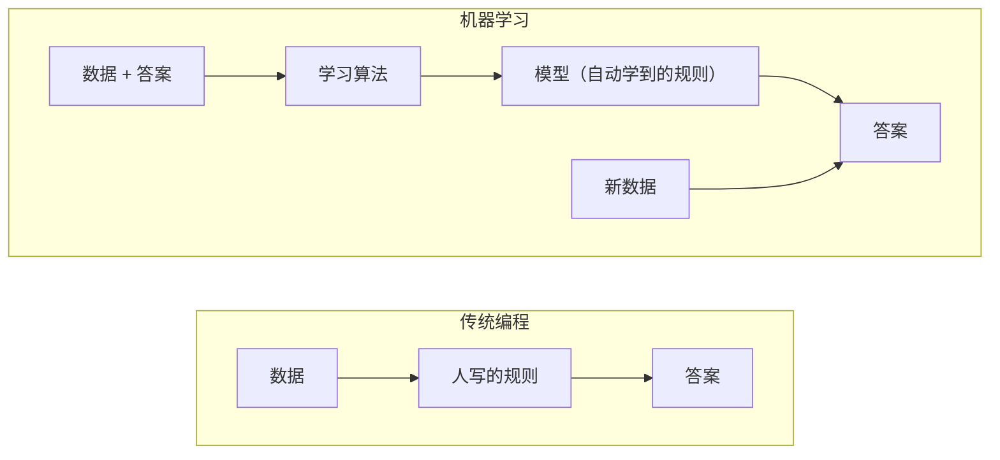
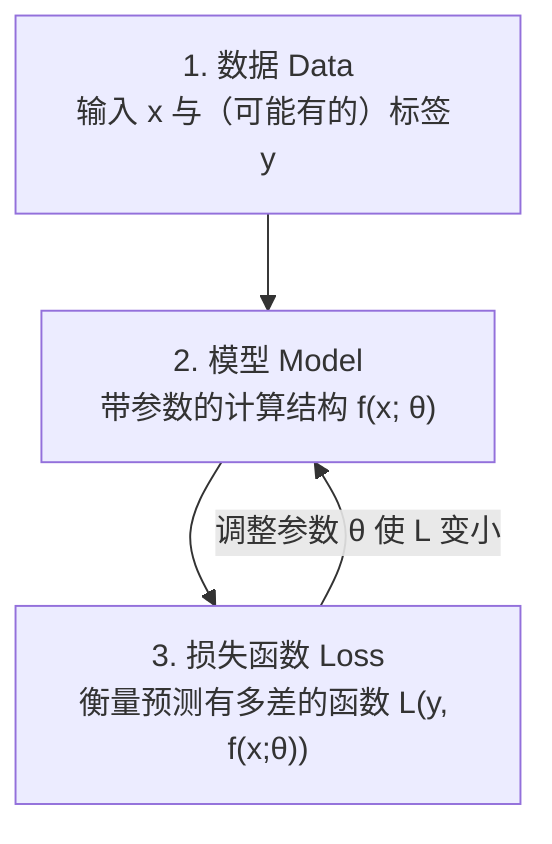
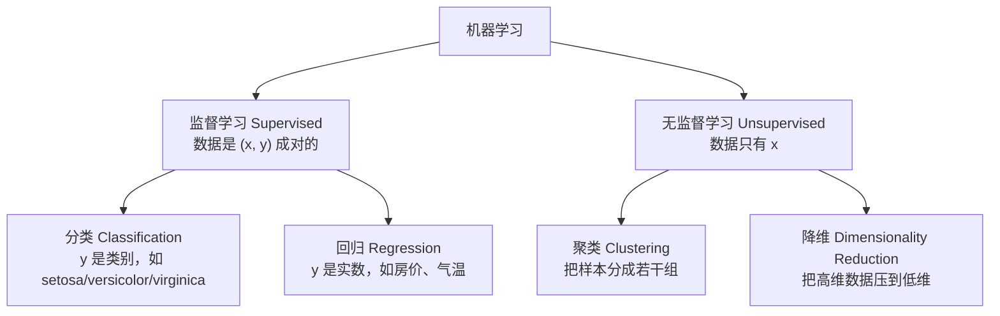
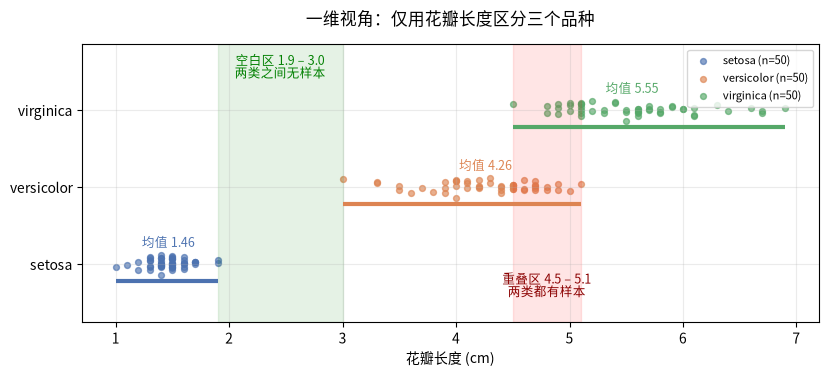
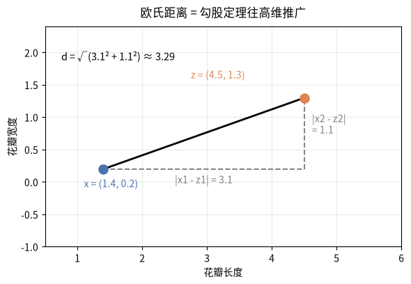
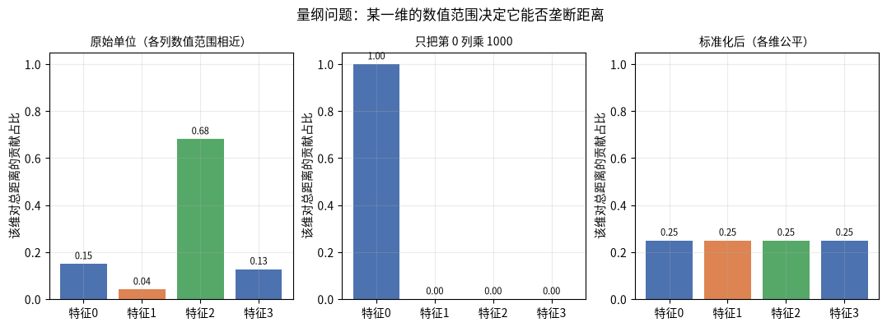
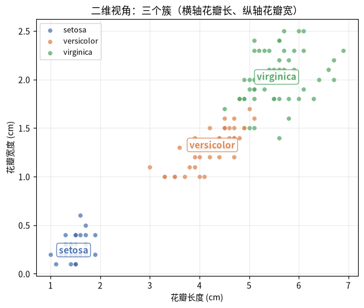

这份讲义假定你**没有系统学过机器学习**。实验一（多项式拟合）和实验二（逻辑回归）你跟着做过，但这里不假定你理解了其中的概念——我们从最底层重新搭一遍，讲清楚每一个术语为什么存在、它解决什么问题。这一讲的终点是：你能用一句话说清"机器学习在做什么"，以及"聚类"和"分类"到底差在哪里。

## 1. 先看一个用传统编程做不了的问题

假设要写一个程序，输入是鸢尾花的花瓣尺寸，输出是它的品种。用你熟悉的 C++ 思路，很自然想写成一串 `if`：

```cpp
std::string classify(double petal_length, double petal_width) {
    if (petal_length < 2.5) return "setosa";
    if (petal_length < 4.8) return "versicolor";
    return "virginica";
}
```

这个函数能跑，而且在这个数据集上准确率还不低。但它有几个绕不过去的毛病。第一，**阈值 2.5 和 4.8 是你凭空猜的**，换一批测量数据、换一台仪器、换一个品种，这些数字全得重猜，而且你不知道该猜多少。第二，**规则数量会爆炸**：现在只用了两个特征，如果再加花瓣的曲率、颜色、纹理，`if` 的分支会迅速失控。第三，**有些问题根本写不出规则**：识别手写数字 8，你没法用 `if` 描述"长什么样才叫 8"——每个人写的 8 都不一样。

机器学习换了一个思路。它不要求你写出规则，只要求你做两件事：**给出一些已经知道答案的例子，以及一个"答得有多差"的衡量方式**。然后让程序自己去调整内部的那组数字，使得在已知例子上的"差"越来越小。上面那段代码里的阈值 2.5 和 4.8 就变成了程序自己算出来的，而不是你猜的。



这张图里最关键的差别在中间那一格。传统编程里中间是**人写的规则**；机器学习里中间是**算法根据例子自动调整出来的一组参数**。这组参数连同它的计算结构，就叫**模型**（model）。

## 2. 机器学习的三要素

任何一个机器学习问题，都能拆成三块。把这三块说清楚，问题就定义清楚了。



**数据。** 输入叫**特征**（feature），通常写成一个向量 $x\in\mathbb R^D$，$D$ 是特征个数。比如鸢尾花的一个样本 $x=(1.4,\ 0.2)$，表示花瓣长 1.4 cm、花瓣宽 0.2 cm。$N$ 个样本堆成矩阵 $X$，形状是 $(N,D)$：每一行是一个样本，每一列是一个特征。这个"行是样本、列是特征"的约定非常重要，后面所有代码都依赖它。

**模型。** 一个从输入到输出的计算结构，里面含一组**待定参数** $\theta$。实验一里模型是多项式 $f(x;w)=w_0+w_1x+\cdots+w_Mx^M$，参数就是那些 $w$；实验二里模型是 $f(x;w)=\sigma(w^{\mathsf T}x)$，参数也是 $w$。所谓"学习"，就是找出一组好的 $\theta$。

**损失函数。** 一个衡量"预测得有多糟糕"的数值，越小越好。实验一用的是均方误差 $\frac1N\sum_n(y_n-f(x_n))^2$，实验二用的是交叉熵。**损失函数是你和目标之间的唯一接口**：你没法直接告诉程序"我要准确率 95%"，你只能告诉它"你答错了多少"，然后让它把这个数压下去。

把这三块串起来，机器学习就变成了一道**优化题**：找一组参数 $\theta$，使损失函数在给定数据上尽可能小。实验一做的梯度下降，就是解这道优化题最常用的方法：算出损失对参数的梯度（指向"变差最快的方向"），然后朝反方向走一小步，反复迭代。

## 3. 监督学习与无监督学习

上面那段"给出已知答案的例子"，在机器学习里叫**标签**（label）$y$。有了标签，损失函数才能算出来（因为要比较预测和正确答案）。根据有没有标签，问题分成两大类。



**监督学习**的数据是 $(x_n, y_n)$ 成对的。实验一是回归（$y$ 是连续的正弦值），实验二是分类（$y$ 是"是/否"两个类别）。你现在能看出这两个实验其实是同一件事的两个变体：模型不同（多项式 vs sigmoid 线性）、损失不同（MSE vs 交叉熵），但它们都在做"用带答案的例子调整参数"。

**无监督学习**的数据只有 $X$，没有 $y$。聚类就是其中最基础的一类任务：**在不知道任何正确答案的情况下，把样本分成若干组，使同组的样本彼此相似，不同组的样本彼此不相似。**

这里有个必须先想明白的问题：**没有标签，怎么知道分得对不对？** 在监督学习里，答案就在数据里，你算一下对错就行。在无监督学习里，没有任何现成的"正确答案"可比。这带来两个后果，它们贯穿着本次实验的始终：

第一，**"正确"必须由你自己定义**。你可以定义"组内距离越小越好"（k-means 就是这么做的），也可以定义"每组内部的点服从同一个高斯分布"（GMM 就是这么做的）。定义不同，最优的划分就不同。所以聚类没有唯一的正确答案，只有当"你的定义"和"数据的真实结构"吻合时，结果才有意义。

第二，**评价很困难**。真实任务里你根本没有标签，只能用一些内部指标（比如"组内是否紧凑、组间是否分离"）来猜。本次实验比较幸运：数据要么是我们自己按已知的高斯分布生成的，要么是 UCI 上自带品种标注的。于是我们可以**在跑完聚类之后**，把结果和真实标签对一下，看看聚出来的组是不是恰好对应真实的品种。这是"事后对照"，聚类算法本身从头到尾都没有用过这些标签。

顺带说清楚一个容易混淆的词：**监督学习里的"类别数"是数出来的**（上面那段 `if` 里有几个分支就是几类），而**聚类里的"类别数"需要你事先指定**。k-means 要求你告诉它"我要分成 K 组"，这个 K 是你给的输入，不是它算出来的。为什么必须这样、以及怎么选 K，是后面几讲的内容。

## 4. 从一维开始建立直觉

抽象讲了这么多，现在看具体数据。取出鸢尾花数据集里最有用的一维：**花瓣长度**。

```python
import numpy as np
import data_gen as dg

X, y, names = dg.load_dataset("iris_2d", standardize=False)
petal_length = X[:, 0]        # 第 0 列是花瓣长度
petal_width  = X[:, 1]        # 第 1 列是花瓣宽度

for j, c in enumerate(["setosa", "versicolor", "virginica"]):
    v = petal_length[y == j]
    print(f"{c:<11} 均值 {v.mean():.2f}  范围 [{v.min():.1f}, {v.max():.1f}]")
```

运行结果是：

```
setosa      均值 1.46  范围 [1.0, 1.9]
versicolor  均值 4.26  范围 [3.0, 5.1]
virginica   均值 5.55  范围 [4.5, 6.9]
```

把这三行数字画在一张图上（`learn/figures/fig01_1d_petal_length.png`，由 `make_fig01.py` 生成），你会立刻看出两类不同的关系：



图中绿色区间是 setosa 与其余两类之间的**空白区**（1.9 到 3.0 之间没有任何样本），红色区间是 versicolor 与 virginica 的**重叠区**（4.5 到 5.1 之间两类都有样本）。

**空白区的含义**：只要看花瓣长度，你就能 100% 地把 setosa 挑出来——它和别的花完全不混淆。

**重叠区的含义**：这段区间里的每一朵花，光看花瓣长度都无法判断品种。一朵花瓣长 4.8 cm 的花，可能是 versicolor，也可能是 virginica。

这两类关系正好对应本次实验会遇到的两类困难。空白区告诉你"有结构时聚类很容易"；重叠区告诉你"结构模糊时聚类必然出错，这不是算法不好，而是信息不够"。记住这一点，后面看到聚类把这两类混在一起时，你就不会以为是程序写错了。

## 5. 距离：什么叫"相似"

聚类要求"同组的相似、不同组的不相似"。"相似"是个模糊的词，要写成代码必须给它一个精确定义。最常用的定义是**距离**：两个样本在特征空间里离得越近，就越相似。

**一维情况**：两个点 $a$ 和 $b$ 的距离就是差的绝对值 $|a-b|$。花瓣长 1.4 的花和 1.9 的花，距离是 0.5。

**二维情况**：两个点 $x=(x_1,x_2)$ 和 $z=(z_1,z_2)$ 的距离，就是中学的勾股定理——把横纵坐标的差当作直角三角形的两条直角边，斜边就是距离：

$$
d(x,z)=\sqrt{(x_1-z_1)^2+(x_2-z_2)^2}
$$

例：$x=(1.4,0.2)$ 与 $z=(4.5,1.3)$ 的距离是 $\sqrt{(1.4-4.5)^2+(0.2-1.3)^2}=\sqrt{9.61+1.21}=\sqrt{10.82}\approx3.29$。几何上它就是下面这个直角三角形的斜边：



**高维情况**：同样的公式往更多维推广，对 $D$ 个特征求和再开方，这就是**欧氏距离**：

$$
d(x,z)=\sqrt{\sum_{j=1}^{D}(x_j-z_j)^2}=\lVert x-z\rVert_2
$$

用 NumPy 写出来，注意到 $D$ 维的点就是长度为 $D$ 的数组，所有维度的差可以一次性算完：

```python
def euclidean(a, b):
    """a、b 是长度 D 的一维数组，返回欧氏距离。"""
    diff = a - b                 # 逐元素相减，长度 D
    return np.sqrt((diff ** 2).sum())
```

**为什么要平方再开方，而不是把各维差值直接相加？** 因为直接相加会有正负抵消：$x$ 比 $z$ 在第一维大 3、第二维小 3，直接相加得 0，程序会以为两个点重合了，实际它们离得很远。平方消除了符号，开方则把量纲还原（平方后再开方，单位回到原来的单位）。另一种做法是取绝对值相加（曼哈顿距离 $\sum_j|x_j-z_j|$），也消除了符号，但欧氏距离更常用，因为它在几何上对应"直线距离"。

### 一个会毁掉整个聚类的坑：量纲

这是初学者最常踩、也最隐蔽的坑，务必在这里理解清楚。

假设我们要用两个特征聚类：花瓣长度（单位 cm，范围 1 到 7）和某个以毫米为单位的特征（数值范围 100 到 700）。计算距离时：

- 花瓣长度的差最多贡献 $6^2=36$
- 毫米那个特征的差最多贡献 $600^2=360000$

两者差了 10000 倍。结果**距离几乎完全由第二个特征决定**，花瓣长度这一维等于不存在。更荒唐的是，同一批数据，你把单位从 cm 换成 mm，聚类结果会完全不同——算法的输出依赖于你用什么单位记录数据，这显然不对。

解决办法是**标准化**：把每一列减去自己的均值、再除以自己的标准差，变成"偏离均值几个标准差"的度量。

$$
x_j'=\frac{x_j-\mu_j}{\sigma_j}
$$

这样每一列都变成均值 0、标准差 1 的数，量纲消失，各维公平参与距离计算。注意两个细节：标准差为 0 的列（所有样本取值相同）不能做除法，会产生 `nan`，应当直接置 0——这种列本来就不含任何区分信息；标准化用的均值和标准差**只能从训练数据上算一次**，然后用同一组数值去处理测试数据（否则就是"偷看"了测试集的信息）。

本次实验的数据集里，Seeds（7 个特征，面积约 10–21、紧致度约 0.8–0.92）**必须**标准化；Iris 的四个特征数值范围相近（0.1–7.9），可以不标准化。这两种情况都留给你实测对比：同一个数据集，标准化前后聚类结果差多少，是本次实验要报告的内容之一。

值得先看一眼真实数据里的情况。把 Iris 的**四个**特征（`iris_4d`）拿出来，算每一维对"全部两两距离平方和"的贡献占比，结果是 `0.150  0.041  0.681  0.127`——四列的单位同为 cm、数值范围也相近，但**索引为 2 的那一列（花瓣长度）独自占了 68%**。也就是说量纲问题不只是"单位不统一"才会出现，**数值范围本身就足以让某一维度垄断距离**：



左图是原始数据，花瓣长已经占据主导；中图把第 0 列乘 1000（模拟换成小单位），该维立刻独占 100%，其余三列的信息相当于被完全抹掉；右图是标准化之后，四列各占 25%，公平参与。这张图就是"为什么必须标准化"的最直观证据。

需要注意的是，**换成特征更少的数据集，这个失衡会更严重**。如果只用花瓣长和花瓣宽两列（`iris_2d`，也就是讲义第 4、6 节用的那个数据集），占比是 `0.8424  0.1576`——花瓣长一个人占了 84%。所以减少特征并不会缓解量纲问题，反而可能加重它。这也解释了为什么讲义开头要先用两列数据讲直觉（画图直观），但在讨论量纲时要用四列数据（差异更有层次）。

## 6. 从一维走向多维：为什么要多个特征

回到鸢尾花。前面看到只用花瓣长度，versicolor 和 virginica 会重叠。如果再加上**花瓣宽度**呢？两类花的二维分布是：

| 品种 | 花瓣长 均值 | 花瓣宽 均值 |
|---|---|---|
| setosa | 1.46 | 0.24 |
| versicolor | 4.26 | 1.33 |
| virginica | 5.55 | 2.03 |

setosa 在 (1.46, 0.24) 附近聚成一小团，离另外两类很远；versicolor 在 (4.26, 1.33)，virginica 在 (5.55, 2.03)，两者接近但仍分开。把它们画在平面上：



你会看到三个团：左下角孤零零的一小团（setosa），以及右上一大片里分成上下两半的两个团。**这就是"簇"（cluster）这个词的来历——在二维平面上，它们真的是一团一团的。**

多一个特征的价值在于：一维时重叠、无法区分的样本，在二维里可能就分开了（因为分界线不再是一个点，而是一条线）；维度越高，能描述的结构越丰富。代价是计算变贵、需要的样本变多，而且高维空间里"距离"这个概念的直觉会失效（所有点之间的距离趋于接近），这一点在讲义 07 里会具体看到后果。

## 7. 本讲小结

把这一讲的核心结论收拢成几句话：

机器学习是**用带答案（或没答案）的例子来自动确定模型参数**的方法，它替代的是"人手写规则"这一步。一个问题由三部分定义：**数据**、**模型**、**损失函数**；学习的过程就是解一道"让损失变小"的优化题。

按有没有标签，任务分成**监督学习**（分类、回归）和**无监督学习**（聚类、降维）。实验一是回归，实验二是分类，都属于监督学习；本次实验三的 k-means 和 GMM 属于聚类，是无监督学习。

无监督学习有两个本质困难：**"正确"的定义由你给出**，以及**没有现成的答案可以评价**。所以本次实验会用"自己生成的数据"（已知真实参数）和"自带标注的 UCI 数据"（事后对照）这两条路来验证结果。

聚类前必须先把"相似"定义成可计算的**距离**。最常用的是欧氏距离；使用时务必注意**量纲**问题，必要时做标准化，否则距离会被数值范围最大的那一维垄断。

## 8. 动手练习

下面的练习都只需要几行 NumPy 代码，目的是把上面的概念变成你手能摸到的东西。不要看答案先自己试。

**练习 1**：用 `dg.load_dataset("iris_2d")` 载入数据，把三个品种的样本分别用三种颜色画在一张散点图上（横轴花瓣长、纵轴花瓣宽）。观察三个团是否分得开、哪两个团靠得最近。

**练习 2**：写一个函数，输入两个样本和一组特征的下标，用欧氏距离算它们的距离。用 `X[0]` 和 `X[60]`（一个是 setosa、一个是 versicolor）验证：只看花瓣长度（第 0 列）时距离是多少？两列都用时是多少？为什么后者更大？

**练习 3**：把 Iris 的四个特征都取出来，算每一列的均值和标准差，然后做标准化，确认标准化后每一列的均值约为 0、标准差约为 1。

**练习 4（重要）**：用**四列**的 `iris_4d`（不是讲义前几节画图用的两列版本），把第 0 列乘 1000（模拟"这一列用了小单位"），然后写一个函数算出每一维对"全部两两距离平方和"的贡献占比，比较处理前后的占比。参考结果：原始是 `0.150 0.041 0.681 0.127`，乘 1000 之后变成 `1.000 0.000 0.000 0.000`（其他三维的信息被完全抹掉），标准化后回到 `0.250 0.250 0.250 0.250`。

如果你用两列的 `iris_2d` 做，数字会完全不同（`0.8424 0.1576` → `1.0 0.0` → `0.5 0.5`），这是正常的，因为特征数不同。**做这个练习时先打印 `X.shape` 确认自己用的是哪个版本**——这个习惯能省下很多困惑。

顺带想一个问题：如果我把**所有列**同时乘 1000，各维占比会变吗？先猜，再跑代码验证。这个问题的答案能帮你理解"为什么必须只放大某一维才会出问题"。

**练习 5**：只用花瓣长度的**一维**数据（也就是把 $X$ 的第 0 列单独拿出来），你能否想出一个不用任何算法、纯靠自己观察就能把 150 朵花分成 3 组的办法？先想，下一讲我们会把它和 k-means 的做法对照。

做完这些，你对"数据、特征、距离"就有实感了。下一讲开始讲 k-means：给定 K，它具体怎么把样本分成 K 组，以及它为什么一定会停下来。
